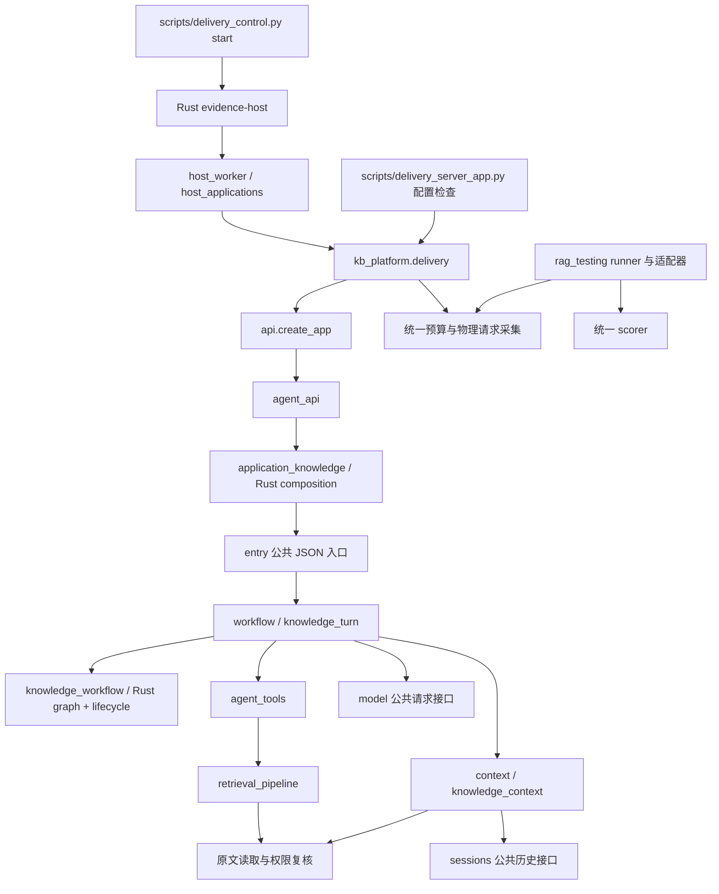

# 产品模块与评测边界

Rust 核心及公共服务的当前分层见 [DSH / Cordis 架构基础](dsh-rust-foundation.md)。`plugin-runtime` 是生命周期内核，`plugin-host` 是进程监督，`agent-harness` 是装配与协议入口；默认 loop/graph、LLM、存储分别位于独立的 `agent-services`、`llm-service`、`storage-service`。各公共服务不依赖生命周期内核，内核也不依赖公共服务或知识库。

当前知识库应用的 11 个显式节点、公共 JSON 合同及配置见 [插件架构](plugin-architecture-v4.md)。[低层组件目录](plugin-catalog.md) 列出可独立复用和测试的内部适配器，不代表知识库用户需要装配这些细粒度节点。公共存储提供 relational、document、kv、vector、lexical、object 合同；内置 PostgreSQL、MySQL、SQLite 实现相同的领域持久化语义。

整体装配与调用关系见 [当前插件架构图](plugin-architecture.md)。

插件在进入 Rust 生命周期之前必须满足 `evidence-plugin/1` 的声明和同步调用约定；配置仍由 JSON Schema 验证。共享 `protocol_validation` 只使用标准库检查调用签名，不执行插件探测请求。公共模型类型与适配器合同位于独立 `model_sdk`；公共存储合同仍位于 `storage_sdk`，两者不依赖知识库或宿主。实际响应、授权、存储身份和调用租约仍在运行时边界核验，启用前结构检查不替代这些行为合同。

HTTP 身份解析已通过 `authentication` 服务访问。[认证会话](authentication.md) 可绑定公共 TTL KV 合同，由现有 Redis 适配器或第三方提供商承载；API 不直接读取 token 文件或导入 Redis。文件认证保留为默认插件，对话历史仍通过独立关系合同管理。

当前内置实现、服务依赖和公开 profile 见 [插件目录](plugin-catalog.md)。公共存储按 relational、document、kv、vector、lexical、object 六类合同连接消费插件与提供商，结构见 [存储插件设计](storage-plugins-design.md)，执行、验收和搬迁步骤见 [执行方案](storage-plugins-execution-plan.md)。知识库领域仓储、会话、预算、缓存索引和请求回执均消费 structured 关系合同；内置 PostgreSQL、MySQL、SQLite 实现同一业务协议。第三轮边界见 [改造方案](plugin-boundaries-v3-plan.md)。

共享模型配置和文档专用组合见 [模型服务](model-services.md)。模型路由、prepared call 和活跃调用由 Rust LLM 注册表管理，插件实例及依赖仍由 Rust 生命周期核心管理。通用底座独立消费、完整应用图和适配层算法见 [底座与应用架构](foundation-architecture.md)。

默认入口现为 [Rust 主宿主](rust-main-host.md)：`evidence-host` 持有生命周期 coordinator、loop 和 graph，启动执行环境并监督退出。Python worker 保存业务对象，按同一 Rust 命令协议执行并回报效果；断开主宿主后不会回退到本地生命周期。`plugin-host` 是与 Agent 无关的进程监督库，业务 dispatcher 由可执行入口注入。

知识库 API 默认加载 `config/applications/knowledge.json`，经 `application_knowledge`、`foundation_services` 和 `knowledge_capabilities` 装配 11 个显式节点：通用 LLM 与存储，以及知识库入口、工作流、上下文、会话、权限、权威数据、模型策略、模型领域视图、文档与检索。Rust 编译具名出口与显式绑定，拥有依赖解析、作用域、生命周期和图节点推进；执行器负责运行实现。通用运行时不导入知识库。未启用远程模型的独立文档工作台仍使用 `config/application-profiles/bm25.json`。

默认本地检索由 embedded 提供；通过存储配置可选择 pg_textsearch BM25 和 pgvector 精确检索。`platform.search.storage` 分别声明 lexical BM25、vector 和 document source 三个槽位，`search_router.SplitSearch` 核对三方身份、内容、封存和发布。BM25 与 dense 可以使用同一实例、不同 PG 数据库或 PG 与 embedded 的组合；通用 PG 搜索分别要求 pg_textsearch 或 pgvector，使用独立搜索 schema；旧知识库专用 PG 搜索代码仅供显式历史数据工具读取，不再出现在运行时 catalog。`KB_SEARCH_CHANNELS_CONFIG` 已移除。知识库正文、权限、发布状态和 Embedding 任务通过 structured 关系合同访问所绑定提供商；`search.py` 保留共有排序与绑定合同。`semantic_pages_v2.py` 通过读回、封存和页向量接口访问后端。原件通过 files 或 S3 对象接口用于下载、PDF 和图片预览；证据以不可变解析快照为准。当前配置边界见 [存储设计](storage-plugins-design.md)，检索协议见 [检索存储](search-storage.md)。

产品保留一个回答方案。`kb_platform/delivery.py` 负责交付应用的组装；`DeliveryProfile` 保存配置路径、提供者路径、运行目录与冻结配置。预算 CLI 和服务启动器都调用这一实现。

## 公共存储与业务所有权

`storage_sdk` 定义接口和扩展合同。知识库插件经 `application_storage.StorageClient` 使用 JSON 操作；结构化数据经 `storage_structured_wire` 的受限表达式、事务租约、schema 协商与作用域检查访问。SQLAlchemy 对象只在各执行器内部使用，不跨插件边界传递。未知事务结果保留 operation_id，不自动重发。对象以有界分块传输并核验 SHA-256。`storage_service` 管理领域绑定，不另建插件生命周期。底层 `PluginSpec.requires` 中也已统一声明类型化存储需求，没有独立 storage_slots 字段。

公共模型和公共存储都是可选基础服务。第三方可直接声明依赖自己的适配器或服务；Rust 宿主仍检查一般依赖和生命周期。一个 PostgreSQL 提供商可以导出多个合同，Redis 只导出基础 KV 与 TTL 扩展。合同缺失或版本不符拒绝绑定，不能按数据库品牌推测能力。

内置 data 与 access 显式依赖同一个 `knowledge.authority.storage/1` 出口。其[公开数据协议](knowledge-authority-storage.md)规定权限修订、不可变来源、构建和发布的一致性；[关系线协议](storage-wire.md)规定传输和事务。替换数据插件须履行这个共享协议，也可以同时替换需要另一种权限协议的相关实现。配置不把两个不同权限数据集当成同一权威来源。

PostgreSQL、MySQL、SQLite 提供商管理连接、受限运行权限和事务。适配器管理实现公共合同需要的内部结构，业务插件拥有领域 schema、查询与迁移。`SpaceKey(application_id, owner_id, space_id)` 加显式初始化的 `dataset_id` 标识持久数据，运行注册代次管理当前句柄。正常启动核对现有身份，错误身份或误指空库拒绝，不自动创建替代数据集。Redis 缓存使用明确的 `cache_id`。多个项目可以共用服务器并保持空间独立，多个宿主各有自己的连接池。旧配置只能离线转换，运行时不回退到 `KB_DATABASES_CONFIG`。

`harness.store.database` 支持三种数据库，`SessionStore` 唯一拥有会话规则。知识库业务只使用 `knowledge_queries.py` 的封闭语义操作；`knowledge_storage.py` 管理可信作用域，`knowledge_sql.py` 使用中立 Core 表达式，`knowledge_schema.py` 拥有逻辑 schema。`platform.repository.storage` 只声明 structured 合同，不读取数据库引擎。公共适配器负责 JSON、锁、时钟、精确字符串和 SQL 编译，并执行作用域隔离；PostgreSQL 额外保留 RLS。新 schema 使用独立迁移身份，旧 Migration 1 归档不变；历史表需 [显式离线迁移](storage-capability-cleanup.md)，运行时不自动接纳或搬迁。

`storage_adapters.objects` 将 files 与 S3 接入 object 合同，`storage` 提供原件业务接口。BlobRef 绑定空间、租户、SHA-256 和长度，API 经对象接口读取，不以外部传入路径读取原件。当前是完整 bytes 读取，未提供端到端流式下载。对象存储和数据库引用没有分布式事务，复制对象后需显式核验和切换业务引用。

`storage.cache.volatile` 将关系索引和 Redis payload 绑定到同一 `StageCache` 实现。Redis 是文件或对象 payload 后端的显式替代，允许 TTL、断线和丢失触发未命中；精确依赖、当前授权、内容校验与预算仍由原实现负责。`BudgetLedger` 不可绑定到缓存合同，历史费用和 UNKNOWN 不因换库清零。

## 请求经过哪些模块

`scripts/` 负责命令行参数、进程启动和输出。产品模块不导入脚本，也不修改 Python 搜索路径。`delivery.py` 拥有配置校验、身份初始化、预算检查和应用工厂。`--check` 仅验证已有配置，实际应用创建仍是显式操作。

`retrieval_pipeline.PipelineConfig` 表达检索策略。检索通过 prepare/finish 阶段衔接工作流内的模型重排，保留权限复核、候选身份和预算。`knowledge_context.KnowledgeContext` 主动读取带 revision 的会话历史并复核证据，调用内部 ContextManager 装配最终模型请求。领域算法仍在原模块内；领域间调用由公开合同约束。

## Rust Agent 运行时与知识库业务

主宿主模式中，Python 的 `plugin_native.native_call` 通过 `plugin-host/1` 请求主进程，插件状态唯一位于主进程。单次 Agent 的 `Kernel` 是独立值状态，仍通过同一构建的 C ABI 动态库计算；它不创建第二套插件生命周期。直接 Python 嵌入入口继续使用原有 C ABI，供组件调用与离线验证使用。

`rust/plugin-runtime` 独占实例、代次、依赖、服务注册、作用域、调用租约、配置与资源清理。`rust/agent-kernel` 保留单次运行的操作准入、关联、取消、截止时间与终态，并导出内嵌协议入口；`rust/agent-services` 实现默认 loop 和 graph，`rust/agent-harness` 按版本化命令分派到生命周期内核与可选服务。Python 执行派发动作并回报结果，不通知 ready 或最终 disposed。loop 发出会话、提示词、模型和工具效果，由适配器执行。`knowledge_workflow.KnowledgeWorkflow` 继续决定知识库内部规划、检索、生成、核验、修复和交付。

默认 HTTP 路径通过 `ApplicationClient` 调用入口的 application.run 合同，入口将已声明操作交给工作流。工作流内部运行知识库图程序；工具、驱动和策略类不再成为独立业务节点。绑定保留身份、session、request ID、expected revision、来源策略和用户约束，不增加外层模型规划调用。模型结果在工作流验证通过并确认后才进入应用响应缓存，费用先按实际调用结算。

`knowledge_service.KnowledgeService` 提供独立知识库会话 API；`knowledge_turn` 持有单轮业务状态，`knowledge_model`、`knowledge_planning`、`knowledge_answer` 分别拥有模型调用、规划与答案合同。业务调用者仍可直接使用领域服务，不必额外建立 Agent。`knowledge_tool.query_tool` 保留通用工具接入方式，使用宿主绑定身份和会话，直接交付经过核验的结果。

`session_store.SessionStore` 唯一实现会话归属、请求指纹、revision、单写者租约和完成结果事务；`KnowledgeSessions` 注入该存储并承担知识库状态初始化及失败响应规则；提供者账本仍独占实际请求身份、预留与 UNKNOWN。原生完成后再次检查授权、证据和取消，再在同一事务保存 assistant 事件、状态与响应。重复完成请求仍经过当前授权复核；中断请求不会自动续跑。

`ToolAgent` 入口的 `harness.sessions.memory` 只保存单次 loop 的临时消息；默认知识库组合已不加载它。显式创建的 core 组合使用 `harness.sessions.durable` 以及同一通用存储合同，持久历史可跨宿主恢复，不加载知识库模块。其上下文按完整轮次裁剪，不改写持久历史。core 不随知识库 HTTP 产品启动。插件注册按作用域隔离；child 可显式覆盖父服务，关闭 child 只清理其拥有的子树。关闭流程先停止接收新调用，再检查活动租约与子作用域，最后按相反顺序释放注册效果和资源；忙碌时返回错误，不强制撤销已发送请求。

运行快照不是可重放 checkpoint，内核不自动重试模型或工具。子运行继承父截止时间及取消信号；同步 Python 效果不提供硬中断。原有 `graph_node_started` 和 `trace.graph` 保留为审计格式，协议为 `rust-agent-kernel/1`。

组合包覆盖规则、独立通用 Agent 用例及 DSH 对照见 [Agent 组合包](agent-bundles.md)。详见 [插件配置与扩展](plugin-harness.md) 和 [基础生命周期](rust-agent-runtime.md)。所有原有行为合同继续运行，并覆盖真实 Rust 协议、非知识库工具、跨层取消、profile 替换和默认路由组合。`default_path_replay --service` 使用同一 profile/图流程、已注册路由函数和请求模型，只替换模型及存储/检索夹具，继续交给统一 runner/scorer。它不启动 HTTP 服务、不验证身份认证中间件，也不调用真实提供者，不能代表线上 RAG 质量或性能验收。

## Agent 输出 Schema 边界

`agent_schema.py` 使用 `jsonschema` 的 Draft 2020-12 实现对象、数组、组合条件与取值范围校验；`agent_model.py` 不再维护递归 Schema 校验引擎。当前按工具能力动态扩展的 Schema 字典继续作为输入，提示词中的 Schema、协议标识与请求哈希构造不变。本轮不同时改写为 Pydantic 模型，避免改变模型可见协议。

兼容层保留已准入的关键字集合，拒绝 `$ref` 等未准入关键字和布尔子 Schema，不加载外部 Schema。整数不接受浮点数或布尔值，`const`、`enum` 保留原有顶层 Python 类型相等规则，长度上限必须为整数，空 `enum` 被拒绝。嵌套 `$schema` 只作为原始协议注释保留；编译副本移除它，防止库切换方言时绕过严格类型规则。标准 meta-schema 额外检查注释字段等格式；非有限数值在整个输出 JSON 中被拒绝，包括未约束的额外字段。

新响应与缓存结果都执行当前 Schema 校验及业务 validator。重复 JSON 键检查、证据与引用校验、预算预留、失败计费和错误码映射仍由原有边界负责。`agent_schema_contracts.py` 使用合成响应验证这些行为，统一质量入口自动发现；本轮未删除测试，也未新增模型调用。

## Luna SDK 与物理请求边界

`magpie_luna` 的 Chat Completions 通过 `luna_sdk.py` 调用 OpenAI Python SDK；Google Embedding 仍使用原适配器。Luna 不再直接调用 HTTP POST，也没有生产路径回退开关。SDK 每次使用提供者当前持有的 HTTP 客户端，因此 `observe_client` 的物理计量 transport 和交付服务的发送串行化继续生效。

SDK 设置 `max_retries=0`，使用调用者客户端的禁止自动重定向配置，超时受当前请求剩余时间约束。SDK 返回原始 HTTP 响应，保留实际载荷、usage 缺失及错误响应，避免 SDK 类型转换影响现有合同。适配层还原 SDK 包装的底层连接/超时/准入异常，并将 HTTP 状态错误还原为响应；`remote.py` 继续唯一负责重试分类、Retry-After、重试等待上限和请求次数上限。

每次获准重试仍创建新的物理身份并关联前次请求。`MeteredTransport` 继续在真实发送之前预留预算，保留失败和缺失 usage 的计费；读取/写入超时及取消保持 UNKNOWN，重启也不能绕过未决请求。收到 403 后关闭提供者准入；预算拒绝即使被 SDK 包装也保持零发送。SDK 不接管客户端关闭生命周期，也不采用环境中的 OpenAI 组织、项目及自定义头来改变提供者配置。

提供者 manifest 和模型响应缓存键包含 SDK 版本及 transport 协议，升级后相关响应缓存失效，旧文件保持只读；这不会清零或迁移现有物理请求账本。`luna_sdk_contracts.py` 使用真实 SDK 加合成 HTTP transport 验证边界，没有调用真实提供者。该检查证明离线协议与计量行为，不代表线上模型兼容性或 RAG 质量验收。

## Markdown 原文解析边界

本系列改造的逐项状态、工具类型注册、重试所有权与已确定的启发式 token 估算方案见 [框架替换计划](framework-migration-plan.md)。

`markdown_source.py` 使用 markdown-it-py 的 CommonMark 块解析并启用 table 规则，关闭不需要的 inline 解析。标题（含 Setext）、匹配长度和标记的围栏、缩进代码及容器中的块均由库识别。库只提供结构与行范围；证据、quote、偏移始终从 UTF-8-SIG 解码后的原文切片生成，不使用渲染结果或 token.content 重建原文。原件 SHA-256 仍覆盖包含 BOM 的完整字节；偏移仍是解码文本的 Unicode codepoint。CRLF/CR 的规范化映射保持原有合同，U+2028 等字符不冒充 Markdown 换行。

业务层保留普通正文逐行证据、管道表格与紧邻说明整体交付，以及无分隔行的历史管道表格约定。标准 Markdown 表格也保留完整原文，不凭 token 创建虚假的单元格坐标。代码和 HTML 内的文本不参与表格说明合并；未闭合围栏仍报告 `unclosed_code_fence`。TXT 共用这层原文分组，库识别的代码/标题只用于保护分组边界，不将 TXT 元素转换成 Markdown 标题或代码类型。

Markdown/TXT 的新快照使用 `native-text/0.3.0-markdown-it`，快照哈希纳入 markdown-it-py 版本；其他格式继续原有解析版本与依赖。改变库版本或解析策略会生成新的证据和锚点身份，不覆盖已有快照、不自动重建索引。旧的逐行表格导航合同继续保留，只将夹具改为提供历史行边界；生产路径已删除旧的手写标题识别和围栏状态机。

`markdown_contracts.py` 使用真实解析库和合成原文验证这些边界；现有权限、导航、上下文与评分合同仍由统一检查运行。参考 [markdown-it-py token 与规则 API](https://markdown-it-py.readthedocs.io/en/latest/using.html)。

## 产品与评测共享什么

`rag_testing` 中有五个模块提供产品所需的稳定能力。

| 模块 | 共享职责 |
| --- | --- |
| `contracts` | 证据合同和规范化哈希 |
| `cache` | 精确依赖缓存和读取授权 |
| `budget` | 唯一的物理请求预留与费用账本 |
| `budget_batches` | 不可变前序账本与新增有界预算 |
| `provider_capture` | 实际请求采集与计量 |

因此，禁止产品导入整个 `rag_testing` 包会破坏现役功能。当前规则允许上述五个模块，拒绝产品依赖 scorer、runner、夹具、历史回放或实验模块。共享模块也不能反向导入这些评测模块。

`contracts`、`cache`、`budget`、`budget_batches` 是基础层，不能依赖产品执行模块。`provider_capture` 是产品适配层，允许使用提供者和请求消息工具。它不拥有评分规则。

缓存和账本保持单一实现。`StageCache` 的索引、`BudgetLedger` 与数据库请求回执可注入三种关系后端，缓存对象通过独立对象接口保存。共享模块依赖中立数据库合同，不反向导入插件宿主或知识库业务。未知请求和缺失 token 的预留不因换库、关闭连接或重新绑定而清零。

冻结 `budget_batches` 的前序 SQLite 文件与 hash 保持只读。`producer_guard` 专用 SQLite sidecar 继续承担跨进程互斥和封存；`model_http` 的 JSON capture 仍使用独立 `audit_root`。LunaClient 响应缓存与默认文件回执保留旧路径；`RequestReceipts` 已支持数据库注入，但 LunaClient 没有新增 slot。`ProviderAdmission.from_directory` 保留不可变历史读取入口。不能把已接入的消费者描述成全部本地审计文件都已迁走。

## 哪些目录不参与运行

知识库授权与会话成功提交共用一个 authority 数据集和物理事务；通用会话接口仍保持领域无关。协议主版本、未知提交和旧布局迁移见[授权与会话的共同提交](authority-session-commit.md)。

`reports/`、`.local/`、`output/`、`outputs/` 保存证据、私有运行状态或独立产物。它们不是产品模块来源。尤其不能把 `output/rag-evidence-testkit/` 导入本项目来替换当前框架。

`scripts/check_project.py` 用 AST 检查活动产品源码的依赖方向、已知动态导入和搜索路径修改。它检查架构约定，不是执行任意恶意 Python 的安全沙箱。离线工作进程另行阻断 Python socket 网络发送和子进程启动。

插件化按服务和资源所有权建立边界，内部算法保留在领域模块。内置实现使用注册的本地执行器；进程实现可以使用任意语言，通过相同 JSON 合同替换。Rust SDK 和 Python/Node 示例验证进程互调。进程隔离不等于恶意代码安全沙箱；项目没有实现完整 DSH CLI 或自动安装任意插件。规则和验证命令见 [开发与合并检查](development.md)。
