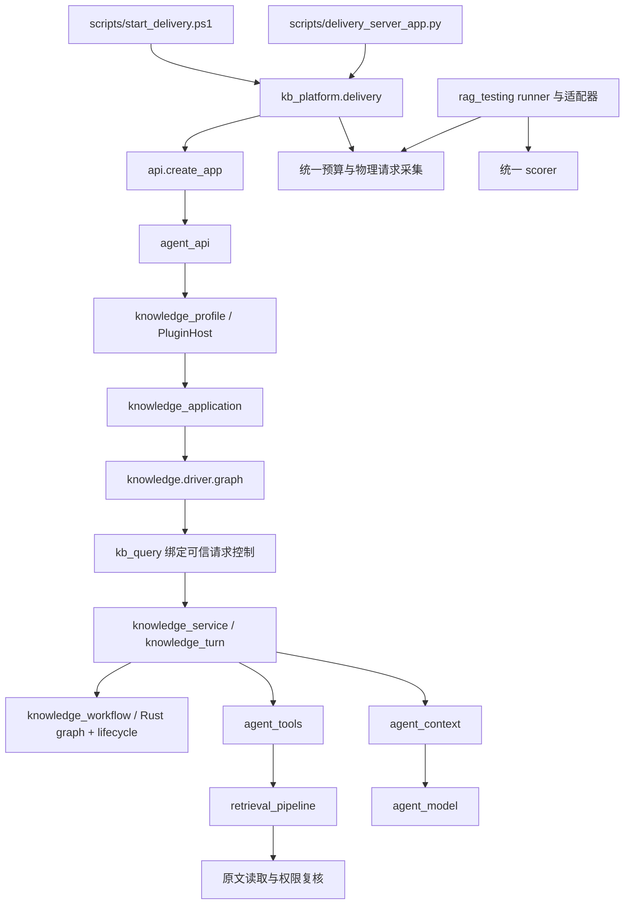

# 产品模块与评测边界

模型接入已增加公共 `models` 服务和 `llm` 结构化端口。默认知识库组合依赖通用模型注册表；
聊天、Embedding、OCR、转写、语音合成和生图使用按能力区分的统一合同。Luna/Google
兼容适配、新的 OpenAI 兼容及 Anthropic 原生适配、配置和限制见 [公共模型服务](model-services.md)。

通用 Agent 内核与知识库业务通过 [插件宿主与 profile](plugin-harness.md) 装配。API 加载 `config/agent-profiles/knowledge.json`，展开显式 knowledge 组合包并取得应用服务；模型、上下文、存储、运行时、loop、工具和知识库实现都由 allowlist catalog 提供。Rust 拥有依赖解析、作用域、生命周期、通用 loop 和图节点推进，Python 执行服务效果与知识库路由策略。通用宿主、loop 与工具目录不导入知识库业务。

默认检索由 `postgres_search.py` 提供，使用 pg_textsearch BM25 和 pgvector 精确检索。检索代际、语义页活动清单和 Embedding 恢复任务均在 PostgreSQL 中持久化。`search.py` 保留共有排序/绑定合同；`embedded_search.py` 与 OpenSearch 仅用于历史迁移和明确配置的对照。`semantic_pages_v2.py` 通过读回、封存和页向量接口访问后端。原件文件只供备份下载，证据以数据库不可变解析快照为准。持久化与切换说明见 [检索存储](search-storage.md)。

产品保留一个回答方案。此次调整把交付应用的组装归入 `kb_platform/delivery.py`，不重排检索、存储或解析模块。原有 `DeliveryProfile` 仍保存配置路径、提供者路径、运行目录与冻结配置。预算 CLI 和服务启动器都调用这一实现。

## 请求经过哪些模块

`scripts/` 负责命令行参数、进程启动和输出。产品模块不导入脚本，也不修改 Python 搜索路径。`delivery.py` 拥有配置校验、身份初始化、预算检查和应用工厂。`--check` 仅验证已有配置，实际应用创建仍是显式操作。

`retrieval_pipeline.PipelineConfig` 表达检索策略。检索管线在授权范围内召回原文子单元、融合候选、重排并装配原文。`agent_context.ContextManager` 管理实际发送前的上下文。此次重构没有改写检索或装配算法。

## Rust Agent 运行时与知识库业务

`rust/agent-kernel` 保留操作准入、关联、取消、截止时间与终态，并导出内嵌协议入口；`rust/agent-harness` 实现插件依赖排序、服务归属、父子作用域、运行租约和通用 loop。loop 发出会话、提示词、模型和工具效果，由 Python 适配器执行；没有在 Rust 核心写入知识库分支。`knowledge_workflow.KnowledgeWorkflow` 继续决定知识库内部规划、检索、生成、核验、修复和交付。LangGraph/LangSmith 调度实现和依赖已移除。

默认 HTTP 路径调用插件提供的 `application` 服务，由 `knowledge.driver.graph` 直接执行绑定的 `kb_query`，进入 `knowledge.workflow.graph` 提供的图程序，不再创建外层 single-tool loop。绑定保留原始身份、session、request ID、expected revision、来源策略和用户约束；模型参数仅包含问题。它不增加外层模型规划调用，返回已验证的原响应及 trace。通用 `model-tools` loop 是另一种可选策略；loop 自身可以替换。

`knowledge_service.KnowledgeService` 提供独立知识库会话 API；`knowledge_turn` 持有单轮业务状态，`knowledge_model`、`knowledge_planning`、`knowledge_answer` 分别拥有模型调用、规划与答案合同。业务调用者仍可直接使用领域服务，不必额外建立 Agent。`knowledge_tool.query_tool` 保留通用工具接入方式，使用宿主绑定身份和会话，直接交付经过核验的结果。

`session_store.SessionStore` 唯一实现会话归属、请求指纹、revision、单写者租约和完成结果事务；`KnowledgeSessions` 注入该存储并承担知识库状态初始化及失败响应规则；提供者账本仍独占实际请求身份、预留与 UNKNOWN。原生完成后再次检查授权、证据和取消，再在同一事务保存 assistant 事件、状态与响应。重复完成请求仍经过当前授权复核；中断请求不会自动续跑。

`ToolAgent` 入口的 `harness.sessions.memory` 只保存单次 loop 的临时消息；默认知识库组合已不加载它。显式创建的 core 组合使用 `harness.sessions.durable` 以及同一通用存储合同，持久历史可跨宿主恢复，不加载知识库模块。其上下文按完整轮次裁剪，不改写持久历史。core 不随知识库 HTTP 产品启动。插件注册按作用域隔离；child 可显式覆盖父服务，关闭 child 只清理其拥有的子树。关闭流程先停止接收新调用，再检查活动租约与子作用域，最后按相反顺序释放注册效果和资源；忙碌时返回错误，不强制撤销已发送请求。

运行快照不是可重放 checkpoint，内核不自动重试模型或工具。子运行继承父截止时间及取消信号；同步 Python 效果不提供硬中断。原有 `graph_node_started` 和 `trace.graph` 保留为审计格式，协议为 `rust-agent-kernel/1`。

组合包覆盖规则、独立通用 Agent 用例及 DSH 对照见 [Agent 组合包](agent-bundles.md)。详见 [插件配置与扩展](plugin-harness.md) 和 [基础生命周期](rust-agent-runtime.md)。所有原有行为合同继续运行，并覆盖真实 Rust 协议、非知识库工具、跨层取消、profile 替换和默认路由组合。`default_path_replay --service` 使用同一 profile/图流程、已注册路由函数和请求模型，只替换模型及存储/检索夹具，继续交给统一 runner/scorer。它不启动 HTTP 服务、不验证身份认证中间件，也不调用真实提供者，不能代表线上 RAG 质量或性能验收。

## Agent 输出 Schema 边界

`agent_schema.py` 使用 `jsonschema` 的 Draft 2020-12 实现对象、数组、组合条件与取值范围校验；`agent_model.py` 不再维护递归 Schema 校验引擎。当前按工具能力动态扩展的 Schema 字典继续作为输入，提示词中的 Schema、协议标识与请求哈希构造不变。本轮不同时改写为 Pydantic 模型，避免改变模型可见协议。

兼容层保留已准入的关键字集合，拒绝 `$ref` 等未准入关键字和布尔子 Schema，不加载外部 Schema。整数不接受浮点数或布尔值，`const`、`enum` 保留原有顶层 Python 类型相等规则，长度上限必须为整数，空 `enum` 被拒绝。嵌套 `$schema` 只作为原始协议注释保留；编译副本移除它，防止库切换方言时绕过严格类型规则。标准 meta-schema 额外检查注释字段等格式；非有限数值在整个输出 JSON 中被拒绝，包括未约束的额外字段。

新响应与缓存结果都执行当前 Schema 校验及业务 validator。重复 JSON 键检查、证据与引用校验、预算预留、失败计费和错误码映射仍由原有边界负责。`agent_schema_contracts.py` 使用合成响应验证这些行为，统一质量入口自动发现；本轮未删除测试，也未新增模型调用。

## Luna SDK 与物理请求边界

`magpie_luna` 的 Chat Completions 通过 `luna_sdk.py` 调用 OpenAI Python SDK；Google Embedding 仍使用原适配器。Luna 不再直接调用 HTTP POST，也没有生产路径回退开关。SDK 每次使用提供者当前持有的 HTTP 客户端，因此 `observe_client` 的物理计量 transport 和交付服务的发送串行化继续生效。

SDK 设置 `max_retries=0`，使用调用者客户端的禁止自动重定向配置，超时受当前请求剩余时间约束。SDK 返回原始 HTTP 响应，保留实际载荷、usage 缺失及错误响应，避免 SDK 类型转换影响现有合同。适配层还原 SDK 包装的底层连接/超时/准入异常，并将 HTTP 状态错误还原为响应；`remote.py` 继续唯一负责重试分类、Retry-After、重试等待上限和请求次数上限。

每次获准重试仍创建新的物理身份并关联前次请求。`MeteredTransport` 继续在真实发送之前预留预算，保留失败和缺失 usage 的计费；读取/写入超时及取消保持 UNKNOWN，重启也不能绕过未决请求。收到 403 后关闭提供者准入；预算拒绝即使被 SDK 包装也保持零发送。SDK 不接管客户端关闭生命周期，也不采用环境中的 OpenAI 组织、项目及自定义头来改变提供者配置。

提供者 manifest 和模型响应缓存键包含 SDK 版本及 transport 协议，升级后相关响应缓存失效，旧文件保持只读；这不会清零或迁移现有物理请求账本。`luna_sdk_contracts.py` 使用真实 SDK 加合成 HTTP transport 验证边界，没有调用真实提供者。该检查证明离线协议与计量行为，不代表线上模型兼容性或 RAG 质量验收。

## Markdown 原文解析边界

本系列改造的逐项状态、工具类型注册、重试所有权与未完成的 token 计量依赖见 [框架替换计划](framework-migration-plan.md)。

`markdown_source.py` 使用 markdown-it-py 的 CommonMark 块解析并启用 table 规则，关闭不需要的 inline 解析。标题（含 Setext）、匹配长度和标记的围栏、缩进代码及容器中的块均由库识别。库只提供结构与行范围；证据、quote、偏移始终从 UTF-8-SIG 解码后的原文切片生成，不使用渲染结果或 token.content 重建原文。原件 SHA-256 仍覆盖包含 BOM 的完整字节；偏移仍是解码文本的 Unicode codepoint。CRLF/CR 的规范化映射保持原有合同，U+2028 等字符不冒充 Markdown 换行。

业务层保留普通正文逐行证据、管道表格与紧邻说明整体交付，以及无分隔行的历史管道表格约定。标准 Markdown 表格也保留完整原文，不凭 token 创建虚假的单元格坐标。代码和 HTML 内的文本不参与表格说明合并；未闭合围栏仍报告 `unclosed_code_fence`。TXT 共用这层原文分组，库识别的代码/标题只用于保护分组边界，不将 TXT 元素转换成 Markdown 标题或代码类型。

Markdown/TXT 的新快照使用 `native-text/0.3.0-markdown-it`，快照哈希纳入 markdown-it-py 版本；其他格式继续原有解析版本与依赖。改变库版本或解析策略会生成新的证据和锚点身份，不覆盖已有快照、不自动重建索引。旧的逐行表格导航合同继续保留，只将夹具改为提供历史行边界；生产路径已删除旧的手写标题识别和围栏状态机。

`markdown_contracts.py` 使用真实解析库和合成原文验证这些边界；现有权限、导航、上下文与评分合同仍由统一检查运行。参考 [markdown-it-py token 与规则 API](https://markdown-it-py.readthedocs.io/en/latest/using.html)。

## 产品与评测共享什么

`rag_testing` 中有五个模块提供产品所需的稳定能力。

| 模块 | 共享职责 |
| --- | --- |
| `contracts` | 证据合同和规范化哈希 |
| `cache` | 精确依赖缓存和读取授权 |
| `budget` | 唯一的物理请求预留与费用账本 |
| `budget_batches` | 不可变前序账本与新增有界预算 |
| `provider_capture` | 实际请求采集与计量 |

因此，禁止产品导入整个 `rag_testing` 包会破坏现役功能。当前规则允许上述五个模块，拒绝产品依赖 scorer、runner、夹具、历史回放或实验模块。共享模块也不能反向导入这些评测模块。

`contracts`、`cache`、`budget`、`budget_batches` 是基础层，不能依赖产品执行模块。`provider_capture` 是产品适配层，允许使用提供者和请求消息工具。它不拥有评分规则。

缓存和账本保持单一实现。SQLite 连接显式关闭，事务提交或回滚之后不会继续占用数据库文件。未知请求和缺失 token 的预留不因关闭连接而清零。

## 哪些目录不参与运行

`reports/`、`.local/`、`output/`、`outputs/` 保存证据、私有运行状态或独立产物。它们不是产品模块来源。尤其不能把 `output/rag-evidence-testkit/` 导入本项目来替换当前框架。

`scripts/check_project.py` 用 AST 检查活动产品源码的依赖方向、已知动态导入和搜索路径修改。它检查架构约定，不是执行任意恶意 Python 的安全沙箱。离线工作进程另行阻断 Python socket 网络发送和子进程启动。

插件化按服务和资源所有权建立边界，知识库内部算法仍保留在现有领域模块中。当前实现不是完整 DSH 移植，没有原生动态插件沙箱、进程隔离或自带模型适配器的交互式 Agent CLI。原生协议驱动程序与完整应用交互界面分开。规则和验证命令见 [开发与合并检查](development.md)。
