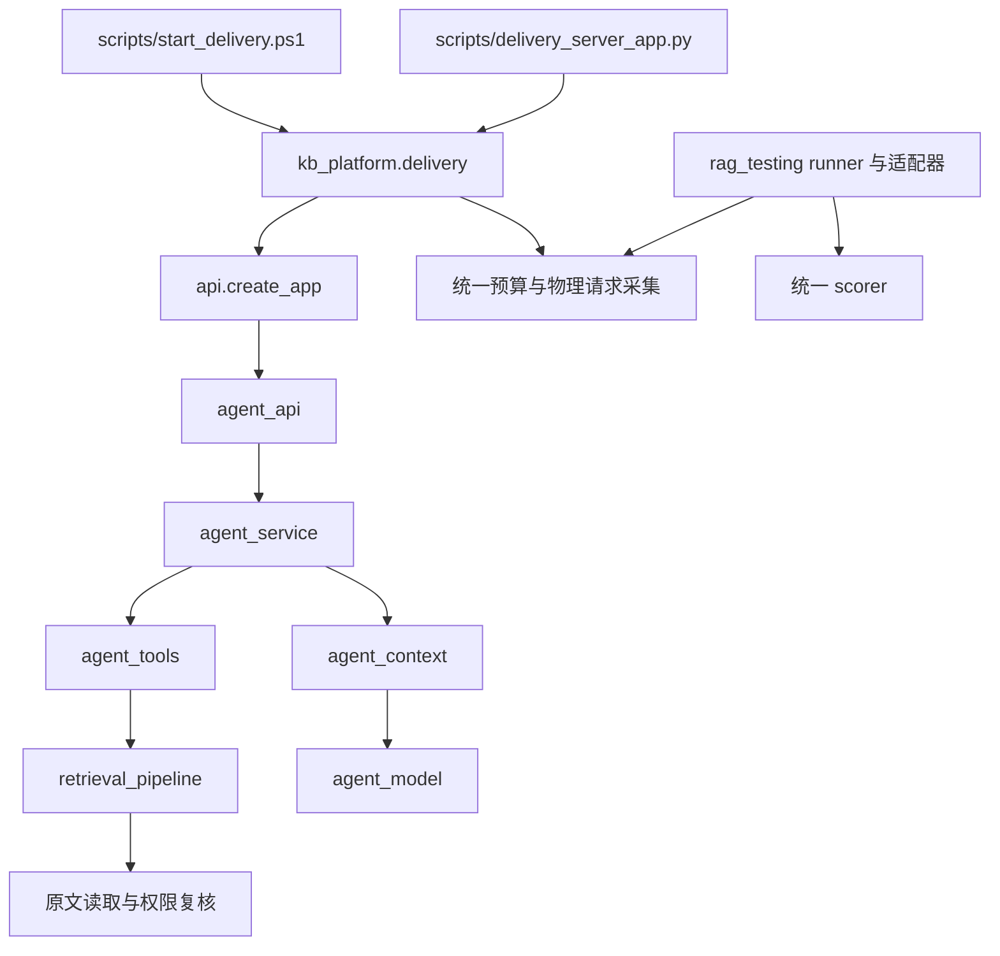

# 产品模块与评测边界

产品保留一个回答方案。此次调整把交付应用的组装归入 `kb_platform/delivery.py`，不重排检索、存储或解析模块。原有 `DeliveryProfile` 仍保存配置路径、提供者路径、运行目录与冻结配置。预算 CLI 和服务启动器都调用这一实现。

## 请求经过哪些模块

`scripts/` 负责命令行参数、进程启动和输出。产品模块不导入脚本，也不修改 Python 搜索路径。`delivery.py` 拥有配置校验、身份初始化、预算检查和应用工厂。`--check` 仅验证已有配置，实际应用创建仍是显式操作。

`retrieval_pipeline.PipelineConfig` 表达检索策略。检索管线在授权范围内召回原文子单元、融合候选、重排并装配原文。`agent_context.ContextManager` 管理实际发送前的上下文。此次重构没有改写检索或装配算法。

## 产品与评测共享什么

`rag_testing` 中有五个模块提供产品所需的稳定能力。

| 模块 | 共享职责 |
| --- | --- |
| `contracts` | 证据合同和规范化哈希 |
| `cache` | 精确依赖缓存和读取授权 |
| `budget` | 唯一的物理请求预留与费用账本 |
| `budget_batches` | 不可变前序账本与新增有界预算 |
| `provider_capture` | 实际请求采集与计量 |

因此，禁止产品导入整个 `rag_testing` 包会破坏现役功能。当前规则允许上述五个模块，拒绝产品依赖 scorer、runner、夹具、历史回放或实验模块。共享模块也不能反向导入这些评测模块。

`contracts`、`cache`、`budget`、`budget_batches` 是基础层，不能依赖产品执行模块。`provider_capture` 是产品适配层，允许使用提供者和请求消息工具。它不拥有评分规则。

缓存和账本保持单一实现。SQLite 连接显式关闭，事务提交或回滚之后不会继续占用数据库文件。未知请求和缺失 token 的预留不因关闭连接而清零。

## 哪些目录不参与运行

`reports/`、`.local/`、`output/`、`outputs/` 保存证据、私有运行状态或独立产物。它们不是产品模块来源。尤其不能把 `output/rag-evidence-testkit/` 导入本项目来替换当前框架。

`scripts/check_project.py` 用 AST 检查活动产品源码的依赖方向、已知动态导入和搜索路径修改。它检查架构约定，不是执行任意恶意 Python 的安全沙箱。离线工作进程另行阻断 Python socket 网络发送和子进程启动。

全量拆分为 domain、application、infrastructure 会移动大量现有代码，却不能直接补上持续验证缺口。当前选择一个所有权修正、一个可重复的质量入口，以及围绕真实风险的合同检查。规则和验证命令见 [开发与合并检查](development.md)。
