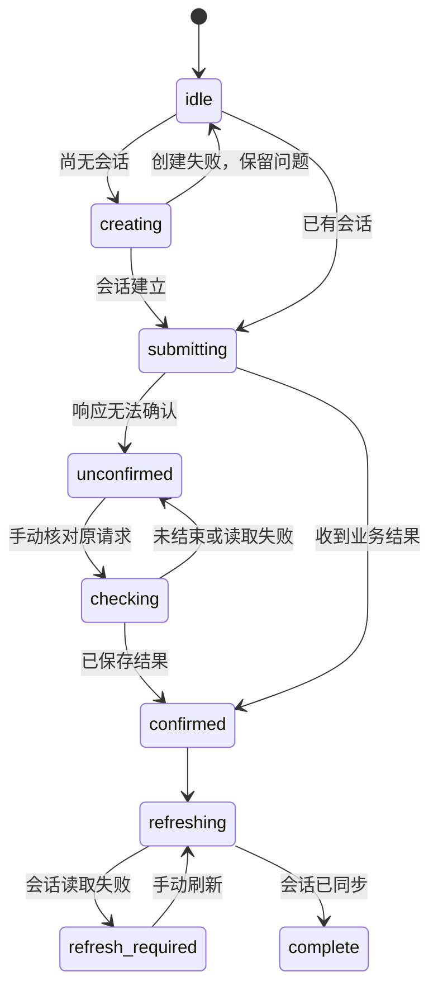

# 对话请求状态与恢复

## 修复的行为

React 工作台原先用一个 `busy` 布尔值和错误字符串表示整轮提问。创建会话前就清空问题；提交成功后又把会话读取、最近对话刷新放在同一个异常处理范围内。结果是创建失败会丢失问题，已经收到答案也可能被后续读取失败标成“请求未确认”。请求 UUID 只存在于 POST 参数里，界面无法使用已有的只读请求恢复接口。

现在每轮提问保留身份代次、知识库、会话、请求 UUID、提交问题和草稿归属。`web/src/turn-request.ts` 的纯转换函数管理下列状态，`main.tsx` 负责 HTTP 与界面副作用。

| 状态 | 已知事实 | 允许的下一步 |
| --- | --- | --- |
| `idle` | 没有活动提问 | 创建会话或发送新问题 |
| `creating` | 正在创建会话，尚未提交模型提问 | 等待；失败后保留草稿 |
| `submitting` | 原请求身份已保存，正在提交这一轮 | 等待响应 |
| `rejected` | 服务的受限恢复依赖在接收本轮前明确拒绝了提交 | 保留问题并展示服务拒绝原因；不自动重试 |
| `unconfirmed` | 原请求结果尚未确认 | 按原会话与原请求 ID 手动查询；阻止原会话继续发送 |
| `checking` | 正在读取原请求状态 | 等待读取；失败仍保留原身份 |
| `confirmed` | 已收到业务结果，包括业务错误或脱敏结果 | 立即显示已知结果，再刷新会话投影 |
| `refreshing` | 正在读取当前会话及相关显示数据 | 等待读取，不重新发送提问 |
| `refresh_required` | 业务结果已确认，但当前会话修订尚未同步 | 手动刷新原会话；保留答案，暂不提交下一轮 |
| `complete` | 业务结果与当前会话状态均已确认 | 可以继续提问；列表单独刷新失败只显示警告 |

HTTP 4xx、5xx、网络中断或单独的 `model_sent: false` 都不证明整轮未接收。预算预留发生 `COMMIT_UNKNOWN` 时也可能返回 `model_sent: false`，并带有需要核查的操作身份；前端保留这些结构化事实，继续进入未确认状态。只有 `DELIVERY_RECOVERY_REQUIRED`、`mode: restricted_recovery`、`reason: UNRESOLVED_PHYSICAL_REQUEST`、`model_sent: false`、`automatic_retry: false` 同时成立，且没有操作、请求、恢复动作或提交事实时，才认作接收前的拒绝。该精确响应来自后端的受限恢复依赖，而非模型调用内的同名错误。

恢复接口的聚合 `send_status: unknown` 保持其原含义，不因业务结果已经保存而改写成零发送或零费用。

图中省略了明确未发送的拒绝分支和连接重置；这两条边在转换类型及直接合同中单独验证。

## 恢复合同

“核对原请求”只调用 `GET /agent/sessions/{session_id}/requests/{request_id}`。它使用保存的原身份；切换显示中的知识库或新建对话不会把查询改成另一个请求。查询返回的会话与请求 ID 必须都相符。

| 服务端状态 | 界面动作 |
| --- | --- |
| `running` | 提示稍后再次核对，保留发送阻断 |
| `not_found` | 提示核对身份；不推断零发送，不自动重试 |
| `interrupted` | 提示核查原请求记录，保留阻断 |
| `reconciliation_required` | 提示维护者核对提交或结算记录，保留阻断 |
| `completed` | 接受保存的业务结果，读取当前授权的会话和历史后恢复显示 |
| `completed` 且 `response.status=redacted` | 显示来源不可访问，原答案和证据不再显示 |

未确认期间可以编辑下一份草稿，也可以浏览其他视图；当前提问保持阻断。取回活动中的原请求会恢复其所属会话，但不会清空后来输入的草稿。结果按原请求 ID 写入或替换，避免恢复时重复追加同一个答案。新请求仍使用新的 UUID 和最新会话修订，未改变服务端幂等或记账合同。

已过期的请求可能永久停留在 `interrupted`；只读查询不会把它变成完成。对于 `interrupted`、`not_found` 或 `reconciliation_required`，用户可以明确选择“保留记录并新建对话”。此操作保留原问题、原会话、请求 UUID、恢复状态和服务端操作事实，打开空白对话，不提交 HTTP 模型请求，也不复制原问题。随后输入新问题时会创建不同会话并使用新 UUID；原会话仍被阻止继续发送。

保留记录与活动提问分开保存，后续保留第二条不会替换第一条。每次“核对保留请求”只更新对应记录，不切换当前会话或清除草稿。如果取回了已确认结果，可另行选择“打开已确认会话”，读取原会话最新修订与历史，再解除该会话的阻断。连接身份重置会同时清空活动和保留记录，旧回调不能重新写入。

草稿归属由每次输入递增的代次表示。即使重新输入相同文字，它也是一份新草稿。只有原提交所属的草稿在收到结果时清空；创建失败、未知结果和之后的列表刷新都不会清空它。

请求记录属于发起连接的身份代次，结果显示另外受当前知识库、会话与操作代次保护。`OperationOwner` 防止过时结果修改新的显示范围。`requestTransition` 按原请求 UUID 将事件路由到活动记录或对应保留记录；异步读取的失败和收尾不能改变后来请求的状态。

请求身份只保存在当前页面内。切换连接或刷新页面会丢弃这份界面记录，因此恢复区显示可保留的会话及请求 ID。服务端原始请求、账本与历史不受页面重置影响；本次没有增加浏览器持久化，也没有提供人工核销或自动重发按钮。诊断用旧 `/agent/console` 不在本次 React 交付范围内，仍按审计清单后续处理。

## 验证边界

直接 Node 合同覆盖状态转换、异步归属、精确接收前拒绝判断、多条保留记录和按身份路由。十二个 React 浏览器用例保留原来的成功路径，并增加创建失败、两类刷新失败、四类未决状态、执行中请求的跨视图完成、脱敏结果、错误请求身份、精确接收前拒绝、未决预算事实、永久中断后独立新会话以及保留结果的显式打开。浏览器阶段仍由原有统一入口执行，要求每个用例单次尝试、非零确定性断言和零模型调用。

有限模型和五个负控见 [请求恢复模型](../formal/web_request_recovery/README.md)。模型区分原会话继续发送与用户主动开启独立会话；它只表示一条保留记录和一次独立发送，不声称证明完整的多记录回调组合。TypeScript 整文件绑定仅检查审阅后的源码漂移；语法及类型由已有前端检查验证，不把文件哈希当作状态机精化证明。新的 `combination-inputs-chat-recovery-v7.json` 保留 v1–v6 冻结输入，只新增本功能的模型与合同，并明确记录类型绑定检查器的一处扩展。

本地必需普通入口及形式化入口因执行环境缺少进程子项发现能力而失败，失败记录保留；直接运行的构建、单元合同和 TLC 是独立的有限证据，不能代替最新提交的完整 CI 或浏览器验收。具体记录见 `.audit/chat-request-recovery-validation.json`。
