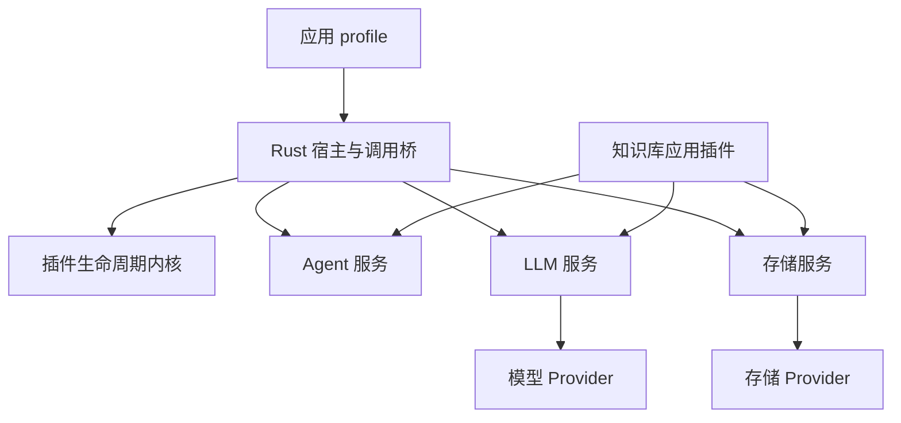

# DSH 边界下的 Rust 基础层

本轮以 DeepSeek Harness 的插件边界为参照：Rust 内核管理插件的装配与生命周期；LLM、存储和 Agent 执行能力是可独立消费的服务；知识库是消费这些服务的应用组合。代码使用 Rust 或 Python，不决定它属于内核还是业务。

## 固定来源与验证范围

2026-11-02 通过 GitHub 查询到上游仓库为 `deepseek-ai/deepseek-harness`，默认分支为 `master`，当时 HEAD 为 `ce7073d51254c26cd63b22a60835b8f948deb447`。本轮固定这一提交，不跟随可变分支。该提交中的 `@deepseek-ai/dsh-llm` 版本为 `0.2.2-alpha.2`。

- [上游架构](https://github.com/deepseek-ai/deepseek-harness/blob/ce7073d51254c26cd63b22a60835b8f948deb447/docs/architecture.md)：loop、session、tools、LLM 都是插件。
- [Cordis primer](https://github.com/deepseek-ai/deepseek-harness/blob/ce7073d51254c26cd63b22a60835b8f948deb447/docs/cordis-primer.md)：依赖注入、作用域、事件和可逆 effect。
- [LLM 类型](https://github.com/deepseek-ai/deepseek-harness/blob/ce7073d51254c26cd63b22a60835b8f948deb447/packages/llm/llm/src/types.ts)、[运行服务](https://github.com/deepseek-ai/deepseek-harness/blob/ce7073d51254c26cd63b22a60835b8f948deb447/packages/llm/llm/src/index.ts)、[组装器](https://github.com/deepseek-ai/deepseek-harness/blob/ce7073d51254c26cd63b22a60835b8f948deb447/packages/llm/llm/src/assembler.ts)、[适配器义务](https://github.com/deepseek-ai/deepseek-harness/blob/ce7073d51254c26cd63b22a60835b8f948deb447/docs/cookbook/adding-an-llm-adapter.md)：本轮 LLM 参考依据。

已有 Cordis 行为轨迹继续使用 [来源基线](rust-plugin-provenance.md) 和 `config/plugin-runtime/cordis-reference-lock.json`。它们记录的是 vendored Cordis 4.0.0-rc.11 加 DSH 本地修改，不等同于任意其他 Cordis 版本。

新增 `config/plugin-runtime/dsh-llm-reference.json` 是根据上述固定源码人工设计的合成语义用例。其 provenance 文件保存原始 Git blob 身份、链接、推导范围和夹具文本哈希。**这些用例没有通过执行上游 TypeScript 生成，因此不称为上游参考执行轨迹。** `dsh_llm_reference_contracts.py` 把用例事件逐条送入本次构建的真实 Rust `llm_stream_apply` 桥，不替换 `native_call`，也不在 Python 重新实现组装逻辑。

本轮不声称兼容 DSH 的 TypeScript 插件加载、JavaScript Proxy、完整应用或全部扩展事件；离线合同也不证明真实供应商兼容性、生产 RAG 质量或性能收益。

## 依赖方向

| 层 | 负责 | 不承担的责任 |
| --- | --- | --- |
| `plugin-runtime` | 插件实例、代次、依赖、作用域、调用租约、更新与清理状态 | 模型协议、SQL、检索、Agent 业务和预算策略 |
| `plugin-host` | 进程协议、宿主启动与监督、取消和进程树清理 | 知识库路由、供应商 wire format、存储方言 |
| `agent-harness` / `agent-kernel` 桥 | 聚合独立 crate 的调用入口，提供现有 ABI | 第二套生命周期权威或第二份业务状态 |
| `agent-services` | 默认 Agent loop/graph 的执行机制，供应用选择和组合 | 插件注册内核、知识库证据规则 |
| `llm-service` | 公共请求与流协议、适配器注册、准备调用与响应组装 | RAG、实际费用估算、自动重发、具体 HTTP SDK |
| `storage-service` | 存储能力与方法准入、类型值、身份和事务协议 | 某个数据库 SQL 编译器、领域仓储、跨库分布式事务 |
| Provider 插件 | 模型 SDK、HTTP/SSE、数据库驱动和后端方言等具体实现 | 创建与应用既有会话/预算冲突的另一份权威 |
| 知识库应用组合 | workflow、context、access、sessions、model、data、authority、model_policy、entry 的业务协作 | 在通用内核硬编码知识库能力 |

`plugin-runtime` 和 `plugin-host` 不依赖 LLM、存储或应用 crate。`llm-service`、`storage-service` 的公共 Rust API 不要求启动本项目宿主，也不依赖 Python 知识库。聚合层可以同时使用它们；这种聚合不允许服务反向依赖聚合层。

一个可替换能力始终区分三个角色：**合同定义、提供商实现、消费方**。它们可以放在同一个发行包中，但消费方声明合同和所需能力，不能通过供应商品牌选择实现。配置 profile 决定绑定，插件生命周期决定资源有效期。



图中的箭头表示装配或调用关系。LLM、存储、Agent 服务的存在不改变 Rust 生命周期内核的资源管理权威。Provider SDK、数据库驱动和知识库算法保留其适合的实现语言。

## LLM 公共语义

### 请求与适配器

公共请求携带明确的 `provider`、`model` 和消息序列。工具 schema、system、reasoning effort、temperature、maxTokens、stop 等字段必须由所选 Provider 显式支持；不支持的选项返回 `UNSUPPORTED_LLM_OPTION`，对应上游 `UNSUPPORTED_OPTION` 的拒绝语义，不能悄悄丢弃。供应商 SDK 的最终 HTTP 请求和返回格式由 Provider 翻译。

适配器注册、调用准备和实际发送必须使用同一注册身份。准备阶段捕获路由和模型能力，热更新不能把旧代模型的能力与新代端点拼接。本轮 Rust `prepare(provider, model)` 固定这份身份、只读模型元数据与适配器提供的 dispatch closure，在 `stream(request)` 消费请求时填入同代模型默认值并验证完整配置；它尚不是上游接收完整 `LlmCallConfig` 的 `prepareCall(config)` API。已准备调用只能发送一次；取消通知后，要等待实际执行结束才能认定资源已经释放。

事件通道是有界的。Provider 发出 finish 后仍可能需要完成异步清理，消费方收到终态不会强制中断这段清理；`close(timeout)` 等待实际任务结束，超时返回 `LLM_CLEANUP_PENDING`，任务继续持有原注册资源。终态事件和清理完成是两个事实。`complete()` 消费完整流并等待清理，不能仅因已有文本或 finish 就报告资源已释放。

本轮注册 API 以单个 provider route 为单位，注册、重复检查和代次更新在同一锁内完成；旧代 disposer 不能注销新代注册。上游多 route 配置一次验证、一次提交的整体替换接口尚未移植，不能把若干次独立注册宣称为一个原子批次。

上游允许同一适配器实例在多个 route 之间恢复其私有 replay 状态。本轮使用不透明 `adapterIdentity` 绑定服务实例与注册代次，并进一步要求相同 provider/model 才保留 replay。缺少身份、重新注册或换代时丢弃 replay；这是一项明确更保守的限制。`replayState.response` 与 `replayState.blocks` 保持不透明，不由通用层解释供应商内部数据。

### 流协议

| 事件 | 内容 |
| --- | --- |
| `block-start` | `index`、`blockType` |
| `text-delta` | `index`、`text` |
| `reasoning-delta` | `index`、`text` |
| `tool-call-delta` | `index`、`id`、可选 `name`、`argumentsDelta` |
| `block-end` | `index`、完整 `block` |
| `usage` | 一次调用目前观测到的累计用量快照 |
| `finish` | `reason` 和可选 `replayState` |

`finish.reason.kind` 为 `stop`、`tool-calls`、`max-tokens`、`error` 或 `aborted`。错误和取消附带稳定 `code` 的 failure。工具参数从增量到最终块始终保留原始 JSON 字符串；只有完整且有效的工具调用才能进入执行阶段。

`usage` 必须先于 `finish`，终态后禁止继续输出。取消、错误或 `max-tokens` 不得把未完成工具调用作为可执行结果发布。裁掉工具块时，同时裁掉对应的 `replayState.blocks` 元数据；元数据数量不匹配时丢弃整个 replay envelope。

原生异步 Service 的调用与现有 Python 供应商桥需要分开报告。对同步 `complete()` 的规范化可以复用这些语义，但它本身不等于供应商实时 SSE、HTTP 前端增量输出或完整 DSH AsyncIterable 兼容。验收必须检查实际使用的入口，不能由类型定义或一个独立示例推断整条业务链已具备实时流式能力。

生产 Python 桥位于 `kb_platform/llm_protocol.py`。Rust `Registry<T>` 同时服务原生异步 SDK 与 Python executor：绑定、准备、准入、活跃调用、排空和清理使用同一算法。Python `ModelService` 只保留执行对象与资源清理函数，不再维护另一套 route phase、active counter 或已发注册 ID 集合。CHAT 与 completion port 都经过原生 call ticket；原始 usage 保留，额外返回规范化 usage/finish。大请求只向调用准入发送必要元数据，不复制全文进入 ABI。

默认应用图现在显式包含 `foundation.llm` 和 `foundation.storage`。`knowledge.model` 通过公开 `llm.service/1` 消费通用模型服务；提供者配置归底座服务，结构化输出、轮次预算和验证回执归应用模型层。`knowledge.authority` 消费通用存储并发布领域结构；`knowledge.model_policy` 通过可选公共合同提供发送许可和 OCR validator。完整职责、操作算法和可运行入口见 [当前底座与应用架构](foundation-architecture.md)。

内置 Luna/HTTP Provider 仍声明 `streaming=False`，本轮未把它们改成 SSE Provider。原生异步流式能力由 Rust `Adapter`、`Service`、`PreparedCall` 和有界通道提供，独立消费者测试只依赖 `llm-service`。原生 SDK 的流式验收和默认同步供应商的业务验收分别报告。

公开请求包含消息 `id`、`toolHistory` 基线与按 messageId 记录的工具新增声明。developer 消息中的 `tool-addition` / `tool-removal` 只引用 `toolName`，不能内嵌另一份工具 schema。Provider 通过 `toolUpdate: addition-only | in-history` 显式声明支持范围；仅支持工具调用但未声明动态更新的 Provider 会拒绝 `toolHistory`。新增声明的历史投影仍由声明支持的 Provider 实现，不能把当前同步文本 Provider 描述为已经支持动态工具更新。

模型元数据包含 `context.contextWindow`、`defaultMaxTokens` 和 `reasoning.efforts` / `defaultEffort`。准备调用使用同一代元数据填入缺省输出上限与 reasoning effort，且 effort 必须属于该模型目录。`systemPromptUpdate: in-history` 是历史 system 消息更新的能力门控。元数据描述本身不替代上下文计量、裁剪和实际供应商参数翻译。

本轮尚未移植上游的完整消息扩展体系、所有扩展事件和图片/文件供应商投影；现有应用的附件处理仍由原有组件承担。未知字段和未支持能力需要明确拒绝，不能因存在同名类型宣称整个 DSH TypeScript API 已兼容。公共 native 命令必须显式携带 `protocol: llm-service/1`，缺失或未知版本返回 `LLM_PROTOCOL_UNSUPPORTED`。

### 用量、估算和预算

| 概念 | 规则 |
| --- | --- |
| `inputTokens` | 未缓存输入；缓存读写另列，不能重复计费 |
| `outputTokens` | 供应商观测的输出用量 |
| `cacheReadTokens` / `cacheWriteTokens` | 可选的缓存输入计数 |
| `totalTokens` | 可选且可信的调用总量；不得小于已知的不重叠计数和 |
| `reasoningTokens` | 可选推理计数，不能无条件再加到 output 上 |
| 多个 `usage` 事件 | 后来的累计快照替换前一快照，不能逐帧相加，也不强制每个计数单调增加 |
| 没有完整 usage 观测 | `usage = null`，不伪造零消耗 |
| 本地 token 估算 | 用于上下文准入与裁剪，不作为供应商实际账单 |
| 预算预留与 UNKNOWN | 保留现有权威账本、请求身份和恢复语义，不因换 Provider 或协议清零 |

LLM 服务执行一次 Provider attempt。重试策略、缓存、限流和预算由相应服务/插件组合；实际发送与账本必须只有一条受控路径。借鉴 DSH 的 retry 插件边界，不意味着照搬其 always-mode 无限重试。本项目未确认发送结果的请求仍需保留 UNKNOWN 和预留，不能由新的通用层自行重发。

### 有意更严格的行为

上游文档要求唯一终态，但其 `BlockAssembler.finish` 在缺少 finish 时默认 stop，`push` 也不拒绝终态后的所有更新。本项目在公共 Rust 边界明确加强：

- `finish` 后的 usage、重复 finish 或其他事件返回 `LLM_STREAM_FINISHED`。
- EOF 时缺少 finish，产生 `LLM_STREAM_MISSING_FINISH` 错误终态；保留已观测 text/reasoning 和 usage，移除未执行工具。
- usage 事件缺少 `inputTokens` 或 `outputTokens` 时拒绝，不能用默认零补全。
- 工具结束、取消、用量和 replay 必须保持一致，不能将畸形流当成正常成功。

参考数据分别标记 `upstream` 和 `project_stricter_validation`，防止把主动加强说成上游行为等价。

## 统一存储层的实际责任

Rust `storage-service` 复用现有 relational/document/kv/vector/lexical/object 合同，负责公共能力、方法、类型值、身份和事务语义准入。现有 SQLAlchemy 编译、SQLite/PostgreSQL/MySQL、Redis 和对象存储驱动仍由 Provider 实现。增加 Rust 合同不创建另一份业务数据库，也不改变现有权限和数据集身份。

`kb_platform/storage_protocol.py` 是 Python 桥；结构化 wire、应用存储和进程存储路径实际消费它。合同校验在能力绑定、方法调用、事务与值边界执行；数据库 SDK 本身仍不导入宿主。Rust 公开 `Contract`、`SpaceKey`、`StorageIdentity`、`StorageValue`、`CommitReceipt` 以及独立 `Driver`/`Service`，示例 `replaceable_kv.rs` 展示只依赖服务 crate 的消费者在同一 MemoryKv Provider 的两个独立 dataset 间更换绑定。该示例不代表新增了两个实际数据库后端。

结构化存储的调用身份需要保留 runtime、instance、generation 和 registration 等完整绑定；过期句柄不能因字符串 ID 复用而恢复有效。事务写入超时或 commit 响应丢失不能推导为回滚，必须保留原 operation_id 与 UNKNOWN，不能因此自动重放；读缓存不能冒充持久账本。已完成写入之后的编码或结果校验失败保留 `STORAGE_WRITE_RESULT_UNAVAILABLE`、`outcome=COMPLETED` 和 method，避免把结果不可用误报为没有发生写入。

4 MiB 是单条 wire 消息限制。大值继续走既有有界分块，不为调用 Rust 校验重新塞入整块大文档。新的控制头保持小型化，typed-value 采用完整有界事件流：真实标量、文本和 bytes 分块进入同一个 Rust 校验栈，容器结构与累计预算不会在批次边界丢失。SQL 结构、COUNT(*)、Numeric 精度与 scale 需要保留原有合同；通用协议不能通过丢信息来制造后端一致。SQLAlchemy AST 解释器和各后端驱动继续工作，本轮没有把 SQL 引擎整体重写为 Rust。

更换 Provider 是否完成，以消费者业务代码不改、配置绑定生效、合同要求确实满足且故障语义保持为准。Milvus、Elasticsearch、OpenSearch 等未实现的驱动不因存在通用合同就被宣称可用。

## 状态权威

| 状态或资源 | 权威 |
| --- | --- |
| 插件实例、代次、依赖与租约 | Rust plugin runtime |
| 子进程、管道与进程树 | 创建它们的 Rust host/process owner |
| 模型 route、prepared call 与活跃调用 | Rust `llm-service::Registry<T>`；Native/Python 共用，身份贯穿实际调用 |
| 会话 revision、请求幂等、结果持久化 | 应用选择的 session service 和既有持久仓储 |
| 物理发送、费用和 UNKNOWN 预留 | 既有唯一计量/预算账本 |
| 原文版本、hash、ACL 和发布代际 | 知识库数据与权限服务 |
| 数据库连接、事务与后端资源 | 对应存储 Provider，由插件生命周期持有 |

统一服务不是增加一个统管所有业务的协调器。每种状态保留明确且唯一的权威，调用桥传递这些权威需要的身份和事实。

## 验收与运行

新环境先执行 `uv sync --locked --group dev`。正式检查仍从仓库根目录运行：

```sh
uv run --no-sync python scripts/check_project.py
```

单独检查新增原生服务：

```sh
cargo test -p llm-service -p storage-service
cargo test -p agent-services
```

调试参考合同必须使用本次构建的真实动态库；指定 `KB_AGENT_KERNEL_LIBRARY` 为该库的绝对路径后运行：

```sh
uv run --no-sync python -m unittest kb_platform.rag_testing.dsh_llm_reference_contracts
```

统一 checker 会构建并选择自己的原生制品，然后自动发现该模块。不得为通过参考合同而加载历史动态库、mock Rust 调用、跳过用例或只比较静态 JSON。

验收需要同时满足：

1. 生命周期核心没有到 LLM、存储或业务 crate 的直接或传递依赖；公共服务可以独立消费。
2. DSH 合成语义参考通过真实 Rust 桥，覆盖累计 usage、raw 工具参数、未知用量、截断、replay 裁剪与终态顺序。
3. 调用准备、注册替换、取消、资源释放和跨代 replay 由真实 Service 用例覆盖。
4. 知识库默认装配与现有同步 Provider 路径实际消费公共合同，预算、授权、UNKNOWN 与持久会话行为不丢失。
5. 存储能力替换、完整身份、事务及大值传输保持现有合同，实际后端矩阵按统一入口执行。
6. Rust 格式、Clippy、构建、Python lint、全部离线合同、宿主/进程集成和既有评分控制无跳过地通过。

具体通过数和执行产物以本次统一 checker 的结果为准。新增参考用例是离线组件验收，不发起真实模型、Embedding 或 judge 请求，不据此宣称生产 RAG 质量提升。
