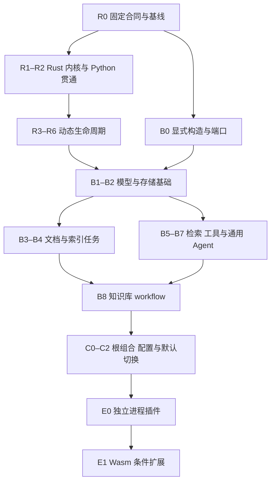
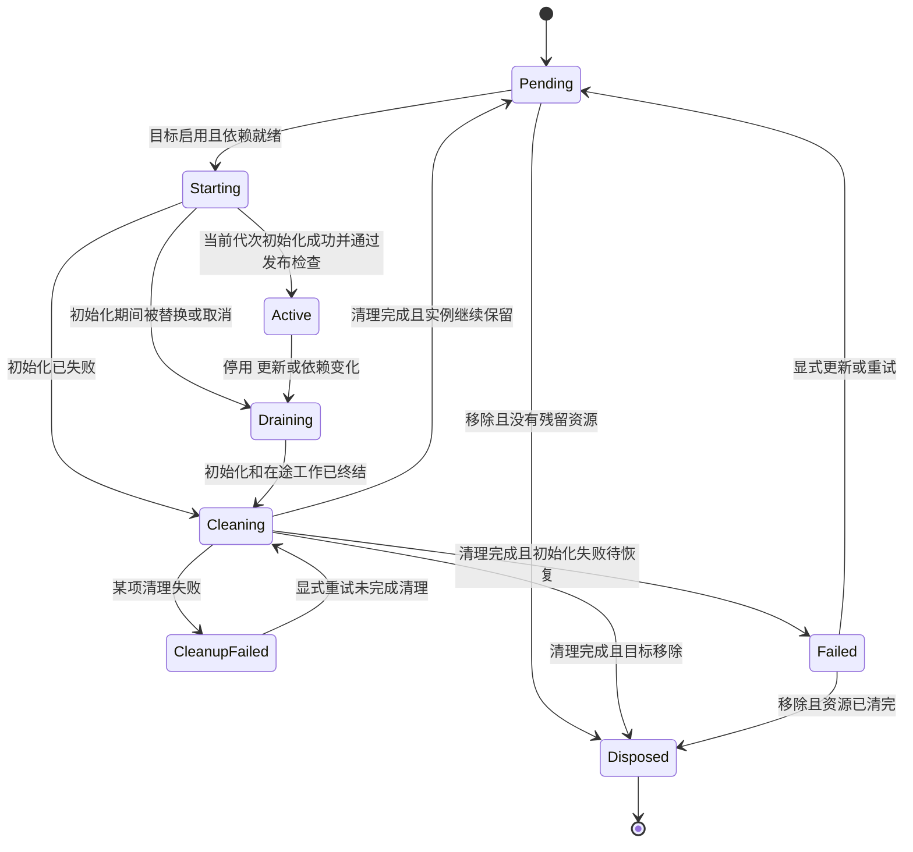

# Evidence KB Rust 插件化改造完整执行计划

> 文档版本：1.0  
> 整理日期：2026-10-30（北京时间）  
> 适用项目：[Hubujiu/evidence-kb](https://github.com/Hubujiu/evidence-kb)  
> 状态：执行方案与任务清单，工作包编号不代表已创建或已完成的 PR。

本文件完整保留前述改造方案，并补充执行依赖图、生命周期状态图、PR 模板与验收勾选清单。仓库与 PR 状态采用前序核查快照；启动 R0 时重新核对当前主干及后续 PR，复用已完成工作，不覆盖后续修复。

## 目录

- [目标与交付层次](#目标与交付层次)
- [一 执行基线与交付规则](#一-执行基线与交付规则)
- [二 目标结构与明确决策](#二-目标结构与明确决策)
- [三 Rust 运行时工作包](#三-rust-运行时工作包)
- [四 Python 桥与生命周期合同](#四-python-桥与生命周期合同)
- [五 业务迁移工作包](#五-业务迁移工作包)
- [六 配置管理与默认切换](#六-配置管理与默认切换)
- [七 后续插件分发能力](#七-后续插件分发能力)
- [八 验证与性能验收](#八-验证与性能验收)
- [九 里程碑与完成标准](#九-里程碑与完成标准)
- [十 执行依赖图](#十-执行依赖图)
- [十一 生命周期状态与动作约束](#十一-生命周期状态与动作约束)
- [十二 PR 执行模板](#十二-pr-执行模板)
- [十三 任务勾选清单](#十三-任务勾选清单)

## 目标与交付层次

目标是把 Evidence KB 改造成以 Rust 为插件生命周期权威的平台。Rust 移植 Cordis 的依赖、作用域、资源与事件行为；现有模型、文档、检索、会话和知识库算法通过统一插件接口接入。先让新内核驱动现有业务，再分批替换装配，最后切换默认入口。

执行分为三个交付层次：V1 完成内置能力插件化；V2 支持独立进程插件安装与管理；有不可信、可移植插件需求时增加 Wasm。V1 的 Rust 静态插件可以动态启停和替换实例，但新增原生代码仍需重新构建。全量 TypeScript 插件兼容、原生动态库热卸载与全业务 Rust 重写不属于 V1 的完成承诺。

## 一 执行基线与交付规则

前序核查的主干基线为 [39199c0](https://github.com/Hubujiu/evidence-kb/commit/39199c0b1592f02ce3b8c5ebdde2d3aa43c05f4e)。[PR #14](https://github.com/Hubujiu/evidence-kb/pull/14) 在该次核查时尚未合并，当时 HEAD 为 27f7001f103479d5327b1e6a7efc7809ee3746df；它提供共享 models 服务与模型能力插件，后续复用这一层。运行时工作可先推进，模型迁移在 #14 的经核验版本上接线。

Cordis 参考基线固定为 [DSH ce7073d 的 vendor](https://github.com/deepseek-ai/deepseek-harness/blob/ce7073d51254c26cd63b22a60835b8f948deb447/vendor/README.md)，其核心来源为 Cordis 4.0.0-rc.11 并包含本地补丁。上游 [bb3bf8a](https://github.com/cordiverse/cordis/tree/bb3bf8ad7a47f61c728c42157fc74c34bb31c1f2/packages/core) 的代码与测试用于补充核对。每次吸收上游变化都更新来源、版本、行为差异与测试映射，禁止混用不同版本语义而不记录。

下文 R、B、C、E 编号是计划工作包，尚未创建对应 GitHub PR。每个功能包单独提交和开 PR；较大的包再按明确能力拆小，提交说明写明依赖、行为变化与验证证据。PR 可独立合并不代表新运行时已经成为默认入口。

当前为架构探索开发版，采用现行配置与数据格式，不建立历史格式迁移、双写和长期兼容层。当前未决请求、UNKNOWN 状态、权限、事务和账本身份仍须保留。

沿用仓库 [AGENTS.md](https://github.com/Hubujiu/evidence-kb/blob/39199c0b1592f02ce3b8c5ebdde2d3aa43c05f4e/AGENTS.md)、[开发检查](https://github.com/Hubujiu/evidence-kb/blob/39199c0b1592f02ce3b8c5ebdde2d3aa43c05f4e/docs/development.md) 与统一验证入口。新增依赖、抽 crate 和改变架构边界时，同步更新精确规则与合同；不能关闭门禁或放宽为任意依赖。

## 二 目标结构与明确决策

| 部分 | 改造方式 | 最终职责 |
| --- | --- | --- |
| 通用插件内核 | 建议新增 rust/plugin-runtime，并迁入现有 host/manifest 中可复用的机制 | 实例、依赖、作用域、注册代次、租约、任务及清理 |
| Agent 与图执行 | 保留 rust/agent-harness 和 rust/agent-kernel 的既有机制 | 作为 Agent loop 与业务 workflow 使用的执行能力 |
| Python SDK 与执行桥 | 收敛 plugin_native.py、plugin_host.py 中的对象和调用适配 | 执行 Rust 派发的动作、持有 Python 对象、回报结果 |
| 业务插件 | 复用 harness、knowledge、models、解析、检索与存储模块 | 提供服务，声明依赖、资源和停止方式 |
| 组合与入口 | 扩展现有 profiles、bundles、API 和 delivery 装配 | 读取配置、选择插件、挂载入口、显示运行状态 |

以上新增目录和名称是实施建议。依赖方向保持单向：通用 plugin-runtime 不依赖 Agent 或知识库；既有 agent-kernel 到 agent-harness 的关系可保留，agent-harness 接入新内核。迁出的宿主 registry 随调用路径一起替换，同一应用实例不能同时运行两个生命周期权威。

V1 固定这些规则：

- 每个根运行时由一个 Rust coordinator 决定启动、依赖变化、准入和最终卸载结果。依赖图变更串行协调，业务任务可按插件声明并发执行。

- 原生异步能力使用 Tokio 及其任务、取消工具；Serde 和现有业务库继续复用。新增 Tokio 等依赖必须进入当前架构白名单与锁文件。

- Python 第一版桥接保留同步业务和 mount/dispose，不声称能够抢占阻塞函数。生命周期动作与业务调用分别调度，插件并发能力显式声明。

- 更新使用排空、清理、重新激活的方式，允许受影响能力短暂不可用。无关插件继续运行。

- 清理失败保留失败记录、剩余资源及需要保留的依赖；显式重试仅继续未完成部分。

- scope 表示服务可见性与资源归属，不能作为恶意插件隔离承诺。

- 最小启动内核保留注册表、生命周期协调和必要诊断；配置加载器、日志输出器及业务能力可以是插件，避免启动依赖环。

当前依赖和边界限制见 [check_project.py](https://github.com/Hubujiu/evidence-kb/blob/39199c0b1592f02ce3b8c5ebdde2d3aa43c05f4e/scripts/check_project.py)。异步关闭采用“通知停止，再等待结束”的明确协议，参考 [Tokio graceful shutdown](https://tokio.rs/tokio/topics/shutdown)。

## 三 Rust 运行时工作包

| 工作包 | 交付与依赖 | 合并验收 |
| --- | --- | --- |
| R0 行为合同与基线 | 固定参考版本，定义状态、身份、错误、资源和配置规则；登记上游对应测试及有意差异；冻结现有回放与性能基线 | 每个目标能力都有场景与判定；参考轨迹可追溯；不以实现内部函数数量代替完成标准 |
| R1 最小 Rust 内核 | 依赖 R0；实现实例、静态服务绑定、调用租约、资源归属与严格清理结果；接入一个原生异步示例 | 初始化、调用、排空、清理闭环成立；失败不会报告成功；不在状态锁内执行插件代码 |
| R2 Python 垂直贯通 | 依赖 R1；复用 C ABI，引入版本化动作和回报；接入现有会话服务，使用临时 SQLite 完成读写与关闭 | 真实 Python 业务类由新内核驱动；不再由 Python 判定最终 ready/disposed；部分初始化失败也交回资源 |
| R3 异步资源与竞争 | 依赖 R2；任务、定时器、监听器、取消、deadline、迟到回报、清理重试统一归属 | 初始化被替换不复活；迟到资源被回收；取消通知不冒充完成；阻塞 Python 调用结束前不提前释放资源 |
| R4 动态依赖 | 依赖 R3；缺依赖 Pending、出现激活、消失停用、服务替换、传递影响与循环诊断 | 只影响依赖子图；消费者清理期间保留旧依赖；提供者最后释放；失败初始化不会因刷新无限重试 |
| R5 作用域与配置叠加 | 依赖 R4；父子继承、显式覆盖、独立和共享服务域、定义处和调用处上下文、intercept 合并 | 多实例不串扰；子作用域不关闭借用父资源；跨域绑定不能绕过依赖声明 |
| R6 事件与拦截 | 依赖 R5；明确 emit、parallel、serial、bail、waterfall 的顺序、等待、终止和错误合同；监听器归属 effect | 观察通知与影响业务结果的拦截分别验证；并行错误有记录；重复 next 和卸载后残留监听器均可检出 |

R2 是首个必须尽早达到的里程碑。先证明跨语言资源归属成立，再扩大动态能力。R3 在 R4 前完成，因为动态依赖会反复触发初始化与清理竞争。

R5 的显式 Rust 服务句柄应表达正确上下文与绑定身份，不必复制 JavaScript Proxy 的实现形式。事件使用显式类型和清晰 dispatch 合同，不把所有模式简化为广播并吞异常。

对照依据包括 Cordis 的 [实例测试](https://github.com/cordiverse/cordis/blob/bb3bf8ad7a47f61c728c42157fc74c34bb31c1f2/packages/core/tests/fiber.spec.ts)、[依赖清理测试](https://github.com/cordiverse/cordis/blob/bb3bf8ad7a47f61c728c42157fc74c34bb31c1f2/packages/core/tests/service-dispose.spec.ts) 和 [作用域测试](https://github.com/cordiverse/cordis/blob/bb3bf8ad7a47f61c728c42157fc74c34bb31c1f2/packages/core/tests/isolate.spec.ts)。

## 四 Python 桥与生命周期合同

桥协议至少携带 RuntimeId、InstanceId、Generation、OperationId、服务绑定身份、资源身份、调用租约、deadline 和取消状态。使用运行时分配的身份，不用 Python 对象地址表示注册身份。

Rust 派发 Init、Invoke、Cancel、Cleanup 等动作；Python 回报初始化成功或失败、已产生资源、调用结果与清理结果。回报可以重复，处理必须幂等；冲突回报应可诊断。最终生命周期状态由 Rust 根据所有动作、租约和资源推导。

建议维持短的 submit、poll、complete、inspect 调用，避免 Rust 线程反向进入 Python callback。任何 Rust 状态锁或 Python 对象表锁都不能跨用户回调或等待回报。mount/dispose 中同步等待同一执行器才能完成的生命周期操作，应明确拒绝，避免执行器等待自己。

目标状态与实际状态分别记录。实际状态至少区分 Pending、Starting、Active、Draining、Cleaning、CleanupFailed、Failed、Disposed。进入 Draining 后拒绝普通新调用；清理流程可以受限使用原已绑定依赖，不重新开放一般业务入口。

三个边界必须单独验证：

1. 旧代次初始化迟到后不能发布服务，但仍要接管并清理它创建的资源。初始化动作终结且全部清理成功前，保留该代次记录。

2. 清理失败不能通过删除包装对象、超时或切换配置被掩盖。失败消费者仍依赖的提供者也不能先释放。

3. 同步 Python 调用收到取消或超过截止时间，不代表它已经停止。需要硬终止、崩溃隔离的实现进入后续进程插件阶段。

## 五 业务迁移工作包

业务准备可与运行时开发并行。先拆直接构造与隐式默认值；新 SDK 稳定后接入生命周期。算法、事务和账本继续复用。

| 工作包 | 主要范围与前置 | 可观察的完成结果 |
| --- | --- | --- |
| B0 显式构造与端口 | 可在 R0 后并行；Platform、KnowledgeService、API 工厂显式接收 search、store、parser、模型等依赖 | 默认结果不变；测试与其他实现可替换端口；不再通过隐藏 fallback 创建第二个实例 |
| B1 模型与请求服务 | 复用经核验的 PR #14；接 R2/R3 的身份、资源与租约，最终通过 R4/R5 | 生成模型能力可关闭，而 Embedding/OCR 仍独立运行；模型旧绑定失效；账本、预算与错误分类保持 |
| B2 存储和检索基础设施 | B0 加 R2/R3；原件存储、PG repository/事务、搜索后端、SessionStore 独立提供服务 | profile 选择后端；Platform 不修改即可换实现；关闭只释放自有连接；只有一个会话与账本权威 |
| B3 文档解析与 OCR | B0/B1/B2；documents、parsing_backends、page_parsing、ocr 等入口插件化 | 原文、坐标、quote、anchor、snapshot 合同保留；去掉 OCR 后原生解析仍能运行 |
| B4 索引和后台任务 | B1/B2/B3 加 R3/R4；embedding_jobs、semantic page ingestion/runtime | 停用后不接收新任务；在途任务按租约结束；恢复沿现有持久状态机，不自动重发 UNKNOWN |
| B5 检索与证据策略 | B1/B2；retrieval_pipeline、reranking、evidence packing/selection 与上下文策略 | BM25-only、dense、hybrid 等组合可独立验证；权限复核和最终模型可见证据身份保持 |
| B6 工具能力 | 依赖新 SDK 与对应业务端口；通用工具注册、调用、取消、查询工具接线 | 新工具经注册进入组合；执行通过租约、预算与错误合同；卸载撤销对应注册 |
| B7 通用 Agent 组合 | B1/B2/B6 加 R4–R6；harness loop、prompt、context、sessions 等现有插件 | loop、模型、工具、上下文策略可以分别替换；会话 revision、幂等和请求身份不改变 |
| B8 知识库 workflow | B4/B5/B6，复用 B7 的公共接口；knowledge workflow、service、application、profile | 默认知识库请求继续进入现有业务图，不额外插入模型规划；输入身份、约束与最终证据绑定保持 |

B2、B3、B5 可按端口稳定程度并行；B4 必须等待后台任务与停止规则清楚。B7 与 B8 分开提交，避免把通用 Agent 改造和知识库业务策略放进一个 PR。

每个插件提供一份短说明：提供哪些服务、必需及可选依赖、资源归属、并发模型、关闭方式、失败恢复、关闭后仍可用的业务。

### 模型服务与模型路由分别处理

核心 models 服务可以是稳定的路由注册表。每个供应商路由有独立 RegistrationId，以及所属 InstanceId 和 Generation。绑定固定到该注册；同一 adapter 对象重新注册也产生新身份。

撤销某个模型子路由时，旧绑定明确失败，其他路由继续可用。V1 用显式 rebind 或重装目标消费者切换，不透明地把旧绑定指向新对象，也不因为一个子路由变化就重启所有依赖 models 的插件。核心服务提供者本身变化时，才按照 R4 处理对应依赖图。

### 保持领域事务内聚

Platform 的解析、授权、发布事务不能简单拆成互不关联的事件回调。现有 ingest 在解析前检查权限，解析后重新锁定 authority、复查权限与 revision，再提交 snapshot。parser 可以替换，这条提交规则继续保留。[当前 ingest 事务](https://github.com/Hubujiu/evidence-kb/blob/39199c0b1592f02ce3b8c5ebdde2d3aa43c05f4e/kb_platform/core.py#L187-L235)

现有构造集中点见 [Platform 初始化](https://github.com/Hubujiu/evidence-kb/blob/39199c0b1592f02ce3b8c5ebdde2d3aa43c05f4e/kb_platform/core.py#L75-L103)；可复用的模型能力见 [PR #14 model_plugins.py](https://github.com/Hubujiu/evidence-kb/blob/27f7001f103479d5327b1e6a7efc7809ee3746df/kb_platform/model_plugins.py)。

## 六 配置管理与默认切换

| 工作包 | 交付内容 | 验收 |
| --- | --- | --- |
| C0 根组合与入口 | 所有目标业务包完成后，把 API、delivery、CLI 装配统一到 profile；最小 bootstrap 只创建运行时和加载启动配置 | 根入口不直接构造指定模型或数据库；路由和后台任务有 owner；原生最小、BM25-only、完整 KB profile 都能启动 |
| C1 配置计划与应用 | 复用 profiles/bundles 展开；提供 schema 校验、依赖影响计划、显式 apply/reload、状态与失败原因查询 | 无效配置在执行前拒绝；显示目标与实际 revision；只改动受影响实例；重复操作不重复挂载 |
| C2 默认切换与删除旧路径 | 通过验收后，所有正式入口使用新运行时；移除旧 Python 生命周期裁决与旧 registry 活动路径 | 每次真实请求只有一个运行时 owner；旧路径不再执行；正式门禁、必要集成与性能预算通过 |

配置操作记录 desired_revision、observed_revision、operation.status、affected_instances 和失败原因。可以保证校验拒绝时尚未变更运行实例；开始卸载和外部动作后，不承诺自动完整回滚。恢复旧配置也是新操作，不能撤销已经发生的外部请求。

切换以应用实例或完整执行会话为单位，请求开始后固定归属。新实例接收新请求，旧实例排空已有调用。存在未结束动作或清理失败时，保留受阻状态，不强行释放资源后宣称切换成功。

新旧实现对照只使用冻结 trace 和合成效果。同一次真实模型、工具或写入请求不能同时送给两个运行时。两个运行时也不能分别维护账本、revision 或重试权威。

DSH 自身配置加载的非事务边界见 [vendor V8 说明](https://github.com/deepseek-ai/deepseek-harness/blob/ce7073d51254c26cd63b22a60835b8f948deb447/vendor/README.md)；本计划将更新结果明确暴露，不依赖隐含回滚。

## 七 后续插件分发能力

### E0 独立进程插件

在 V1 生命周期与桥协议稳定后，增加独立进程 transport。用途是独立依赖环境、崩溃隔离、可终止工作和安装宿主构建之外的新插件。接口沿用已有身份、deadline、取消和资源合同，不建立第二套生命周期语义。

交付包括插件 manifest、协议版本握手、能力查询、调用关联、取消和关闭、退出检测、版本及来源记录、安装和停用管理。消息封装和进程 I/O 复用成熟实现；域内取消、失败和恢复规则仍由项目定义。进程隔离本身不等于针对恶意插件的权限沙箱。

验收用一个未编译进主程序的示例插件：安装后声明能力并被消费，停用后拒绝新调用，退出或崩溃后依赖方得到准确状态；发送后崩溃仍保留 UNKNOWN，禁止盲目重发。

### E1 Wasm 条件扩展

存在不可信、跨语言可移植或细粒度能力授权需求时，增加 Wasmtime Component/WIT transport。接口复用 V1；明确 imports、资源上限和执行中断策略。WIT 定义接口类型，生命周期与业务失败仍由项目合同定义。

参考 [Wasmtime 官方插件示例](https://docs.wasmtime.dev/wasip2-plugins.html)。原生动态库热卸载与原样运行全部 npm/DSH 插件分别作为独立需求，不混入这两项验收。

## 八 验证与性能验收

每个活动代码 PR 都通过现有正式入口：

```bash
uv sync --locked --group dev
uv run --no-sync python scripts/check_project.py
```

Python 合同继续进入 kb_platform/rag_testing/*_contracts.py，Rust 合同进入同一 workspace。扩展原有 runner、scorer、trace 和性能框架；本轮构建失败时不能加载旧 native 库冒充通过。基线版本 CI 为 Ubuntu/Windows 与 Python 3.12/3.13 的组合，另有 Gitleaks 与 required 汇总。[CI 配置](https://github.com/Hubujiu/evidence-kb/blob/39199c0b1592f02ce3b8c5ebdde2d3aa43c05f4e/.github/workflows/ci.yml)

### 行为与故障矩阵

| 维度 | 必须覆盖的情景 |
| --- | --- |
| 初始化 | 同步/异步失败，部分资源已经创建，初始化期间替换，旧代次迟到成功或失败，重复或冲突回报 |
| 依赖与作用域 | 缺失、出现、撤销、替换、传递影响，多实例独立与共享域，服务依赖和资源所有权组合形成的环 |
| 清理 | 消费者先结束，旧依赖供收尾使用，第二项清理失败，重试不重复已完成清理，父资源借用，资源计数恢复 |
| 调用 | 排空后拒绝新准入，在途结束后才释放，deadline 与取消竞争，阻塞 Python 工作尚未结束，旧绑定拒绝 |
| 业务效果 | 预算预留前、预留后发送前、发送后回执前、回执后持久提交前故障；重启后读取同一真实账本 |
| 业务正确性 | ACL/source policy、原文与 snapshot、引用锚点、最终上下文绑定、session revision、幂等与结果提交 |
| 配置 | 无效配置零变更，重载受影响范围准确，运行中失败可观察，目标 revision 与实际状态不同步时如实显示 |

使用屏障和可控时钟构造交错，避免依靠 sleep 碰运气。差分测试比较公开行为、错误类别、资源和发送次数。并发比较必要的先后约束，不要求无关任务的完整日志顺序相同。

Cordis 参考运行器用于生成或更新可追溯的固定场景与事件轨迹；常规离线 CI 消费锁定夹具。需要直接运行参考实现时，使用锁定依赖的独立校验任务，不能让默认测试依赖临时联网下载或整套 DSH 应用。已知旧错误用修正合同判断；有意改变的旧语义逐项记录和替换，不能通过 skip、xfail 或删除失败样本绕过。

### 物理请求验收

- 发送前拒绝：实际发送次数为零。

- 一次获准效果只有一个执行者；桥接超时、旧代次回报、配置切换不能额外发送。

- 结果不确定时保留 UNKNOWN、physical_request_id 与相关预留，不自动重新执行。

- 已授权的正常重试由现有统一层决定，新物理请求关联原请求。

- 不宣称缺少远端幂等支持时的全局恰好一次；验收宿主不会因迁移和恢复引入重复发送。

默认离线审计钩子禁止网络和子进程。HTTP、PostgreSQL、解析子进程和崩溃场景由统一 checker 编排受控集成 fixture，不在普通合同中整体解除钩子。现有 default_path_replay 服务回放可作为业务验收，但它不等同于真实 HTTP 中间件、数据库或供应商验收。

### 性能验收

扩展现有 [harness_performance.py](https://github.com/Hubujiu/evidence-kb/blob/39199c0b1592f02ce3b8c5ebdde2d3aa43c05f4e/kb_platform/rag_testing/harness_performance.py)，分别测 Rust 核心、Python 桥、完整离线业务三层。保留现有 1/32/128/256 目录规模，再加入作用域创建销毁、依赖变化、事件分发和不同调用并发度。

记录冷启动、稳态调用 p50/p95、吞吐、停止延迟、常驻内存、任务/监听器/句柄残留和错误样本。同机器、同工作量、同 release 配置、同语义比较；记录源码、库 hash 和环境。

R0 冻结基线与测量波动后确定绝对预算，C2 以该预算验收，不能到切换前临时降低标准。普通正确性 CI 不加入依赖共享机器时延的脆弱断言。内存以独立进程稳态采样和反复创建销毁后的趋势、资源计数为证据，不能把累计峰值 RSS 当作单个 Rust 内核成本。

## 九 里程碑与完成标准

| 里程碑 | 达到条件 | 此时可以准确宣称 |
| --- | --- | --- |
| M1 新内核贯通 | R1/R2 完成，原生示例和既有 Python 会话服务跑通 | Rust 已能决定现有插件生命周期 |
| M2 动态运行时可用 | R3–R6 完成，失败、取消、代次、依赖、作用域和事件合同通过 | 已具备约定的 Cordis 式核心运行能力 |
| M3 内置业务完成插件化 | B0–B8 完成，默认与最小业务组合通过 | 模型、文档、检索、工具、Agent、知识库能力可按配置组合 |
| M4 默认切换完成 | C0–C2 完成，正式门禁及集成、性能预算通过，旧权威删除 | 新 Rust 运行时已是唯一默认 |
| M5 外部插件可安装 | E0 完成，独立包安装、退出、故障与停用合同通过 | 宿主发布后能安装新的进程插件 |

核心改造完成必须同时满足：

- 每项纳入的 Cordis 行为有来源、差异说明和验证映射。

- 每项内置能力能通过 profile 启用、停用和替换，资源与任务有清晰 owner。

- 至少用两个不同实现验证关键能力可替换，核心与业务消费者不用修改。

- Rust 是唯一生命周期裁决者，session、账本、权限和重试仍只有既有权威。

- 保留的业务合同及新增故障矩阵通过；所有需要改变的旧预期都有明确说明。

- 当前支持的平台矩阵通过，失败、跳过、旧制品回退不能当通过。

- 真实请求不存在迁移引入的双执行；未决效果与清理失败可观察。

- 性能结果可重跑，明确收益发生在哪一层。

- 插件作者文档、配置样例、错误与停止规则、来源差异表同步完成。

执行起点为 R0 与 B0：一条线固定运行规则和基线，一条线拆除业务直接构造。随后优先完成 R1/R2 的垂直闭环。高级加载和业务语言迁移以已经稳定的插件合同为基础推进。

## 十 执行依赖图

图中表示主要集成依赖。B0 可与运行时开发并行；业务包在所需 SDK 接口稳定后可以提前准备，合入条件仍以各工作包验收为准。



E1 是条件扩展，其排在 E0 后表示本计划的推荐推进顺序；Wasm 在技术上并不要求先实现进程 transport。

## 十一 生命周期状态与动作约束

下面是 V1 建议的公开状态模型。目标状态 Enabled、Disabled、Removed 单独保存；同一个 Pending 状态可因目标停用或依赖缺失而等待，诊断字段说明具体原因。



状态图与以下约束共同生效：

1. Starting 的输出只有在实例、代次、操作编号、依赖绑定与目标状态均有效时，才可以公开成为服务。
2. Draining 拒绝普通新调用。旧初始化、已获准调用及登记任务没有真正结束时，不能释放其资源。
3. 清理动作使用受限的旧依赖访问权限，不能借此重新打开普通业务或后台任务入口。
4. 旧代次迟到回报仍归属于原代次；其资源进入原代次清理，不能交给新代次，也不能直接丢弃。
5. Cleaning 的三个成功出口由终结原因与目标状态决定，不能任意选择；清理失败优先保留 CleanupFailed。
6. Disposed 是实例终态，重新创建使用新 InstanceId。停用后保留的实例可以停留在 Pending，并由目标状态阻止重新启动。
7. 插件状态与物理请求状态分别建模。插件被取消或移除，不会把已发送但结果未知的请求自动改为失败、未发送或可重试。
8. 同一 OperationId 的相同回报幂等处理；冲突回报记录诊断，不覆盖已接受的结果。

## 十二 PR 执行模板

每个 PR 使用下面的结构记录实际改动。依赖 PR 未完成时明确标注前置条件；不要把未运行的检查填写为通过。

````markdown
## 为什么需要

说明当前具体问题及其影响，并填写对应计划工作包。

## 本次改动

- 本 PR 实现的单一能力或完整纵向切片。
- 改动的入口、服务接口和资源归属。
- 对外可观察行为。

## 依赖与参考

- 前置 PR 或已合并提交：
- Cordis 或 DSH 固定参考提交：
- 对应合同与有意差异：
- 架构依赖规则是否同步更新：

## 验证

- [ ] 新增或调整了能检出实际风险的合同。
- [ ] 正式检查入口通过，使用本轮构建的原生制品。
- [ ] 受影响的初始化、调用、取消、清理和恢复场景通过。
- [ ] 失败、跳过和未运行项单独说明。
- [ ] 外部效果及新增真实请求数量明确。
- [ ] 文档、配置示例与插件说明同步。

## 结果与后续

说明本 PR 后哪些能力已经可用、还依赖哪些工作包，以及任何有意保留的差异。
````

## 十三 任务勾选清单

这份清单对应计划范围。实施时先对照当前主干和后续 PR 更新状态，已完成能力直接复用；勾选必须关联具体提交和验收证据。

### 运行时

- [ ] R0 固定参考版本、行为合同、场景映射和基线。
- [ ] R1 最小 Rust 生命周期与原生异步示例。
- [ ] R2 Python 会话服务经 C ABI 完成真实读写与关闭。
- [ ] R3 异步资源、取消、迟到回报和清理重试。
- [ ] R4 动态依赖、服务替换和传递影响。
- [ ] R5 作用域、显式覆盖与配置叠加。
- [ ] R6 各类事件分发与拦截合同。

### 业务能力

- [ ] B0 显式构造、服务端口与配置读取边界。
- [ ] B1 模型服务、提供商注册和物理请求接线。
- [ ] B2 原件存储、搜索基础设施、事务和会话存储。
- [ ] B3 文档解析与 OCR。
- [ ] B4 索引、Embedding jobs 与语义页后台任务。
- [ ] B5 检索、重排与证据策略。
- [ ] B6 工具注册与执行。
- [ ] B7 通用 Agent 组合。
- [ ] B8 知识库 workflow 与默认业务合同。

### 组合与切换

- [ ] C0 根 profile、API、delivery 和 CLI 入口统一。
- [ ] C1 配置校验、影响计划、应用及状态管理。
- [ ] C2 默认切换、删除旧生命周期权威、完成性能和集成验收。

### 外部插件

- [ ] E0 独立进程插件安装、调用、停止和故障处理。
- [ ] E1 按已确认需求接入 Wasm，并验证能力限制。

### 最终交付

- [ ] 来源与行为差异表完整。
- [ ] 核心行为、业务合同和故障矩阵均有证据。
- [ ] 支持的平台矩阵通过。
- [ ] 每项关键能力至少使用两种实现验证可替换。
- [ ] 单一生命周期、会话、预算、账本与重试权威成立。
- [ ] 资源残留与重复物理发送检查通过。
- [ ] 性能基线、对照报告与环境可重现。
- [ ] 插件作者文档、配置样例和操作说明齐全。
- [ ] 所有代码变更按功能提交并形成独立 PR。

