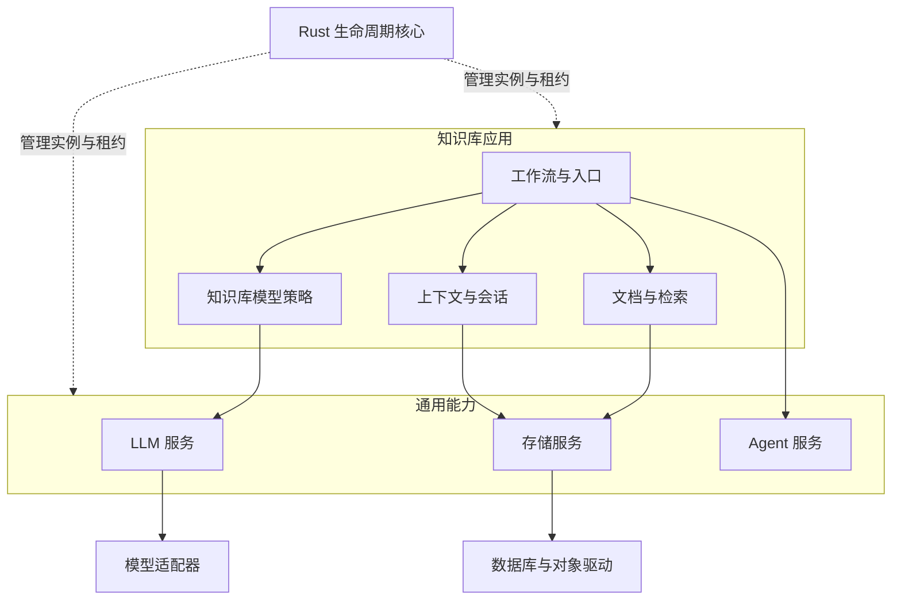

# 可独立运行的 Rust 底座与知识库应用

## 这次解决的架构问题

此前的分层主要约束文件依赖：已经有通用 Rust LLM crate，但 Python `ModelService` 仍自己维护路由、活跃调用数和清理状态；默认 `knowledge.model` 同时创建注册表、HTTP 客户端和知识库策略；`ApplicationStorage` 内置知识库、会话和预算表。继续增加适配器会在这些位置重复增加分支，通用服务也无法证明自己能脱离知识库运行。

当前默认应用明确拆成底座服务、领域适配器和应用工作流。模型路由状态由同一个 Rust `Registry<T>` 算法管理，Python 仅保存具体执行对象和资源清理函数。存储方法由 Rust operation catalog 描述，类型、参数、能力、读写效果与结果验证共用准备调用。大值使用一个与业务无关的 `contract_transfer` 算法；模型和存储是它的两个协议客户端。

## 四个层次

| 层 | 入口 | 职责 |
| --- | --- | --- |
| 生命周期核心 | `rust/plugin-runtime` | 实例、代次、依赖图、作用域、调用租约、配置更新、清理顺序 |
| 执行宿主 | `rust/plugin-host`、`agent-harness` | 进程监督、版本化消息、跨语言执行、公共服务分派 |
| 通用能力 | `agent-services`、`llm-service`、`storage-service` | Agent 执行机制、统一模型语义、统一存储合同；均不导入知识库 |
| 应用组合 | `config/applications/knowledge.json` | 知识库身份、权限、证据、索引、会话、上下文、问答与结果持久化 |

底座服务由 `foundation_services` 装配，独立入口是 `build_foundation_application`。应用声明需要哪些服务，配置选择实例和出口；实现是否使用 Rust、Python 或进程执行器不改变合同。提供者资源由其所在插件作用域持有，业务调用方不创建提供者客户端。



箭头表示服务消费关系。运行时只理解声明、身份和资源状态，不解释模型输出、知识库表或检索评分。

## 默认知识库的显式依赖

| 实例 | 实现 | 负责的内容 | 依赖 |
| --- | --- | --- | --- |
| storage | `foundation.storage` | 存储实例、具名出口、数据空间与通用访问 | 配置中的 Provider |
| authority | `knowledge.authority` | 知识库权威表的公开结构与统一数据身份 | storage |
| access | `knowledge.access` | 身份、权限、当前数据与发送许可 | authority |
| model_policy | `knowledge.model_policy` | 模型发送许可和 OCR 领域校验 | access |
| llm | `foundation.llm` | Rust 注册表、提供者资源、统一调用、物理账本接线 | storage；可选 `llm.policy` |
| model | `knowledge.model` | 结构化生成、应用与轮次预算、Embedding/OCR 领域视图 | llm、access |
| sessions | `knowledge.sessions` | 会话、revision、请求幂等与轮次状态 | storage |
| data | `knowledge.data` | 文档入库、索引、检索、原文和证据 | storage、authority、model |
| context | `knowledge.context` | 授权历史、证据与最终请求组装 | sessions、data、access |
| workflow | `knowledge.workflow` | 规划、检索、生成、核验和交付 | context、sessions、data、model、access |
| entry | `knowledge.entry` | 应用与文档操作入口 | workflow、access、data |

模型提供者文件移到 `plugins.llm.config`；`plugins.model.config` 只保留路由选择、上下文策略与应用预算。知识库表声明通过 `knowledge_storage_configuration` 显式注入通用存储，`ApplicationStorage` 不再认识 `repository`、`store` 等业务名字。独立应用可以使用自己的消费者、合同和结构化 schema。

`llm.policy` 是可选的通用依赖，只有知识库组合绑定知识库实现。授权与 validator 不会以 Python 函数穿过 JSON 边界；模型服务通过声明的 `admit`、`validate` 方法调用。公开 LLM 客户端只接受具名验证合同，无法等价投影的任意 Python callback 在发送前明确拒绝。提供者仍能在真正发送之前重新请求授权，并在保存结果缓存之前执行校验。

## 统一 LLM 调用算法

1. **声明与绑定。** 提供者声明能力和元数据；Rust 注册表产生不可重用的注册身份与代次。消费者固定该身份，不能在旧绑定下静默使用新端点。
2. **准备与准入。** Native SDK 与 Python executor 使用同一个 `Registry<T>`。准备对象只消费一次；准入再次检查服务、路由和代次，并取得真实的活跃执行所有权。
3. **执行一次。** 提供者适配最终 wire。调用的请求身份、真实次数、用量和 UNKNOWN 继续由原物理账本记录。协议层不会因传输失败换供应商或重发。
4. **完成与校验。** Rust 核验返回身份和规范化文本终态、usage；领域模型层执行 schema、引用与业务校验。只有完成 `settle(accept=true)` 后才写应用结果缓存。
5. **释放与清理。** 结果终态与资源释放是不同的事实。活跃调用排空后才能清理；清理失败保留资源身份供重试，不能直接删掉注册记录。

公开 JSON 合同 `llm.service/1` 提供 `catalog` 与 `exchange`。后者承载可生成的 operation schema：模型调用、completion、身份、缓存、审计、故障诊断、Embedding 恢复等，见 `config/contracts/knowledge-v1.json`。每次操作携带固定 `route` 和 `registration`。`LlmClient` 和 `LlmCompletionPort` 只做数据投影，不另建注册状态或费用账本。

内部类型 `model-service/1` 描述同步 Python adapter；原生协议 `llm-service/1` 描述 Rust SDK 和 executor 命令；`llm.service/1` 是跨插件 JSON 服务合同。三个版本号各自覆盖不同边界，有明确转换入口，不能混用。

原生 Rust SDK 提供有界异步流、七类事件、累计 usage 和准备调用。当前内置 Python HTTP/Luna adapter 的实际业务入口是同步 completion。该能力声明保持明确，未用同步文本拼出假的供应商 SSE。

## 统一存储调用算法

存储合同分为 relational、document、kv、vector、lexical、object 六类。能力扩展、持久性要求、数据空间和 dataset 身份均显式声明；提供者不能通过名字或数据库品牌自动获得能力。

Rust operation catalog 是方法语义的权威定义，包含参数绑定、调用通道、读写效果与返回类型。调用先产生 `PreparedOperation`，再执行一次具体驱动，最后按同一个操作描述验证结果。这让本地绑定、进程提供者和应用 JSON 入口共享准入和故障分类，不需要各自维护“写方法名单”。

类型值以有界事件流交给 Rust 验证。容器开始/结束、键、实际标量、文本及 bytes 分块共同维护校验栈和累计预算；不会把真实输入替换成 `0` 或空字符串来冒充校验。一次调用的临时状态会在完成、失败或取消时释放。

成熟驱动继续负责 SQLAlchemy 表达式、参数绑定、事务和后端资源。Rust 不复制 SQL 编译器。写入完成后的结果编码失败保留 `outcome=COMPLETED`；提交响应丢失保留原 `operation_id` 的 UNKNOWN，恢复只能查询该操作，不重新执行。

## 传输与故障事实

`contract_transfer` 为模型和存储共用的 JSON 分块引擎，使用大小、SHA-256、严格顺序偏移、单次 dispatch 和有界暂存。大值不会绕过单帧 4 MiB 的公共合同上限；未完成上传、完成下载、取消、到期和关闭都释放暂存资源。它不负责业务重试，也不替应用推断操作是否发生。

适配层依据未准入、已派发、已取得结果三个阶段统一投影错误事实，保留 `model_sent`、`physical_request_id`、`preflight_code`、`call_record`、usage 和累计 attempt。`request_id` 保持原合同含义；只有提供者明确观察到的物理身份才进入 `physical_request_id`，不能把逻辑 ID 改名冒充物理事实。结果解码、后置授权或最终分块发布失败仍属于已执行阶段，保留已观察用量；上传容量不足等派发前错误保持零发送。没有供应商 usage 不等于零消耗。已发请求丢失响应后，原账本仍保留预留；应用重启与重复请求不能绕过未决记录。

会话幂等、原文与发布版本、权限 revision、预算和插件代次分别保留一个权威 owner。通用调用 token 只表示执行与释放所有权，不是第二份账本、事务日志或会话记录。

## 如何验证可交付

独立底座示例及真实 wire 验收见 [验收说明](foundation-acceptance.md)。完整检查入口仍为：

```sh
uv run --no-sync python scripts/check_project.py
```

统一检查包括独立 Rust crate 测试、公开模型 JSON 边界、完整离线合同、跨语言进程插件、Rust 主宿主、受控本地 HTTP/S3 验收和原有评分器控制。受控验收使用合成文档与脚本化模型返回，明确记录实际本地 HTTP 请求数，不宣称外部模型质量或生产吞吐已验证。

其中关键判定是：只替换模型与存储配置，同一知识库消费者完成入库、发布、检索、带引用回答；重复请求不会再次发送，撤权后不能复用历史；HTTP 已收到请求但断连时保留 UNKNOWN 与预算；不导入知识库也能运行底座消费者。检查最终通过数以对应 PR 的统一报告和 CI 为准。
