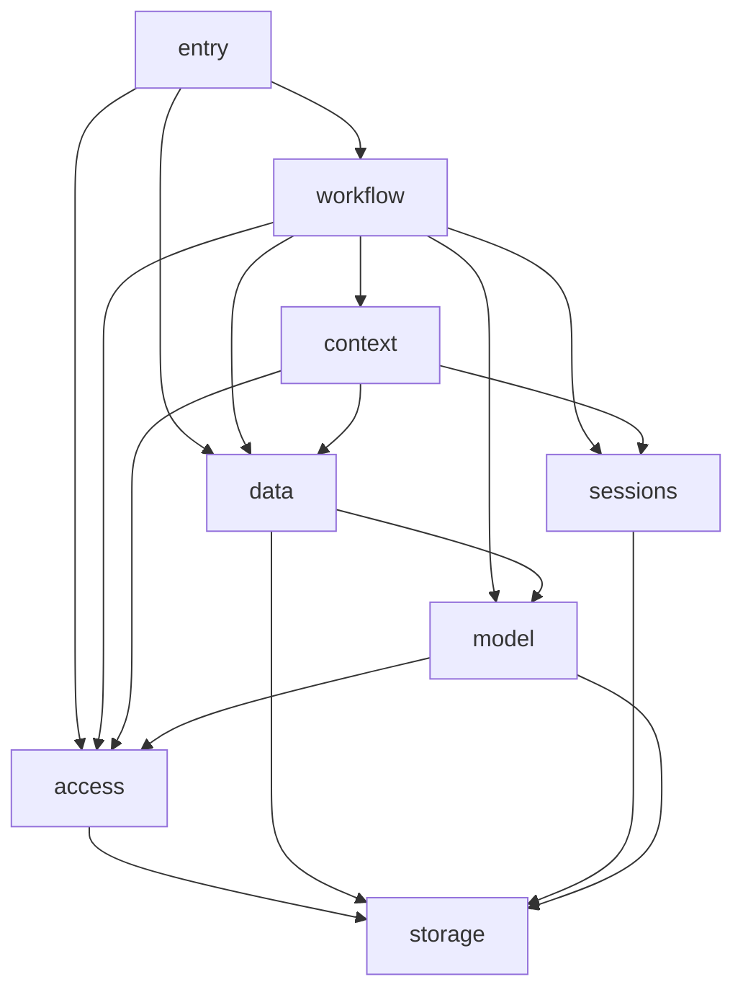

# 插件架构第四轮

Rust 拥有装配、依赖解析、实例身份、租约、取消和释放顺序。语言执行环境执行插件代码。插件之间以公开的版本化合同和 JSON 消息连接；配置负责选择实现、命名实例和绑定依赖。新配置和业务格式不提供历史兼容、字段回退或自动迁移。

## 插件格式与应用编排

插件定义包含 implementation、version、executor、provides 和 requires。process 执行器需要真实 command 参数数组；local 执行器由宿主注册对应实现，不填写 command。省略 executor 表示 process。local 表示代码在语言执行环境内运行，生命周期仍由 Rust 管理。

```json
{
  "implementation": "example.database",
  "version": "1",
  "executor": "process",
  "command": ["node", "database.mjs"],
  "provides": {
    "documents": {
      "id": "storage.document", "major": 1,
      "capabilities": ["revision", "batch"]
    }
  },
  "requires": {}
}
```

requires 的每个键是消费者的本地依赖名，值为所需合同。例如 `{"records":{"contract":{"id":"storage.document","major":1,"capabilities":["revision"]}}}`。它不指定提供商名称或编程语言。配置把 records 绑定到一个实例的具名出口：

```json
{
  "version": 1,
  "plugins": {
    "api": {"implementation": "example.http", "version": "1", "config": {}},
    "database": {"implementation": "example.database", "version": "1", "config": {}}
  },
  "bindings": {
    "api": {"records": {"plugin": "database", "export": "documents"}}
  },
  "entrypoint": {"plugin": "api", "export": "server"}
}
```

入口只需提供 application.run/v1。它负责启动应用行为，不递归创建依赖。Rust 根据 bindings 编译有向无环图，依赖先启动、消费者先释放。多个消费者可以共享一个提供者，因此完整应用通常是依赖图。每个依赖当前绑定一个出口；optional 允许不绑定，显式给出的错误绑定仍然拒绝。

插件版本精确匹配；合同按 ID、主版本和能力集合匹配。替换 database 的 implementation、version、config 即可选择另一个提供者；保留实例名和出口名时无需修改消费者绑定。不同出口名需修改 binding.export。相同协议允许多个实例共存。可替换的前提是实现满足方法、数据、能力和领域语义，相同 JSON 形状不足以证明业务行为等价。

## 通过部署配置替换外部插件

正式启动读取 `KB_APPLICATION_PROFILE` 指定的应用图，以及可选的 `KB_PLUGIN_CATALOG` 指定的可信外部插件目录。目录文件固定为 `{"version":1,"definitions":[...],"schemas":[...],"root":"."}`。definitions 使用上面的 process 插件格式；schemas 每项为 `{"implementation":"example.context.process","version":"1","schema":{...}}`，必须与定义逐项匹配。root 相对于目录文件所在目录解析，必须是已存在的工作目录；可执行程序和其他相对路径按该工作目录解释，裸程序名从 PATH 查找。

目录只能声明 process 实现，不允许 local、Python factory、任意导入或未知字段。所有命令、配置和合同在挂载前验证。它扩充当前公开合同的实现目录，不替换内置实现的代码注册。没有填写目录的默认应用仍只使用内置实现。

仓库提供可运行目录 `examples/contract-context/catalog.json`，把 example.context.process 指向同目录的 worker.py。这是会在最终模型上下文写入验收标记的示例实现。将 `config/applications/knowledge.json` 复制为 `.local/knowledge-external.json`，仅把 context 节点的 implementation 改为 example.context.process，保留版本、配置和绑定，然后在已初始化本地知识库环境中启动：

```bash
KB_APPLICATION_PROFILE=.local/knowledge-external.json \
KB_PLUGIN_CATALOG=examples/contract-context/catalog.json \
uv run uvicorn kb_platform.api:app --host 127.0.0.1 --port 58080
```

生产替换时，把目录中的 command 改为实际提供者程序，配置 Schema 使用发布的合同或该实现的明确配置。上述过程不需要添加 Python mount、factory 或编辑应用装配代码。KB_PLUGIN_CATALOG 用于新的对象形式应用图；指定旧文档工作台 profile 时明确报错，避免静默忽略目录。

## Rust 编译与调用边界

`plugin-runtime::composition` 的 `runtime_compose` 接受 application 和 catalog。主宿主管道及嵌入 ABI 使用同一入口。编译无外部效果：未知实现、重复版本、缺失或未声明绑定、未知出口、合同不符、错误入口和循环均在挂载前拒绝。

Plan.plugins 交给已有生命周期协调器；Plan.order 是启动顺序；Plan.bindings 和 Plan.exports 保存本地名字与实际服务身份的对应。内部 config 保存 configuration、bindings、command 和完整 declaration。执行命令或合同变化进入实例配置身份。内部实现键同时包含实例名、实现名和版本，避免替换实现时误认原实例。

`plugin_contracts.ContractApplication` 执行计划。`ContractContext.require/provide` 只接受声明的名字。`ContractApplication.call(instance, export, method, request)` 调用公开出口，run 调用配置入口的 run 方法。未注册的 local 实现直接失败；process 声明不能悄悄改成本地 mount。

方法与配置使用 JSON Schema 2020-12。配置、合同与所有绑定校验后才创建插件。每个方法接收一个 JSON 值并返回一个 JSON 值，禁止 Python 对象、tuple、非字符串对象键、NaN、无穷值和未声明方法。JSON 最大 4 MiB、嵌套最大 64 层，进程帧限制还包括协议信封。Schema 注册时复制并禁止外部引用，校验不会访问网络。

配置校验同样适用于 `host.update` 和 `host.apply`。生成的 PluginSpec 同时验证编译信封及插件自身 configuration；bindings、command 和 declaration 必须保持编译所得值，配置 Schema 的本地引用仍按原作用域解析。非法配置在卸载活动实例前拒绝，旧实例及其依赖继续提供服务。

`ContractError` 公开 code、message、status_code 和 details。跨进程保留这些字段；领域适配器恢复 PlatformError、模型或存储错误。调用账本等领域信息放在 details 中。未知实现异常使用通用错误，响应不能包含 Python 私有对象。

挂载期间可通过当前初始化动作的专用租约调用已经就绪的声明依赖，外部调用仍等待根作用域就绪。取消和截止时间继承父调用。stop 停止准入并请求取消活动调用；释放等待实际工作结束。同步本地函数须主动观察取消。无法协作退出的进程使用既有监督终止机制。

## 语言执行器

process 使用 `evidence-plugin-process/1` JSON-lines 协议，command 直接执行而不经过 shell。握手声明服务和方法并接收配置；invoke 携带执行身份、截止时间和单个 JSON 请求。进程可通过 call 消息访问声明依赖，由父执行器解析提供者并继承租约。未声明别名、私有方法和不存在的父调用均被拒绝。

`kb_platform.contract_worker` 是整个应用的执行环境入口，使用 `plugin-host/1` 监督协议。boot 文档包含 application、catalog、contracts、schemas、request、root；不接受 Python factory，所选插件都必须能作为 process 启动。它不是单个内置知识库插件的启动命令。

`plugin_host::process_plugin` 提供 Rust 提供者 SDK：Plugin trait、CallContext 和 serve。它支持握手、配置、并发请求、结构化错误、取消和排空关闭，校验重复请求及实例代次。长任务通过 CallContext.check 检查取消与截止时间。Rust SDK 当前封装提供者侧；Rust 消费者依赖回调需要实现相同公开消息协议。

`rust/plugin-host/examples/contract_provider.rs` 是实际 Rust 提供者。`examples/contract-application/` 包含 Python、Node 消费者和 Python 提供者。统一检查构建并复制本次 Rust 示例二进制，再执行跨进程合同验收，二进制缺失不会跳过该检查。

## 知识库的八个业务插件

应用配置为 `config/applications/knowledge.json`，可信目录位于 `knowledge_capabilities.CATALOG`。内置实现声明 executor=local；外部替换实现声明 executor=process 并提供对应方法合同。

| 实例 | 拥有的职责 | 公开依赖 |
| --- | --- | --- |
| entry | 统一应用与文档操作入口 | workflow、access、data.platform |
| workflow | 知识库工作流、轮次与工具调度 | context、sessions、data、model、access |
| context | 获取授权历史和证据，组装最终模型上下文 | sessions、data、access |
| sessions | 会话、完整历史、轮次状态与产物 | storage |
| access | 身份认证、知识库权限和发送前授权 | storage.authority |
| model | 生成、Embedding、OCR、预算及提供商适配 | storage、access |
| data | 原文、文档管理、索引、检索和证据操作 | storage、storage.authority、model |
| storage | 关系、对象、搜索存储和数据空间 | 无业务插件依赖 |



context 决定本次模型看到什么：读取会话完整历史并校验 revision，通过知识库合同重新校验来源和授权，输出 prepared 请求和证据。会话持久化和知识库内容分别由各自领域拥有，context 不读它们的私有表。模型之前的最终裁剪与来源绑定继续使用现有上下文实现。

插件内部可包含策略、索引分支、工具包装和资源适配器，这些不是额外的用户插件。内置工作流使用 Rust graph driver 推进状态；外部工作流可通过公开业务合同提供相同行为，无需复制这个内部类。

公共合同位于 `knowledge_contracts.py`、`knowledge_context.py`、`knowledge_platform_contract.py` 和 `knowledge_model_ports.py`。Python 客户端将 Actor 等领域值转成 JSON 并恢复公开错误。模型验证和检索的分阶段处理使用有界请求令牌传递状态，不传递 Python 回调、迭代器或数据库连接。

其他语言可直接读取 `config/contracts/knowledge-v1.json`：它发布完整内置目录、版本化方法请求/响应 Schema、插件配置 Schema 和错误格式，无需导入 Python。共享权限存储合同另包含不绑定具体 owner 的 dataset_schema。`uv run --no-sync python scripts/generate_application_contracts.py` 从实际声明重新生成，`--check` 检查是否过期；统一合同测试也校验该文件与运行代码一致。

模型元数据和上下文 prepared 响应声明消费者必需的字段、消息结构、策略、预算及估计值。会话 state、提供者 capabilities/manifest、checkpoint 和证据扩展元数据保留开放对象，按相应领域语义解释；这些字段没有被宣称为完全封闭的通用数据模型。权限数据集另有公开结构与事务规则，提供者的 schema revision 是不透明标识，客户端匹配结构后使用提供者给出的值。

文档上传的解析结果可以大于原文件。`ingest_finish` 对小结果返回 result，对大结果返回带大小和 SHA-256 的 transfer；客户端通过 `ingest_result_chunk` 取回完整结果，因此 HTTP 响应仍包含完整 document。结果传输失败不会自动重放已执行的入库。票据绑定上传者和来源版本，每块交付前重新检查写权限及当前活动绑定。

原件下载先通过 `read_original_begin` 读取并校验一次原件，建立绑定 actor、知识库、引用、用途、来源版本和内容摘要的快照。后续 `read_original_chunk` 只读取下一块，并通过轻量权限查询重新检查访问权限及来源身份；不会为每块重新读取整份原件或解析文档。权限撤销、版本变化、完成、取消、过期和服务关闭都会停止或清理相应传输。单个快照最多 64 MiB，最多 16 个票据、总保留容量 256 MiB，发布后的有效期为 300 秒；开始业务写入前先预留结果容量。每个方法消息继续遵守 4 MiB 上限。

模型轮次预算通过生产 StructuredModel 包装层公开读取，查询持有当前模型注册的租约；被撤销的绑定不能继续读取旧快照。缺失提供者用量时保留 UNKNOWN 计费预留，durable replay 不新增物理请求或预算消耗。

## 存储与切换后清空

存储也是普通依赖，PluginSpec 不再接受 storage_slots。内部存储适配器用 requires 中的 StorageSlot 描述接口；未编译的类型化需求不能直接挂载。业务层调用 storage.service/v1；关系表达式、事务、对象分块和搜索操作有公开 JSON 编码，连接和方言留在提供者内部。

编码、事务与对象传输规则见 [存储线协议](storage-wire.md)；空空间初始化及失败处理见 [业务数据重置](storage-reset.md)。

data 与 access 通过明确的 knowledge.authority.storage/v1 出口共享知识库权限数据，而非约定一个未公开的表集合。合同发布完整数据结构；客户端核对结构和数据空间身份。内置 data/access 必须绑定同一个 authority 出口，分离的配置在挂载前拒绝。该出口仍属于 storage 插件，不增加用户节点，详情见 [知识库权限存储合同](knowledge-authority-storage.md)。

切换提供商不迁移旧业务数据。`python -m kb_platform.storage_reset --input <现配置> --output <新配置>` 为知识库、会话、上下文和缓存创建空数据空间，输出必须是新文件。启用新配置后业务看到空数据。旧数据不会作为回退来源，也不会因连接或解析失败自动删除。

预算/计费账本、身份和显式外部数据空间保留，重置不能丢弃已经产生的费用或未知请求。未知消费者必须显式指定角色。重置协调知识库、索引和会话的空间身份，不承诺跨提供商事务；初始化失败不发布新配置，已经创建的空空间可能需要清理。此行为不是旧数据迁移。

## 验证与适用范围

统一入口为 `uv run --no-sync python scripts/check_project.py`。框架合同覆盖配置零效果拒绝、能力匹配、同合同多实例、替换身份、公开出口、JSON/Schema 边界、错误保真、挂载依赖调用和取消清理。Rust SDK 覆盖协议、重复请求、实例代次、取消身份、截止时间和关闭。

跨语言验收执行 Python 消费者调用本地和 Rust 提供者，并验证 Rust 503 领域错误经过依赖回调返回消费者后保持 code/status/details。Node 可通过进程验收的 `--plugin-node` 执行同一组检查。验收检查依赖调用记录、租约及子进程退出。这证明协议与执行机制可替换，不代表任意第三方实现已经通过知识库领域验收，也不代表真实模型质量或生产性能。这些受控检查新增的外部模型、Embedding 和裁判调用数均为零，合成模型调用单独记录。

实际存储进程验收通过 storage.service/v1 执行 SessionStore 的创建、轮次、事件、产物、重放和互斥守卫，并运行知识库入库、构建、发布、检索、跨租户隔离、引用撤权及过期任务 UNKNOWN 合同。此处存储在独立 Python 子进程，客户端无法访问提供者的连接对象。

大值回归覆盖超过 4 MiB 的会话产物跨独立存储进程写入和读取，以及 100 KB TXT 生成超过 4 MiB 解析结果后的 HTTP 上传、构建、发布、搜索和原件下载。失败路径覆盖容量限制、传输过期、偏移与摘要校验、权限撤销和响应丢失；检查不通过调高单帧限制、查询预算或超时来接受大值。

实际知识库验收把八节点应用的 context 替换为独立 Python 进程。该实现通过公开 sessions/data/access 回调主动获取历史和证据；完整入库、发布、检索、回答与重复轮次重放保持原文引用。四次受控模型请求都能观察到替换上下文写入的标记，证明实际请求使用了替换节点，而非仅检查配置或元数据。

当前 catalog 是可信代码清单，不包含插件市场、签名分发或恶意代码沙箱。原生动态库、Wasm 和 TypeScript 原样执行没有独立适配器；能提供兼容可执行程序和协议消息的语言可使用 process 执行器。
