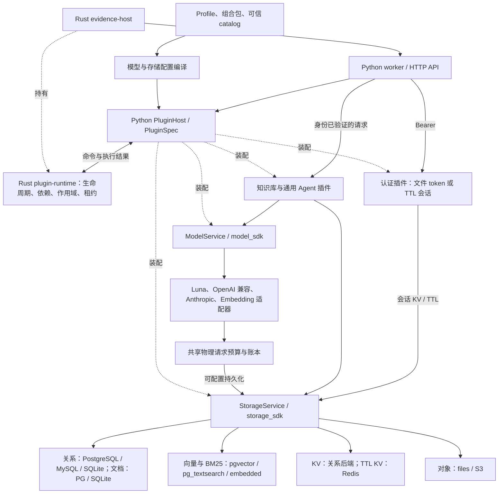

# 当前插件架构

以下是当前代码的装配和调用边界。实线表示调用或启动，虚线表示装配与所有权。

Rust 独占生命周期状态，Python 保存业务对象并执行挂载、调用、清理效果。Rust `agent-harness` 另负责 loop/graph 推进，`agent-kernel` 管理单次运行状态；它们不会形成第二套插件生命周期。

所有 Python 插件均使用 `PluginSpec`，包含 `key`、`provides`、`requires`、`mount`，并按需声明配置 Schema、存储槽位及配置依赖。`evidence-plugin/1` 是插件接口版本，`version` 是具体实现版本。进程插件通过 manifest 编译为同一 `PluginSpec`，保留独立的进程通信协议。

配置先展开为可信目录内的插件和依赖，再由公共校验与 Rust 宿主准入。服务校验器在每个新代次发布前执行，覆盖启动、配置更新、profile 替换和子作用域。协议错误不会延迟到业务首次请求才发现。结构准入不证明插件的所有行为正确，结果身份、权限、事务和释放状态仍在调用边界验证。

模型提供商实现 `model-service/1` 的 `info + invoke`。业务通过公共模型服务调用；结构化回答复用 `AgentModel`。供应商 SDK、HTTP 和认证留在适配器，物理请求预算保留唯一实现。`completion_port` 仅作为需要保留缓存和重试行为的扩展。

存储按六类能力合同绑定，不按数据库品牌猜能力。业务拥有领域 Schema、授权和事务规则，驱动负责执行与隔离。认证会话使用 TTL KV；对话历史使用关系合同，继续保留 revision、幂等和单写者规则，两者不混用。

内置插件与出口明细见 [插件目录](plugin-catalog.md)，编写约定见 [插件运行时](plugin-runtime.md)，模型与存储接口见 [模型服务](model-services.md)、[存储协议](storage-plugins-design.md)，认证配置见 [认证会话](authentication.md)。

Milvus、Elasticsearch、OpenSearch 尚无内置适配器；模型接口仍为同步 v1，未实现 DSH 流式协议和原生工具调用。文件认证是启动快照；Redis 认证支持每次请求读取、到期与撤销。
