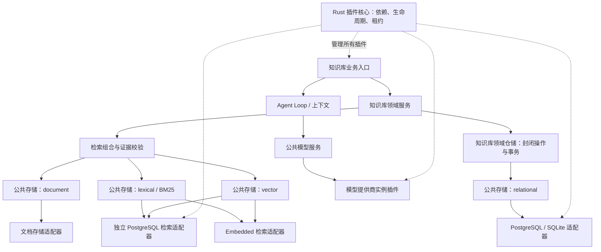

# 插件边界第三轮改造

本轮保留现有 Agent Loop、上下文、检索通道和业务入口，只拆除已经存在的跨层依赖。Rust 继续负责插件依赖合法性、生命周期和租约；不增加第二套插件管理器。公共模型与存储服务保持可选，第三方插件仍可自行组合服务。

## 边界与选择

知识库仓储采用一个封闭的领域操作集合，业务只提交操作及参数，在已有事务中组合授权、写入和发布。SQL、JSON 编解码、数据库时钟和锁归仓储私有实现。操作不是插件，不增加查询 DSL。Embedding 任务同样通过该边界，保留原有请求身份、租约、UNKNOWN 和重试规则。

另一条完整方案是将 ingest、publish、evidence snapshot 等整段业务搬入深层 Repository。它能隐藏更多细节，但同时移动当前集中维护的授权和发布策略，增加跨阶段类型。本轮选择保留策略所有者，避免为了数据库切换重写业务层。两份独立候选均支持该选择；评审使用当前可用的同系列模型，并非跨模型系列评审。

模型配置在启动前展开为普通 Rust 插件节点。公共服务只持有注册表，一个配置的提供商实例拥有其客户端和路由注册。预算继续使用现有单一账本。消费方通过真实依赖等待对应提供商，卸载先排空租约再关闭资源。

PostgreSQL 的通用 lexical/vector 出口直接存储通用记录和 metadata，使用独立检索 schema，不创建知识库成员、原文、引用或任务表。两种出口分别检查自己的扩展。原有知识库专用 PostgreSQL 搜索入口属于领域实现，不能据此宣称它已经成为通用数据库适配器。

## 迁移与支持边界

现有 PostgreSQL Migration 1 的三个 statement 和运行时授权策略必须保持不变，其 digest 为 `c65c97d6918c75a741647e87131df806f71aa22ccb70d4ba3662f75dd9a91235`。旧知识库 PG schema 暂保留历史搜索对象与初始化依赖；新通用检索使用独立空间。禁止改写迁移记录或自动选择另一条迁移链。

本轮先实现并实际验证 SQLite、PostgreSQL 知识库业务。MySQL 已有通用 SQL/KV 能力，但未通过相同知识库业务验收前不声明支持知识库仓储。修改绑定不等于搬迁既有数据。已有 dataset_id、证据身份、索引 seal 和权限仍需逐项核验。

## 验收

统一入口为 `uv run --no-sync python scripts/check_project.py`，合同仍在 `kb_platform/rag_testing/*_contracts.py`。新增行为包括真实 SQLite/PG 的创建、摄取、构建、发布、检索、引用、重启、拒绝越权及任务恢复；混用 BM25/dense/document 后端；模型提供商依赖、关闭与预算不变；通用 PG 检索空间中不存在知识库业务表。

使用新的唯一输出目录，保留此前验收产物，不发起付费模型、Embedding 或裁判请求。真实后端、HTTP、浏览器结果与离线合同分别报告。清理仅限本轮拥有的测试资源。
