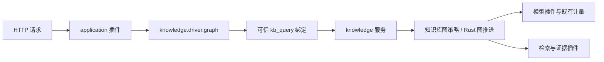

# Rust 插件宿主与 Agent loop

模型能力与配置见 [模型服务](model-services.md)。共享注册表服从本页的 Rust 生命周期和租约约束。

`rust/plugin-runtime` 是根应用的唯一生命周期权威。来源基线、运行状态和行为差异见 [Rust 插件运行时](plugin-runtime.md)。Python 保存业务对象并执行 Rust 派发的动作，既有算法和物理请求账本继续复用。

默认入口现为 [Rust 主宿主](rust-main-host.md) `evidence-host`，由 `config/host-profiles/` 选择语言执行环境与应用工厂。下述应用/Agent profile 决定业务插件组合。

## 当前边界

| 实现 | 拥有的职责 |
| --- | --- |
| `rust/plugin-runtime` | 实例、代次、服务注册、依赖、作用域、配置应用、运行租约、资源与清理结果 |
| `rust/plugin-host` | 执行环境进程监督、协议传输、启动与关停期限 |
| `rust/agent-harness` | 通用 loop、图节点推进与效果序号 |
| `rust/agent-kernel` | 每次运行的操作准入、结果关联、截止时间、取消、终态；导出内嵌 C ABI 与 JSON 协议 |
| `plugin_native.py` | 主宿主管道调用，或直接嵌入模式的 C ABI 编解码与内存释放 |
| `plugin_host.py` | Python 服务实现、装配上下文、事件监听、资源释放回调 |
| `harness_services.py` / `harness_profile.py` | 通用服务 catalog，以及显式启用的持久 Agent 组合 |
| `plugin_profiles.py` | 显式组合包展开与条目覆盖，不挂载服务 |
| `session_store.py` / `knowledge_sessions.py` | 通用 SQLite 事务 / 知识库状态适配 |
| `application_composition.py` / `platform_plugins.py` | 根 profile、API、delivery、运维入口与基础设施 catalog |
| `knowledge_profile.py` | 知识库插件 catalog、配置读取与环境变量适配 |
| `knowledge_application.py` | 知识库应用 API 和绑定身份/请求控制的 `kb_query` |

Rust loop 请求执行效果，Python 适配器提供模型调用、工具执行、会话读写和提示词组装结果。提供者、数据库、证据内容及其权限规则继续在现有 Python 边界内运行。没有在 Rust loop 中硬编码检索、生成、核验等知识库阶段。

插件代码必须可信。profile allowlist 和作用域不构成恶意代码安全沙箱。独立进程 transport、动作身份和错误规则见 [Rust 插件运行时](plugin-runtime.md)。当前不提供 TypeScript 插件原样兼容、原生动态库热卸载或 Wasm。
## 根 profile 与默认知识库组合

`api.create_app()`、`delivery.create_delivery_app()` 和需要 Platform 的运维入口调用 `application_composition.py`。API 的 `app.state.root_plugins` 和 `app.state.agent_plugins` 指向同一个宿主。

| 根 profile | 配置文件 | 启动能力 |
| --- | --- | --- |
| native | `config/application-profiles/native.json` | 原生执行服务，HTTP 仅挂载健康检查 |
| bm25 | `config/application-profiles/bm25.json` | 原件、解析、事务、搜索、索引恢复服务和 Platform |
| knowledge | `config/application-profiles/knowledge.json` | 基础设施、模型、上下文、持久会话、工具与知识库 workflow |

`KB_APPLICATION_PROFILE` 选择根 profile。未指定时，`KB_REMOTE_MODELS=1` 且有 generation 路由时选择 knowledge，其余情况选择 bm25。单独配置 Embedding、OCR 或两者时，不创建知识库 Agent。`KB_AGENT_PROFILE` 选择根组合中的知识库子组合。


`KB_AGENT_PROFILE` 默认指向 `config/agent-profiles/knowledge.json`，由它选择 `config/agent-bundles/knowledge.json`。组合包先展开，再检查依赖；覆盖语义及独立通用 Agent 示例见 [Agent 组合包](agent-bundles.md)。展开后配置的每个条目包含 `id`、catalog 键 `use` 和可选 `config`；`disabled: true` 停用该实例。默认静态启动要求依赖完整，动态模式保留缺依赖实例为 Pending。重复服务、循环依赖和隐式覆盖在执行前拒绝。

默认组合如下：

| Plugin key | 提供的服务 |
| --- | --- |
| `knowledge.resources` | `knowledge.platform`、`knowledge.research`，借用应用已有资源 |
| `models.service` | `models`，共享路由注册表 |
| `models.route.generation` / `models.route.embedding` | 独立路由及启动依赖标识 |
| `platform.embedding.client` / `platform.ocr.client` | 保留原提供者 manifest 的模型能力视图 |
| `knowledge.context.policy` / `knowledge.context` | `knowledge.context.policy` / `knowledge.context` |
| `knowledge.budget` / `knowledge.model.route` | 逻辑预算与已绑定 generation 路由的模型 |
| `harness.store.sqlite` | `session.store`，通用 SQLite 会话事务 |
| `knowledge.sessions` | `knowledge.store`，注入上述事务服务的 KnowledgeSessions |
| `knowledge.reranker` / `knowledge.gateway` / `knowledge.executor` | 共享模型重排、授权证据访问和工具执行 |
| `knowledge.tools.catalog` | 显式 `knowledge.tool_plugins` 目录 |
| `knowledge.semantic` | `knowledge.semantic`，未配置时显式为 None |
| `harness.runtime` | `runtime` |
| `knowledge.workflow.graph` | `knowledge.workflow`，知识库图策略工厂 |
| `knowledge.driver.graph` | `loop`，直接进入知识库图流程 |
| `knowledge.service` / `knowledge.tools` | `knowledge` / `knowledge.tools` |
| `knowledge.application` | `application` |

现有 `KB_AGENT_*` 预算、上下文和存储环境变量仍可覆盖相应内置插件的配置；`KB_SEMANTIC_PAGE_CONFIG` 选择现有语义页配置。私有提供者配置仍由已有配置文件承载，不把密钥写入公开 profile。



默认图驱动不再创建外层 single-tool loop 和临时会话。该路径保留原始 actor、session、request ID、expected revision、来源策略和用户约束；工具参数只有问题。它不增加外层模型规划请求，不改写已经核验的答案，原响应和 trace 原样返回。`harness.loop.model-tools` 则适用于需要模型反复选择工具的普通 Agent，并显式依赖 `model` 和 `prompt` 服务；内置 `harness.model.callable`、`harness.prompt.history` 分别提供其适配器。single-tool 不需要额外 prompt 插件。

`harness.sessions.memory` 用于轻量单工具入口，每次 loop 结束后释放；它不是默认知识库的会话服务。显式启用的 `core` 组合使用 `harness.sessions.durable`，支持历史恢复与请求幂等。两类应用都复用 `session_store.SessionStore` 的 SQLite 事务，知识库状态规则由 `KnowledgeSessions` 适配。提供者账本继续唯一负责物理请求、费用预留与 UNKNOWN。

## 增加一个服务插件

下面的示例只执行本地计算，展示 profile 选择、依赖注入和卸载清理。真实连接、文件句柄等资源同样通过 `ctx.defer()` 注册释放。

```python
from kb_platform.plugin_host import PluginHost, PluginSpec

class Greeting:
    def __init__(self, prefix):
        self.prefix = prefix

    def say(self, name):
        return f'{self.prefix}, {name}'

def mount_greeting(ctx, config):
    ctx.provide('greeting', Greeting(config['prefix']))

def mount_application(ctx, config):
    ctx.provide('application', ctx.require('greeting'))

catalog = [
    PluginSpec('example.greeting', ('greeting',), (), mount_greeting),
    PluginSpec('example.application', ('application',), ('greeting',), mount_application),
]
profile = {'version': 1, 'plugins': [
    {'id': 'greeting', 'use': 'example.greeting', 'config': {'prefix': 'Hello'}},
    {'id': 'application', 'use': 'example.application'},
]}

with PluginHost(profile, catalog) as host:
    print(host.call('application', 'say', 'Ada'))
```

`ctx.require()` 只允许读取声明的依赖。`ctx.provide()` 必须与声明的输出完全一致。`host.service()` 供装配时解析，处理业务请求使用 `host.call()`，或保存 `host.bind()` 返回的注册身份绑定并调用其 `call()`。旧绑定在替换后拒绝执行。API 的 HostedPlatform 对公开操作取得调用租约。

接入知识库时可以用 `create_knowledge_application(..., profile=profile, extra_plugins=[...])` 扩展可信 catalog，并把相应配置条目的 `use` 改成新实现。新实现提供相同服务接口，消费者不需要修改。增加模型或其他会产生费用的实现时，仍必须接入原有准入与物理账本，不能把配置替换当作新增付费执行授权。

## 作用域、事件和关闭

`host.scope(profile)` 创建 child。child 可以借用父服务；若要覆盖，条目需要显式声明 `overrides: ["服务名"]`。关闭 child 只清理它拥有的插件及其后代，不释放父作用域的借用资源。关闭 parent 会排空并关闭它拥有的 child 子树。

服务在挂载时绑定依赖。child 覆盖 `model` 或 `tools` 后，需要在 child 同时挂载自己的 loop，并显式声明 `overrides: ["loop"]`。直接继承父 loop 会继续使用父 loop 已绑定的服务，不会自动重新构造它。

插件可通过 `ctx.on(EventName.TOOL_BEFORE, callback)` 等固定事件观察运行、模型和工具阶段。事件载荷是只读快照；监听器不是第二套会话持久化或物理请求账本。插件卸载时清理其监听器及服务注册。

观察者的普通异常会产生告警并继续分发，不改变已经完成的工具或业务结果。需要拒绝执行或改变请求的策略应放进明确的服务接口及准入守卫。

事件分发与服务调用一样持有运行租约，直到所有监听器结束；子作用域的事件也保护其借用的父级监听器资源。关闭不能在监听器仍执行时释放资源。同线程的已准入嵌套调用可以在 drain 后收尾，但把 ContextVar 复制到新线程不构成新线程的准入凭证。挂载尚未完成、已排空或已关闭的宿主拒绝新的事件分发。

Rust 串行协调注册、发布和移除服务元数据。执行业务、监听器和资源释放回调时不持有 Rust 状态锁或 Python 对象表锁。清理回调仍可通过 `ctx.require()` 查找尚未释放的声明依赖；`service()` 返回原始实现用于装配和清理，不是请求准入接口。Rust 在创建作用域时建立服务归属索引，服务覆盖、激活及逆序清理规则不变。

`host.drain()` 拒绝新调用，已有租约可以结束。`host.close()` 排空所属子树，只有活动租约全部释放才执行资源清理；仍忙碌时返回错误，调用者应等待已有请求结束后再次关闭。它不取消或重试业务请求。清理按启动相反顺序执行，失败会保留未完成资源以便再次清理，不报告成功卸载。

启动过程中失败也会清理已经登记的效果。插件只能释放自己创建的资源；共享研究客户端和父级服务由原拥有者关闭。同步 Python 效果仍为协作取消，截止时间不能撤回已经发送的远端请求。

## 构建与验证

```powershell
cargo fetch --locked
cargo build --locked --offline
uv run --no-sync python scripts/check_project.py
```

原生库缺失或协议不匹配时明确失败，不自动回退 Python loop。统一入口覆盖 Rust 状态/协议测试、Python 插件组合合同和既有 RAG 权限、预算、引用合同；必要合同位于 `kb_platform/rag_testing/*_contracts.py`。

此次生命周期加固、兼容性回归及同负载性能记录见 [插件工程验收](plugin-engineering-acceptance.md)。它只覆盖当前产品使用的插件组合，没有增加多 Agent 或沙箱插件。

`default_path_replay.py --service` 使用真实 profile/原生图流程、已注册路由函数与请求模型，保留现有冻结原文、问题、上下文预算和最终消息绑定；仅模型及存储/检索传输使用合成夹具。它不启动 HTTP 服务或执行身份认证中间件，继续交给统一 runner/scorer，不新增远端调用。这些结果证明组件行为，不能作为线上模型质量或延迟成绩。


## 显式端口与更新

Platform 接收 repository、search、store、parser、embedding jobs 和模型能力。KnowledgeService 接收存储、gateway、context、runtime、workflow、工具执行器及检索配置，不创建隐式默认实例。业务资源归属与关闭规则见 [业务插件](business-plugins.md)。

`host.apply(profile)` 先验证完整配置，再排空和更新受影响实例。`host.update(plugin_id, config=config)` 更新单个实例。状态保留 desired revision、observed revision、操作状态与失败原因。开始清理或执行外部动作后不承诺完整回滚。

内置 catalog 的 `PluginSpec.config_schema` 拒绝未知字段，并校验必填项、类型、枚举和范围。`config_check` 使用 ContextBudget、ContextPolicy 和 PipelineConfig 的纯值校验处理跨字段条件。两项检查都在 Rust 执行变更前完成。验证不创建存储、连接池或提供者客户端。`plugin_configuration.configured_plugins()` 对没有配置项的插件设置严格空对象 Schema，新增配置字段必须在 catalog 中声明。

模型和语义页的引用配置也在变更前读取和校验。激活路径复用同一解析函数，检查端点、能力、预算、预留、维度、提供者配置和已有账本的固定 caps。`config_inputs` 把实际消费的配置文件与 Vertex 凭据文件绑定到原始字节 SHA-256，模型配置引用的 API key 环境变量以 `env:变量名` 绑定值的 SHA-256。同路径内容或凭据值变化会触发对应实例及消费者更新。Rust 状态只保存输入名称与哈希，挂载前再次核对，不保存原始凭据。

`host.drain()` 停止普通新准入，`host.close()` 申请移除。Rust 等待已有工作终结后才派发清理。清理失败保留失败资源及所需依赖，显式重试只继续未完成项。同步 Python 函数收到取消通知时仍可能运行，资源须等函数实际结束后释放。

模型子路由使用 `ctx.identity`、`ctx.registration_id('model_route')` 和 `ctx.lease()` 绑定 Rust 身份。撤销一条路由只使其旧绑定失效。`KB_MODELS_CONFIG` 的配置路由由模型服务加载后公开，现有提供者路径则使用独立 generation 和 embedding 路由插件。
