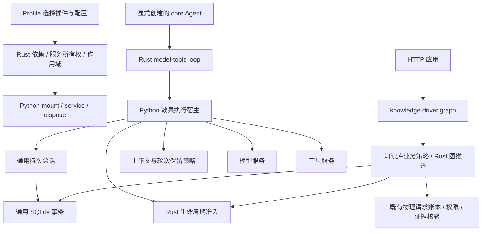
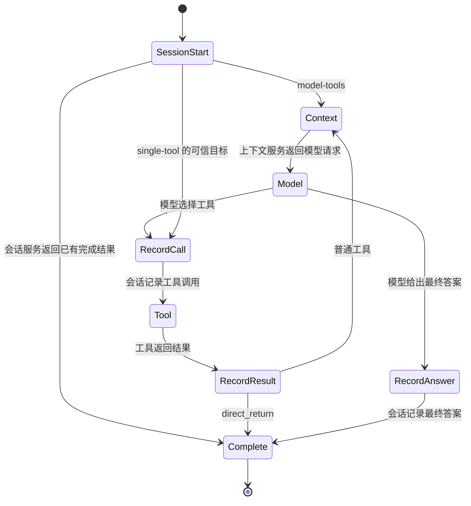

# Rust 插件宿主与通用 Agent loop

## 当前实现与边界

项目参考 Codex 的任务生命周期和 DSH 的服务、作用域与插件组合方式，自行实现 Rust 内核，没有依赖这两个项目的运行时。

`plugin-runtime` 独占插件生命周期、代次、依赖、租约、配置应用和资源清理。`agent-kernel` 负责单次运行的操作准入、结果关联、取消、截止时间与终态；`agent-harness` 保留通用 Agent loop 和图节点推进，并转发生命周期协议。图的业务路由选择由 Python 策略提供，Rust 检查已声明边与效果关联。Python 实现模型、工具、会话和上下文服务，并执行原生动作。公开状态和 SDK 见 [插件运行时](plugin-runtime.md)。

通用层不导入知识库代码。默认 HTTP 应用由 profile 的 knowledge 组合装配，由 `knowledge.driver.graph` 直接进入 `kb_query` 所绑定的知识库图流程，不再套外层 single-tool loop；知识库服务内部保留检索、生成、核验、修复和现有费用账本。通用 `model-tools` loop 支持模型选择工具，不需要安装知识库插件。

这是可以独立运行协议服务的 Rust 插件内核，不是完整的交互式 DSH 替代品。模型 HTTP 客户端、Python 工具执行、持久知识库会话、终端 UI、第三方插件下载和进程沙箱没有因此迁入 Rust。原生 CLI 不会替调用者执行模型或工具效果。



## 对照 DSH 的插件化

| 能力 | 本项目的机制 |
| --- | --- |
| 描述与依赖 | `PluginSpec` 声明 `provides`、`requires`；Rust 检查缺失服务、重复注册、循环依赖并返回启动顺序 |
| 配置装配 | profile 显式展开 bundle，`use` 从 catalog 选择实现；没有动态 import 字符串或任意代码求值 |
| 服务注入 | `require()` 只能读取声明的依赖；`provide()` 必须满足声明的输出 |
| 作用域 | 子宿主继承父服务；覆盖必须显式声明；父作用域停用后子调用也不能再获得准入 |
| 资源生命周期 | `defer()` 登记清理；反向释放；有调用或子作用域时不能假装卸载完成 |
| 观察事件 | `EventName` 定义运行、模型、工具事件；观察者收到不可变元数据，不能篡改工具参数或预算决定 |
| loop 与图策略 | Rust `LoopProgram` 支持通用循环；`GraphProgram` 把可信节点和路由接到 Rust 图协议，profile 选择驱动及领域策略 |

事件同时提供观察通知和显式 waterfall 中间件，分发顺序及错误合同见 [插件运行时](plugin-runtime.md)。scope 表达服务可见性和资源归属，不是恶意代码安全沙箱。更新先排空受影响子图、等待实际终结，再清理并激活新代次。原生代码仍为静态构建，外部插件使用独立进程 transport；不提供原生动态库热卸载。

## 最小 loop 与服务所有权

Rust loop 只保存阶段、待处理效果、一次模型请求的上下文快照、计数和最终结果。它不保存第二份完整消息历史，也不调用业务代码。



服务效果为 `session.start`、`context.prepare`、`decide`、`session.append` 和工具名称。每个效果只有一个递增 `effect_id`。必须接受当前结果后才能取下一项；重复取出、错序接受或无效模型决策会关闭原生 loop，不能隐式重发。

`session.start` 返回 `{}` 时继续，返回 `{"cached": value}` 时直接完成，包括合法的 `null`。是否允许复用由会话服务决定，Rust 不自行判断缓存或权限。会话插件唯一持有消息历史；持久化与幂等由注入的 `session.store` 事务实现。显式 core 组合通过 `harness.sessions.durable` 恢复持久历史；旧轻量入口的内存会话只保留本轮消息。两者均不会自动重试中断的远端操作。

`single-tool` 作为兼容策略保留，工具名和参数由可信调用者显式绑定，不请求模型或上下文效果。默认知识库已使用直接图驱动；`kb_query` 的直接交付合同仍保留。

## 图推进边界

`harness_graph.GraphProgram` 提供节点执行函数、声明路由与初始节点；Rust `graph_create/graph_next/graph_accept/graph_close` 管理当前节点及效果序号。Python 执行节点并选择一个声明的路由标签，Rust 验证关联后推进。业务状态与回调留在 Python，不经 JSON 复制到 Rust。知识库的规划、工具、生成、核验、修复与交付顺序保留原规则。

`Runtime` 在每个操作前后执行生命周期检查，并在退出时关闭图句柄。图错误不触发自动重发。当前图是顺序执行的有向流程，允许声明回边；没有并行节点调度、多 Agent spawn 或持久图断点恢复。此处的图推进能力不表示任意现成图框架插件都能直接加载。

## 模块与调用方式

| 模块 | 职责 |
| --- | --- |
| `rust/agent-kernel` | 生命周期状态机及 C ABI；链接 harness 的 JSON 桥接 |
| `rust/agent-harness` | 插件、作用域、依赖检查、loop/graph 推进和 JSON 命令协议 |
| `plugin_native.py` | JSON 与原生动态库间的薄适配器 |
| `plugin_host.py` | Python 装配、服务实例、观察事件和资源清理 |
| `harness_loop.py` | 取出 Rust 指令，通过注入服务执行，再回交结果 |
| `harness_services.py` / `harness_profile.py` | 内置服务 catalog 与显式 core 应用装配 |
| `harness_sessions.py` / `session_store.py` | 通用会话策略与 SQLite 事务 |
| `harness_context.py` / `harness_model.py` | 历史输入组装、轮次保留和通用模型适配 |
| `harness_graph.py` | Rust 图推进的 Python Program 适配器 |
| `plugin_profiles.py` | 显式 bundle 展开 |
| `agent_tool_loop.py` | 兼容入口；不再维护 Python 版 next/accept 算法 |
| `knowledge_profile.py` | 知识库插件和环境配置装配 |
| `knowledge_application.py` | HTTP 业务应用与可信工具绑定 |
| `knowledge_service.py` 等 | 检索、生成、证据、权限、引用和业务提交 |

默认知识库 profile 位于 `config/agent-profiles/knowledge.json`，可用 `KB_AGENT_PROFILE` 选择知识库配置。独立持久 Agent 通过 `create_agent_application()` 显式加载 core profile，示例见 [Agent 组合包](agent-bundles.md)；core 不会自动启动。配置只引用 catalog 中已经注册的实现；替换 provider、store、context 或应用服务，需要提供相应 `PluginSpec`，不能靠 profile 任意加载模块。

```python
from kb_platform.agent_plugins import ToolContext
from kb_platform.agent_tool_loop import ToolAgent
from kb_platform.knowledge_tool import query_tool

agent = ToolAgent(decide, [query_tool(knowledge_service, knowledge_session_id)])
answer = agent.run('查询原文要求', ToolContext(actor, 'outer-session', 'outer-turn'))
```

`decide(messages, manifest)` 返回 `Answer` 或 `ToolCall`，由模型插件转换为原生协议。真实模型调用仍须进入既有实际请求准入和费用账本。新增插件可通过 `extra_plugins` 注册，并在自定义 profile 中选用。

## 独立 Rust JSON-lines CLI

从仓库根目录启动纯 Rust 协议进程，不需要 Python：

```powershell
cargo run --locked --offline -p agent-harness --bin agent-harness
```

stdin 每行是一条 JSON 请求，stdout 每行是一条 JSON 响应。调用方保持同一进程连接并使用实际返回的句柄，EOF 结束进程。stderr 仅用于传输错误。每行有效载荷上限 4 MiB，支持 LF、CRLF 和 EOF 处没有换行的最后一帧。超长帧以有限内存丢弃到下一行，返回 `request_too_large`；坏 JSON 或 UTF-8 返回结构化错误，不自动重试。

先创建不安装知识库的 loop：

```json
{"version":1,"command":"loop_create","mode":"model-tools","message":"hello","tools":[]}
```

新进程中的示例响应：

```json
{"ok":true,"result":{"loop_id":"loop-1"}}
```

随后在同一进程取出第一项效果：

```json
{"version":1,"command":"loop_next","loop_id":"loop-1"}
```

```json
{"ok":true,"result":{"kind":"host","effect_id":1,"name":"session.start","arguments":{"message":"hello"}}}
```

调用方执行会话服务后回交结果，再取下一项：

```json
{"version":1,"command":"loop_accept","loop_id":"loop-1","effect_id":1,"result":{}}
{"version":1,"command":"loop_next","loop_id":"loop-1"}
```

下一项是 `context.prepare`。回交 `{"messages": [...], "tools": [...]}` 后才会发出模型效果。模型结果为 `{"kind":"answer","value":...}` 或 `{"kind":"tool","name":"...","arguments":{...}}`。模型调用、工具调用和会话追加仍由外部适配器执行。取消或不再使用时发送 `loop_close`，不要重新派发已发出的效果。

插件宿主命令使用同一通道，包括 `create`、`activate`、`ready`、`resolve`、`acquire`、`release`、`drain`、`dispose` 和 `finish_dispose`。CLI 只驱动 harness 协议，不自行实施墙钟截止时间、持久账本或外部效果取消。独立宿主必须在执行效果时接入这些能力，不能把 loop 句柄当作持久 checkpoint。

## 保留的执行保护

- `SessionStore` 是 revision、请求指纹和单写者租约的唯一事务实现；知识库通过 `KnowledgeSessions` 适配。assistant 事件、最终响应和会话状态仍原子提交。
- 提供者唯一拥有实际请求与费用账本。未发送时取消属于准入拒绝；已发送且结果不明保持 UNKNOWN。Rust loop 不自动重试。
- Python Runtime 在效果执行前后检查取消与截止时间，子运行继承父取消信号和较早截止时间。同步效果执行中不承诺强制中断或撤销副作用。
- 原文版本、哈希和 Unicode codepoint 偏移仍由既有证据合同处理，未改成 Rust 字节偏移；实际请求采集、最终权限和引用核验保留原边界。
- loop 效果次数、知识库探索步数和物理请求预算是不同限制，会话和上下文效果也计入通用操作上限。
- 同进程 Python 审计钩子不是原生代码安全沙箱。

## 构建与验收

安装 `rust-toolchain.toml` 指定的工具链后执行：

```powershell
cargo build --workspace --locked --offline
uv sync --locked --group dev
uv run --no-sync python scripts/check_project.py
```

直接 Python 嵌入入口读取 `target/debug` 的平台动态库，也可用绝对路径 `KB_AGENT_KERNEL_LIBRARY` 指定构建产物。默认部署已使用 [Rust 主宿主](rust-main-host.md)：插件生命周期、loop 和 graph 位于主进程，Python worker 仅为单次运行值状态加载宿主同目录的动态库。库缺失或协议不兼容直接报错，不自动编译、不回退旧 Python loop。修改 Rust 后需要重新构建部署产物。

性能部署显式构建 release 库，并在启动服务的同一环境中选择它。例如 Linux：

```bash
cargo build --workspace --release --locked --offline
export KB_AGENT_KERNEL_LIBRARY="$(pwd)/target/release/libagent_kernel.so"
uv run --no-sync target/release/evidence-host --profile config/host-profiles/api.json --stop-file .local/api.stop
```

PowerShell 使用 `$env:KB_AGENT_KERNEL_LIBRARY = (Resolve-Path target/release/agent_kernel.dll).Path`；macOS 使用 `target/release/libagent_kernel.dylib` 的绝对路径。主宿主未显式指定库时加载其同目录制品，直接 Python 嵌入模式默认加载 debug 库。

统一入口执行 Rust 格式、Clippy、整个 workspace 的独立 release 构建和测试，再把本轮库副本的准确路径传给 Python 离线合同。构建失败时阻断合同，不能用旧库得到通过结果。原有禁止 socket 和子进程的 Python 审计钩子未放宽。CLI 帧边界和状态协议由 Rust 内存流测试验证，不从 Python 合同偷偷启动程序。

架构门禁限制通用 Python 模块只能依赖声明的通用接口，同时限制 workspace 四个 Rust crate 的依赖和源码包含路径。知识库、远端适配和评分执行器不能反向进入内核。组件合同覆盖依赖、作用域、卸载、替代 loop、历史所有权、直接交付、迟到结果、取消和既有 RAG 保护；这些离线合成检查不代表生产 RAG 质量或性能提升。

## 方案取舍

通用 loop 发出会话、上下文、模型和工具服务效果，使历史只有一个所有者，存储与上下文策略可独立替换，也能在会话命中已完成请求时避免新增模型或工具执行。领域图节点及辅助插件可以调用注入的服务；例如共享结构化模型的 `complete()` 不要求绕经主 loop，但仍复用已有请求准入与费用账本。这是本项目的协议选择，不把它描述为 DSH 对所有插件调用的强制规则。

默认部署通过 `plugin-host/1` JSON Lines 将生命周期调用发给 Rust 主进程；C ABI 保留单次运行值状态与直接嵌入用法。进程重启会丢失原生句柄，恢复和重发决定必须交给持久业务记录，不能根据句柄失效自动重做远端请求。
