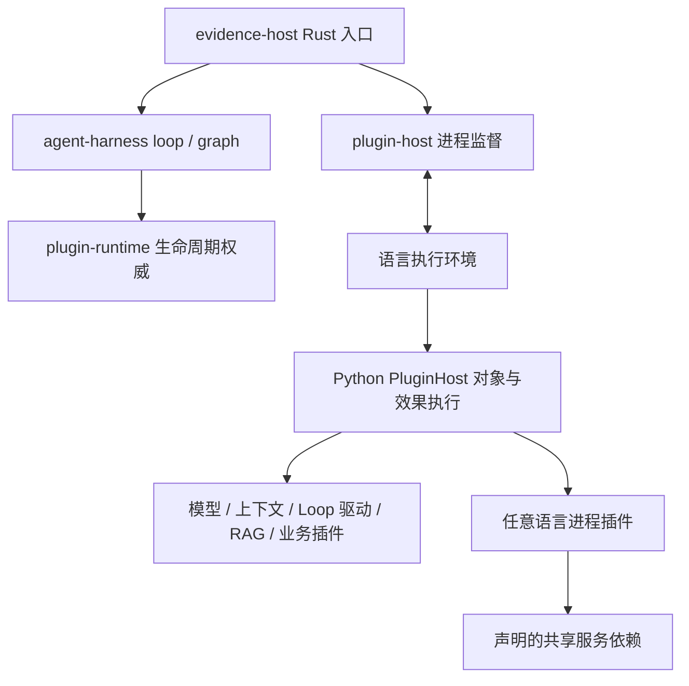

# Rust 主宿主

默认进程入口是 `evidence-host`。Rust 持有插件生命周期、依赖和作用域状态；执行环境保存业务对象并执行效果。企业知识库继续复用现有 Python 实现，普通 Agent 和不含 Agent 的服务也可以通过同一宿主运行。

本轮行为基准为 [DeepSeek Harness](https://github.com/deepseek-ai/deepseek-harness/tree/ce7073d51254c26cd63b22a60835b8f948deb447)，2026-10-31 核对的远端 HEAD 为该提交。依赖注入、作用域、资源清理和公共模型入口沿用现有 [Cordis 对照合同](rust-plugin-provenance.md)。这是本项目的 Rust 实现与执行协议，不直接加载 DSH/JavaScript 插件。

## 运行方式

先构建整个 workspace，确保主宿主与单次 Agent 值状态动态库来自同一源码。

```powershell
cargo build --workspace --locked --offline
uv run --no-sync cargo run --locked --offline -p agent-harness --bin evidence-host -- --profile config/host-profiles/api.json --stop-file .local/api.stop
```

`uv run` 让配置中的 `python` 使用项目环境。也可以直接启动 `target/debug/evidence-host.exe`，通过 `--worker` 指定 `.venv/Scripts/python.exe` 的绝对路径。Linux/macOS 可执行文件没有 `.exe`。

在另一终端创建 `.local/api.stop` 请求正常关停；再次启动前移除旧标记。宿主监督启动、协议写入、关停与子进程退出。启动默认上限 30 秒，关停默认上限 10 秒；HTTP 长期运行本身没有总时限。超时和清理失败返回非零退出码，输出未完成根状态，不自动重放业务请求。强制终止进程不等于完成业务清理。

宿主拥有 worker 及其后代的进程生命周期。Windows 在恢复挂起的 worker 前将它加入关闭时终止的 Job Object；Unix 在创建 worker 时建立专属进程组。正常协议关停后或协议失败、超时时，宿主清理该组，避免残留插件进程。Unix 在清理进程组前保留已退出 leader 的身份，避免 PID 复用导致误终止。此机制不阻止可信插件刻意脱离进程组，也不替代业务资源的正常清理。

固定交付流程使用 `scripts/start_delivery.ps1`，先构建 `cargo build --release --workspace --locked --offline`。启动器保存 `process.json`、宿主路径和专属停止标记；使用 `scripts/stop_delivery.ps1 -Receipt <process.json>` 关停。既有配置验证、物理预算和提供者账本继续生效。

## 两种配置

`config/host-profiles/` 选择执行环境与应用工厂。应用/Agent profile 再选择业务插件及其配置，二者职责不同。

```json
{
  "version": 1,
  "worker": ["python", "-B", "-u", "-m", "kb_platform.host_worker"],
  "cwd": "../..",
  "application": {
    "factory": "kb_platform.host_applications:api",
    "config": {"host": "127.0.0.1", "port": 58080}
  }
}
```

`cwd` 相对配置文件；worker 可执行文件带相对目录时相对 cwd，单一名称从 PATH 查找。profile 内的 `stop_file` 相对配置文件，命令行 `--stop-file` 相对启动目录。`--worker` 只替换 argv 的第一个元素，其余参数保持不变。

宿主将 `application` 作为不透明 JSON 交给执行环境。Python 执行环境将其解释为可信 `module:function` 工厂与 config；工厂返回提供 `run()`、`close()`、可选 `stop()` 的应用对象。普通插件 profile 仍只引用 catalog 中的 `use`。工厂承担应用装配，插件通过 `PluginSpec`、`ctx.provide`、`ctx.require` 与 `ctx.defer` 接入。

内置 `api`、`delivery` 工厂启动现有 HTTP 应用；`agent` 工厂执行一次普通 Agent turn，配置示例为 `agent.example.json`。后者需要显式配置可用模型，可能产生真实费用，不属于离线示例测试。

## 调用与所有权



| 层 | 所有权 |
| --- | --- |
| `rust/plugin-runtime` | 实例、代次、依赖、作用域、服务注册、租约和清理动作 |
| `rust/plugin-host` | worker 进程树生命周期、双向管道、帧边界、退出与关停期限；依赖 Serde 及按平台选择的 libc 或 windows-sys |
| `rust/agent-harness` | loop/graph、协议 dispatcher，以及注入 dispatcher 的 `evidence-host` 入口 |
| Python worker / `PluginHost` | 业务对象、执行派发动作、完成与 ack；不自行决定插件就绪或卸载终态 |
| `rust/agent-kernel` | 单次 Agent 值状态的准入/关联/取消；当前仍通过 worker 加载同一构建的 C ABI 库 |
| 业务插件 | RAG 策略、上下文预算、模型适配、会话事务与业务状态 |

主宿主模式在导入应用前安装进程级 `native_call` transport。线程池、取消定时器与子进程退出回调都访问同一个父进程 coordinator。连接断开即失败，不切换到另一个本地 coordinator。直接 Python 嵌入入口仍可使用 C ABI，服务于现有组件调用与验证。

插件依赖图决定哪些服务可用以及装卸顺序；Agent 的业务流程图由相应 loop/graph 插件决定。通用宿主没有硬编码 RAG 步骤。多个业务组合可使用独立根或 scope，同时共享父作用域模型服务；覆盖服务必须显式声明。

## 执行环境协议

父子进程使用 stdin/stdout JSON Lines，协议 `plugin-host/1`。stdout 仅承载协议，业务日志写 stderr。单帧上限为 4 MiB + 64 KiB。

```json
{"protocol":"plugin-host/1","kind":"request","id":1,"method":"handshake","params":{"runtime":"plugin-runtime/1"}}
{"protocol":"plugin-host/1","kind":"response","id":1,"ok":true,"result":{"runtime":"plugin-runtime/1","language":"python","version":"3.12","executable":"python"}}
```

父进程依次请求 `handshake → boot → run → shutdown`。run 期间可以请求 shutdown，worker 合作停止并等待在途操作。run 结果发出前完成应用 close；stop 与 close 不重叠执行。宿主的 `ready` 表示插件根就绪，HTTP 可访问性还需 `/health` 验证。

worker 可以发送 `method: "native"`，params 为既有版本 1 harness 命令。返回 result 保留内层 `{ok,result/error}` 信封。业务方法参数不经 Rust 重新序列化为领域类型；Rust 维护注册与运行状态。响应按调用身份关联，没有断线自动重试。

最终成功要求 run 与 shutdown 成功、所有创建的根已 collect、worker 以零状态退出。故障保留根快照。`rust/plugin-host/examples/native_worker.rs` 使用 Rust 执行相同握手与生命周期协议，证明 worker 不限定 Python；它是接入示例，不是完整业务 SDK。

## 独立进程插件与共享模型

独立插件是 worker 装配的服务实现，不需要替换整个执行环境。manifest 支持 `command` argv 或既有 Python `entry`/`python` 后端；协议及依赖回调见 [插件运行时](plugin-runtime.md)。Node 示例位于 `examples/process-echo/plugin.mjs`，依赖消费示例位于 `examples/process-dependency/`。

需要共享 LLM 时，外部插件声明依赖 `llm` 并调用 `complete_json`，取得可 JSON 序列化的完整结果与 usage。此方法只包装既有 `complete` 返回值，仍使用原路由、租约和账本。`examples/process-llm/` 提供实际接入示例。

安装者负责信任插件。公共模型服务是本项目插件的约定入口，统一模型路由、能力描述和物理请求账本。框架检查依赖声明与接口，不扫描源码，也不阻止插件自行发起网络调用。因此“统一模型入口”是开发合同，不宣称对任意可信代码具有强制封锁能力。

本轮没有改变同步模型接口为流式接口，没有增加前端扩展系统、恶意插件沙箱、通用任意对象 RPC 或 npm 插件兼容层。跨进程参数与结果须可 JSON 序列化；领域对象需要显式适配。

## 验证

统一入口 `uv run --no-sync python scripts/check_project.py` 新增 `host-integration` 阶段，使用本轮构建副本。覆盖非 Agent 服务、并发嵌套调用、scope 覆盖、普通 Agent 工具与持久历史、辅助插件共享模型及物理账本、知识库最终请求采集、真实 loopback HTTP 启停、失败清理、取消和 Rust worker。另有完整组合用例验证 Rust 主宿主 → Python worker → 外部进程插件 → 共享服务回调，以不存在的 DLL 路径确认生命周期没有回退。

RAG 部分复用统一 Suite/Trace/scorer，使用已有合成控制及本地模型响应；它验证接入和最终请求合同，不代表企业业务金标成绩。普通离线合同继续禁止网络与子进程；真实进程行为放在单独集成阶段。此次不新增外部模型、Embedding 或 judge 调用。

独立进程 LLM 用例使用真实 ModelService 和 OpenAICompatibleAdapter，加本地 MockTransport；核对完整 JSON 结果、usage、一次物理请求及零残留租约。这里的物理请求计数来自受控本地 transport，不是供应商付费调用。
