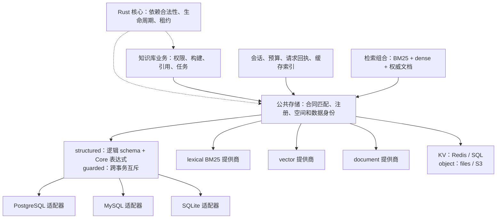

# 存储能力边界与旧数据迁移

消费者声明所需合同，配置绑定提供商。知识库不判断数据库厂商，也不要求 PostgreSQL。公共存储负责匹配合同、验证数据身份和返回有租约的句柄。Rust 核心继续管理插件依赖、作用域和生命周期。



同一 PostgreSQL 插件可导出 structured、document、kv、lexical 和 vector。消费者只得到所声明合同的方法。Redis 的 expiring KV 合同无法满足 document、vector 或 structured，编译器在挂载消费者和创建资源之前返回 `STORAGE_CONTRACT_MISSING`。

## 代码所有权

| 模块 | 职责 |
| --- | --- |
| `storage_sdk/relational.py` | 中立逻辑类型、结构化 schema、structured 与 guarded 合同 |
| `storage_adapters/structured.py` | 厂商类型、SQL 编译、UTC、JSON、锁、作用域、冲突写入 |
| `knowledge_schema.py` | 领域逻辑表、关系和不可变约束 |
| `knowledge_sql.py` | 封闭领域操作到 Core 表达式的映射 |
| `knowledge_storage.py` | 可信 actor 与 tenant、kb 作用域 |
| `storage_plugins.py`、`storage_service.py` | 合同编译、注册、绑定与资源租约 |
| `application_composition.py` | 组合 catalog 与配置，不改写提供商或消费合同 |

structured 句柄不暴露 `info.engine`、DSN 或物理 schema。低层 raw SQL 是独立合同，保留给明确需要它的插件和适配器测试；它不是知识库的兼容回退。第三方通过 `provider_catalog` 注入实现，公共服务不维护知识库专用的厂商白名单。

业务表所有者声明逻辑 schema。提供商负责实现该合同，在数据库账号权限、事务和编译边界实施约束。structured 写事务在同一 Space 内串行化，保证时钟、租约和条件更新语义；不同 Space 独立。这个设计尚无吞吐提升的测量结论。

## 已删除的运行路径

旧 `platform.repository.postgres`、厂商命名的 platform search 插件、手工 split 插件和 `platform.originals.files` 已从运行时 catalog 删除，统一使用三个 capability 消费插件。`Settings` 不再包含 DSN 或检索后端字段。旧选择器 `KB_DSN`、`KB_SEARCH_BACKEND`、`KB_SEARCH_URL`、`KB_SEARCH_CHANNELS_CONFIG`、`KB_DATABASES_CONFIG` 明确报错。

装配层不再根据插件名补合同、重写插件或自动注入预算依赖。使用数据库会话时，profile 显式选择 `harness.store.database`；模型服务需要共享预算库时，在配置声明 `database_slot: "budget"`。

旧 `postgres_operations` 的五个构建恢复用例迁入 `build_recovery_contracts.py`，保留分批重试、依赖变化拒绝恢复、索引提交后崩溃恢复、停用词查询及撤权拒绝发布。原 `embedded_operations` 的发布、重启、版本更新、ACL 与原件缺失行为完整迁入同模块的第六个用例 `test_publication_versions_acl_and_missing_original_survive_restart`，并在三种关系后端执行。两个依赖旧业务表和旧 Settings 的 API 性能脚本删除；历史结果保持只读，不将旧性能数字用于当前架构。

`postgres_search.py` 和旧 SQL 文件仍供显式历史数据读取、备份与恢复工具使用，不属于当前平台提供商路径。新 PostgreSQL 搜索出口在 `storage_adapters/postgres_search.py`，使用独立的通用存储 schema。

## 初始化新数据集

本地运行 `uv run --no-sync python scripts/bootstrap.py`，创建 SQLite、embedded、files 的独立新空间及 `.local/storage.json`。脚本保留已有配置和数据。其他部署使用初始化模板：

```bash
uv run --no-sync python -m kb_platform.storage_configuration initialize --input config/storage.example.json --output .local/storage-configured.json
export KB_STORAGE_CONFIG="$(pwd)/.local/storage-configured.json"
```

模板中的消费者必须与应用 profile 一致，删除未使用的绑定。普通启动只核对已初始化的 `dataset_id`，不自动创建或迁移数据。

## 导入旧知识库

先停写源和目标，保留数据库备份、原件、搜索索引、会话及请求账本。使用 `scripts/migrate_knowledge_storage.py export --help` 和 `import --help` 查看必需参数。导出必须指定 source format、空间身份、预期 dataset、`--source-frozen` 和新输出目录；导入必须指定已初始化目标配置、预期目标 dataset、`--target-offline` 和另一新输出目录。连接密钥通过指定的环境变量读取，不写进命令参数。

迁移核对旧身份和冻结迁移哈希，保存十二张表的行数、内容哈希及原发布信息。它不改写源数据或旧迁移记录。导入保留权限、不可变原文、引用、Embedding 结果、attempt 和 UNKNOWN 请求；目标使用新的迁移身份。

旧搜索封存绑定原数据身份，不能直接冒充新提供商的封存。导入将发布指针置空，原 PUBLISHED 和 VALIDATED 构建转为 STAGING，并增加目标权限版本；原构建依赖保持原样，因此旧构建恢复会被拒绝。收据记录这些变化。按当前依赖显式重建、读回、封存和发布后再切换应用绑定；迁移本身不调用模型或 Embedding。

会话使用现有 `session_transfer` 显式导入；预算使用 `persistence_migration` 导入并保留实际费用、UNKNOWN 和前序封存。缓存使用独立新数据集或由操作者明确丢弃，不在启动时清空旧空间。

## 验证

修改源码后运行 `uv run --no-sync python scripts/check_project.py`。真实服务使用相同入口的 `--local-integration --storage-integration`，环境与资源准备见 [执行方案](storage-plugins-execution-plan.md)。架构合同会拒绝旧厂商判断和 provider 内部字段访问，并保留检出历史错误代码的反例。

离线合同、真实数据库行为、Rust HTTP 和浏览器结果分别报告。合成文档、固定向量与本地模型夹具用于验证权限、事务和协议，不代表线上 RAG 答案质量。测试不新增外部模型、Embedding 或 judge 调用。
