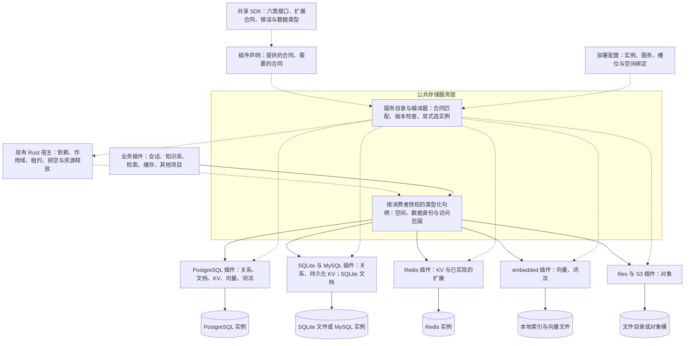
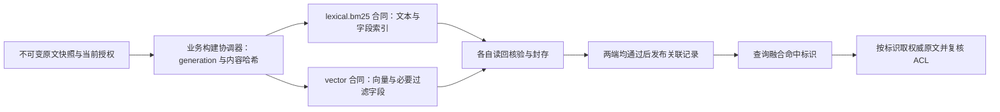

# 六类存储合同改造审批稿

状态：已批准并实施。日期：2026-11-01。用户已授权执行 P0–P6、使用真实数据库进行 E2E、清理测试资源并提交合并。本稿保留批准时基线，实施与本地最终验收见[验收记录](storage-contracts-v2-acceptance.md)，远端结果见 [PR #25](https://github.com/Hubujiu/evidence-kb/pull/25)。

批准本稿后，按 P0–P6 实施。分类固定为 relational、document、kv、vector、object、lexical。提供商可以实现多个合同，消费插件按合同声明需求，部署配置选择具体实例。

**一、当前基础与本轮目标**

当前数据库已经具有三种关系后端、静态插件依赖、授权绑定、空间隔离、迁移、租约和排空。files 与 S3 已提供原件存储。BM25 与 dense 可以分库，但两个通道仍实现完整搜索对象，重复接收完整单元。统一六类合同、Redis KV 和独立文档接口尚未实现。

本轮交付一个所有可信插件都可依赖的存储 SDK 和公共绑定入口。SDK 不依赖知识库、Agent、模型或具体驱动。保留既有 Rust 宿主作为唯一的依赖和生命周期管理者。

公共模型服务与公共存储服务采用同一种扩展方式。公共服务定义合同、接收适配器注册、校验能力并提供绑定；适配器声明并实现其支持的接口；消费插件声明自己需要的公共服务及合同。模型能力与存储能力各自定义业务语义，不要求二者使用相同的方法或数据结构。

公共服务是可复用的可选基础插件。本稿的统一入口及架构检查约束我们维护的这套公共服务与相关消费者，不要求所有第三方插件使用公共模型或公共存储服务。第三方可以自建服务和适配器，或声明直接依赖自己的提供商插件；它们仍遵守 Rust 宿主的通用依赖、作用域与生命周期规则。

依赖声明由插件提供，Rust 宿主负责检查并执行通用依赖关系。各公共服务负责其领域合同和实际服务条件的检查，Rust 核心不内置模型品牌、数据库类别或领域 schema。装配时，适配器依赖公共注册服务并向其注册，消费方的绑定再依赖公共服务和选中的适配器就绪节点。公共注册服务不反向依赖所有适配器，避免注册依赖形成环。业务调用方向仍是消费插件经公共服务绑定调用适配器。

关系基础层和会话支持 PostgreSQL、MySQL、SQLite，不等于完整知识库可以直接切到这三库。当前知识库正文、ACL、任务和构建仍使用 PostgreSQL 专用实现。本轮将这些要求变成明确的合同约束；完整知识库的跨库重写不在本轮范围。

**二、合同分类与首批提供商**

| 类别 | 基础合同职责 | 按需声明的扩展合同 | 本轮必须真实验收的实现 |
| --- | --- | --- | --- |
| relational | 参数化 SQL、有界结果、明确的提交与回滚语义 | 方言、隔离级别、特定原子操作 | PostgreSQL、MySQL、SQLite |
| document | JSON 文档按 ID 读写、删除、版本与有界批量读取 | 条件更新、特定查询或索引 | PostgreSQL、SQLite 的文档适配 |
| kv | 按键读写、删除，明确持久性与淘汰语义 | TTL、条件写入、原子计数 | Redis 缓存适配、三库持久化适配 |
| vector | 定义集合、写入向量、删除、近邻查询 | 指定过滤操作、距离算法、索引构建与封存 | PostgreSQL pgvector、embedded dense |
| object | 二进制对象写入、读取、元信息和完整性校验 | 条件创建、范围读取、流式传输 | files、S3 兼容服务 |
| lexical | 文本建索引、查询及排名 | BM25、字段检索、分词协议、索引封存 | PostgreSQL pg_textsearch、embedded Tantivy |

首批扩展只实现现有消费者确实需要的部分。上表列出的扩展种类不代表全部在本轮实现。P0 固定每个扩展的方法、错误和验收用例，未实现的不导出。

本轮 object 继续提供现有有界 bytes 接口；端到端流式传输不列入交付。document 基础接口不承诺任意 MongoDB 查询语法。MongoDB、Qdrant 和其他新提供商后续按相同 SDK 接入，不列为本轮支持。

同一 PostgreSQL 提供商实例可导出 relational、document、持久化 kv、vector、lexical。vector 与 lexical 仅在相应扩展、权限和部署配置通过验证后发布。SQLite、MySQL 的关系 KV 由共用适配实现，不让每个业务插件各写一套。

合同集中定义接口、输入输出、错误与语义。类别从合同定义派生，用于服务目录展示。TTL、BM25 等要求用扩展合同表达，不再维护一份含义重复的能力标签清单。插件实现版本与服务合同版本分别管理；第一版采用合同 ID 加主版本的精确匹配，合同继承关系由 SDK 明确定义，不自动降级。

需要持久化、禁止淘汰、特定隔离级别或原子操作的消费方必须声明相应合同，不能只依靠提供商的文字说明。旧 `DatabaseInfo.capabilities` 不再承担平行匹配职责；对外支持目录从同一份合同导出声明生成。

**三、目标架构图**

下图全部表示目标设计。实线表示服务调用或后端访问，虚线表示声明、装配或生命周期管理。



公共存储服务层不是所有插件都能检索的共享数据池。它暴露符合合同且经过授权的服务句柄。找到同类服务不等于取得其他插件数据的读取权限。

**四、消费方用法与接口草图**

以下为设计草图，不是当前可执行配置。槽位对象同时用于声明和获取接口，避免消费方再次填写合同、实例或租户身份。

```python
CACHE = StorageSlot("cache", contract=KV_EXPIRING_V1)
DENSE = StorageSlot("dense", contract=VECTOR_V1)
BM25 = StorageSlot("bm25", contract=LEXICAL_BM25_V1)

PLUGIN = PluginSpec(..., storage_slots=(CACHE, DENSE, BM25))

def mount(ctx, config):
	cache = require_storage(ctx, CACHE)
	dense = require_storage(ctx, DENSE)
	bm25 = require_storage(ctx, BM25)
	cache.put_expiring("request:123", payload, ttl_seconds=60)
	dense.query(query_vector, limit=10)
	bm25.query(query_text, limit=10)
```

配置明确绑定到提供商实例的具名服务。下面 dense 与 bm25 使用不同后端；也可以都绑定到 pg-main。

```text
retrieval.dense → pg-main.vector
retrieval.bm25  → local-search.lexical
agent.cache    → redis-main.kv
agent.sessions → mysql-main.relational
```

核心签名草图如下。合同接口与具体方法由 P0 冻结，不把底层连接、客户端对象或凭据放进公共类型。

```python
Contract[T](id: ContractId, major: int, extends: tuple[Contract, ...])
StorageSlot[T](name: SlotName, contract: Contract[T])
StorageExport[T](name: ServiceName, contract: Contract[T], open_space: ScopedFactory[T])
StorageBinding(service: ServiceRef, space: SpaceKey, target: ExistingDataset | EphemeralCacheSpace)

compile_storage_plugins(profile, catalog, configuration) -> CompiledPlugins
require_storage(ctx, slot: StorageSlot[T]) -> T
```

编译器把声明、提供方导出和配置转换为现有宿主的依赖节点。启动时先检查合同、后端条件及授权，再准备空间和迁移，最后发布消费者服务。一个实例多服务共用资源时，连接池只有一个关闭所有者。

**五、所有权、拒绝服务与模块边界**

- 物理提供商插件管理连接、空间创建、引擎差异及共享资源。文档、KV、向量和词法适配器管理实现合同所需的内部表与索引。
- 数据拥有插件管理领域结构、字段要求、逻辑集合定义、业务表、领域迁移与业务约束。关系表的方言迁移由该领域实现提供；提供商不自动翻译任意 SQL。
- 宿主绑定 `SpaceKey(application_id, owner_id, space_id)`、消费者身份与授权。插件实例名和运行代次不改变持久归属。不同项目默认隔离，共享数据必须显式授权。
- 同一个物理空间只认一个 schema 所有者。适配器内部表使用保留命名区。不同合同不自动共用逻辑空间；跨服务关联在业务元数据中明确记录。
- 首次创建持久空间必须执行显式初始化，记录生成的 `dataset_id`。正常启动、重启及迁移切换必须携带并核对已有身份；身份缺失、不匹配或误指向空库时拒绝绑定，不能自动初始化。临时缓存使用独立的空间身份及明确的可丢失合同，不伪造持久性。对象和索引补齐与其语义相符的身份及授权，不能假定已有 SQL 同等保护。
- 租约、排空、旧代次拒绝和资源清理由原宿主控制。可信插件的隔离不能宣称为恶意 Python 代码沙箱。

缺少合同、主版本不匹配、缺少必需扩展、后端扩展未就绪、权限不足和数据身份不符，均在对应消费者就绪前拒绝绑定。运行时依赖丢失或句柄过期时拒绝调用，不自动切实例。错误携带消费插件、槽位、实例、所需和实际合同，诊断中隐藏凭据。

只实现 vector 的服务不能满足 document 请求。实现基础 kv 但没有 TTL 的服务不能满足 expiring KV 请求。允许淘汰的 Redis 缓存不能承接费用账本和会话主存储所需的持久事务合同。提供商声明合同后，还必须有相应实现、部署探测和真实行为验收；名称匹配不证明实现正确。

模块改造范围如下。

| 位置 | 改造后职责 |
| --- | --- |
| `kb_platform/storage_sdk/`，新增 | 中立合同、六类接口、扩展、统一错误与领域类型 |
| `kb_platform/storage_plugins.py`，新增 | 公共存储的唯一槽位声明与配置编译入口，生成现有宿主依赖 |
| `kb_platform/storage_service.py`，新增 | 统一服务目录、空间授权、绑定和部署检查 |
| `kb_platform/database_providers/`，保留改造 | 既有三库事务、隔离、空间和迁移基础 |
| `kb_platform/storage_adapters/`，新增 | 文档、KV、向量、词法和对象的合同适配 |
| `plugin_host.py`、进程桥及组合入口 | 结构化声明、授权回调、有界序列化及生成依赖 |
| 会话、知识仓储、缓存、预算、回执和检索模块 | 按需声明合同，保留各自领域规则 |

已有 `storage.py` 文件继续作为对象后端内部实现，不创建同名 `storage/` 包。旧数据库和 blob 注册、编译及获取入口在各调用方迁完的同一阶段删除；保留仍需复用的事务、迁移和内容校验实现。配置提供显式转换工具，运行路径只接受新版本，不自动识别或回退旧格式。

**六、检索数据流与换库边界**



检索协调器不要求 vector 后端实现文档或词法服务。两端可以保留各自需要的文本或元数据副本，但权威原文、版本与权限来源必须明确，不能把向量附带文本直接当成完整文档服务。

每个后端保留真实的数据集身份，发布记录关联各端 dataset、generation 和原文哈希。ACL 撤销后重新核验命中。分库继续采用构建、核验、封存、发布，不假定分布式事务。共用 PostgreSQL 也不自动获得跨合同事务；确有需求再设计明确的共享事务合同。

切换实例采用停写、导出、导入、校验、更新绑定、恢复的流程。更换配置不会搬数据。切换前保留备份和可恢复的原绑定；目标接收新写入后，回切需要显式处理新增数据，不能承诺无条件一键回滚。

**七、执行阶段及退出条件**

| 阶段 | 主要改动与交付 | 进入下一阶段的条件 |
| --- | --- | --- |
| P0 固定基线与合同 | 盘点活动运行、已有 trace、请求账本、缓存和实际消费者；冻结六类基础语义、必需扩展、版本、错误和后端矩阵；记录 PG 专用依赖 | 当前统一检查结果可复核，每个必需接口有行为验收项，没有把未实现后端列为支持 |
| P1 纵向接通 | SDK、类型化槽位、统一配置编译、服务目录、显式空间初始化和授权句柄；先接一个关系槽位与一个 Redis KV 槽位 | 缺合同、版本错误、缺 TTL、越权均拒绝；真实 Redis 调用通过；多实例显式绑定；原宿主排空与旧句柄拒绝通过 |
| P2 迁移现有关系和对象 | 三库、files、S3 接入；迁移会话、缓存索引、预算和回执；补齐对象授权与持久引用的迁移方案 | 三库事务与会话、六向会话搬迁、对象引用和完整性、UNKNOWN 费用保留均通过；对应旧入口和配置路径删除 |
| P3 文档与 KV | PostgreSQL、SQLite 文档实现；Redis 缓存与三库持久化 KV；迁移一个真实文档消费路径和一个可失效缓存路径 | 两种文档实现满足相同基础合同；Redis TTL 与已承诺原子操作真实通过；缓存丢失可重建，账本不能误绑 Redis |
| P4 拆分检索合同 | PG 与 embedded 分别导出 vector、lexical；拆除完整搜索对象的耦合；在业务层关联权威原文、generation 和 ACL | 同后端、不同实例、不同提供商检索均通过；vector 不需要实现 lexical/document；单端构建失败不能发布；重启恢复及新增索引通过 |
| P5 插件与数据切换 | 全部相关消费者使用新声明；扩展进程插件有界 JSON 桥；提供空间显式初始化、配置和数据迁移、核验与恢复工具；更新目录和文档 | 非知识库示例插件可独立使用基础存储；进程调用不泄漏原始句柄与凭据；旧公共入口无活动调用；PG 专用边界明确 |
| P6 全链路验收与清理 | 运行冻结矩阵、统一 checker、真实后端集成、HTTP 与浏览器；导出报告并删除专属测试资源 | 无失败和伪装通过；必需项没有跳过；清理结果与残留可核对；支持清单与实际导出一致 |

P3 中真实文档消费路径优先采用检索原文读取的独立适配，并保持不可变快照和授权规则；如果 P0 发现该路径需要超出基础合同的语义，先定义并验收相应扩展，不用简单 JSON CRUD 替代原有证据约束。

**八、验收矩阵与证据要求**

| 验收组 | 必需场景 |
| --- | --- |
| 合同绑定 | 一提供商多合同、一合同多实例、显式选择、未知合同、合同版本不符、缺扩展、后端不可用；失败前不产生业务写入 |
| 实现一致性 | relational 三库；document 两库；KV 的 Redis 与持久化实现；vector 两实现；lexical 两实现；object 两实现逐一真实执行 |
| 隔离与生命周期 | 同服务器多项目、同项目多插件、显式共享授权、重启、排空、连接池单一关闭、旧句柄、越权和密钥脱敏；已有持久绑定缺失身份或误指向空库时拒绝 |
| 数据迁移 | 三种会话后端的六个有向迁移；文档 PG 与 SQLite 双向迁移；files 与 S3 双向搬迁；中断保留进度、错误身份和损坏数据拒绝 |
| 缓存与主存储语义 | Redis TTL、条件写入及声明的原子操作；缓存清空后重建；持久事务消费方拒绝缓存服务；失败及 UNKNOWN 预算不丢失 |
| 分库检索 | PG lexical 与 PG vector 同实例、不同 PG 实例、PG lexical 与 embedded vector、embedded lexical 与 PG vector、embedded 两通道；故障注入、ACL 撤销和半成品拒绝发布 |
| 产品 E2E | 上传、解析、构建、BM25、dense、融合、原文权限复核、上下文、回答与引用、下载；会话重启恢复和权限拒绝；分别覆盖三种会话后端 |
| 独立与进程插件 | 不加载知识库的第三方示例，声明并调用多类服务；进程接口的大小、时间、结果限制和提交未知错误 |
| 浏览器与资源 | 沿现有浏览器入口验证上传、检索引用、预览下载与历史恢复；关闭后核对专属容器、数据库、桶、临时文件及下载资源 |

矩阵在 P0 固定具体用例分母及后端配置。按风险选择全链路组合，各接口与后端的合同测试必须全覆盖，不承诺穷举所有配置的笛卡尔积。不同 BM25 或近邻实现不要求分数数值完全相同；排名与证据断言来自固定夹具，不能由被测实现产生预期值。分词、距离、维度和过滤语义必须明确。

必要合同接入 `kb_platform/rag_testing/*_contracts.py`，每个模块可由 unittest 发现非零用例。真实后端验收扩展现有 storage integration，HTTP 和浏览器复用现有入口；不建立第二套评分器、预算账本或临时实验控制器。组件合同、真实存储集成、合成产品 E2E 和生产 RAG 质量分别报告。

修改活动源码后运行 `uv run --no-sync python scripts/check_project.py`。涉及真实后端时，使用同一入口的 `--storage-integration` 与 `--local-integration` 选项，并明确专用 loopback 验收数据库。新环境先 `uv sync --locked --group dev`。不修改门槛、不忽略退出码、不以缺资源跳过代替验收。

优先复用精确依赖未变的已有产物。被测存储和检索阶段真实执行；确定性评分重新运行。测试使用合成文档和本地模型夹具，不新增外部模型、Embedding 或 judge 付费调用，也不把合成测试称为企业生产质量验收。

测试资源沿用已有下载授权，但只创建带本次唯一标识的专用容器、数据库、空间、桶和目录。下载版本固定，测试后删除本轮资源，保留计划、结果与清理记录。不删除共享镜像缓存、已有服务或其他运行的数据。清理失败记录具体残留并报告。

**九、方案比较与审批范围**

比较了两个候选。A 把类型化声明编译为既有宿主的直接依赖；B 增加中央存储 Broker 作为消费方的运行入口，仍委托宿主管理生命周期。选择 A，公共目录吸收 B 的统一发现、授权诊断和部署检查，绑定后走有租约的专用接口。它减少一次运行分发，也不让消费方重复填写合同。

没有采用独立 Broker 自建依赖和停机状态机、万能 `get/execute`、只添加类别标签或按数据库品牌推导合同。候选按合同表达、宿主复用、接口边界、迁移覆盖和验收完整性比较。候选采用当前可用模型，技能默认的 Claude 与 Grok 在本环境无可用同族，未进行跨模型交叉裁判。

审批确认以下范围即可进入实施。

1. 采用六类合同、可组合扩展、显式具名实例绑定，复用原 Rust 宿主。
2. 按首批矩阵实现到 P6，Redis 必须真实验收，MongoDB 与 Qdrant 后续接入。
3. 会话与公共关系基础支持三库；本轮不将完整知识库重写为 SQLite 或 MySQL。原始 SQL、跨服务事务和已有数据搬迁均按本稿边界处理。

**十、现状依据与文档修正**

- 当前槽位及版本：[plugin_host.py](../kb_platform/plugin_host.py)、[storage_sdk](../kb_platform/storage_sdk/__init__.py)，公共存储编译与绑定：[storage_plugins.py](../kb_platform/storage_plugins.py)、[storage_service.py](../kb_platform/storage_service.py)。审批时的 SQL 基础实现保留在 [database_service.py](../kb_platform/database_service.py) 内部复用，旧公共 `database_plugins` 入口已删除；旧验收结果只作为前序基线。
- 当前知识库与检索：[knowledge_storage.py](../kb_platform/knowledge_storage.py)、[search_router.py](../kb_platform/search_router.py)、[postgres_search.py](../kb_platform/postgres_search.py)、[embedded_search.py](../kb_platform/embedded_search.py)。
- 必须保留的约束：[架构](architecture.md)、[开发约定](development.md)、[现有存储设计](storage-plugins-design.md)、[现有验收及迁移](storage-plugins-execution-plan.md)。
- 实施时修正 [search-storage.md](search-storage.md) 中与 development.md 冲突的历史 hash 兼容放行表述，当前严格规则优先，不恢复兼容放行。

这些依据用于确认当前行为和明确约束。部分存储源码尚未提交，没有可归因的历史 PR 动机证据。本轮未查询外部 issue、团队聊天、监控或分析记录，不将其作为设计依据。
