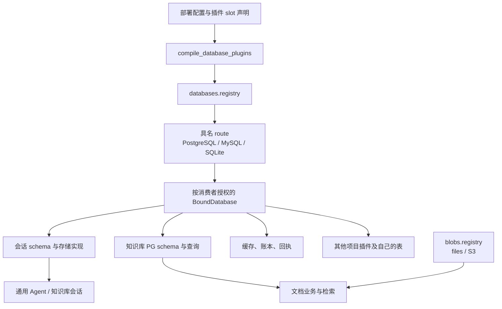

# 公共数据库与原件存储插件

状态：核心实现已落地。本文描述当前源码中的能力与边界；验收及切换步骤见 [执行方案](storage-plugins-execution-plan.md)，实现键见 [插件目录](plugin-catalog.md)。数据库提供商支持 PostgreSQL、MySQL 和 SQLite。会话可以切换三种后端；知识库正文、权限、构建和任务仍要求 PostgreSQL。

## 数据库成为公共依赖

任意可信业务插件可以声明数据库 slot，通过 `require_database(ctx, slot)` 获取绑定。数据库插件负责连接、数据空间、事务和资源生命周期。消费者持有自己的表结构、迁移、查询及业务约束，不需要加载知识库或模型服务。



`PluginSpec.storage_slots` 描述插件需要的 slot。`compile_database_plugins` 也接受显式 `slots` 映射，供已有内置消费者装配。它可以用于独立应用，不依赖知识库组合器。

消费者在 mount 中获取数据库，执行自己的 `SchemaPackage`，然后封闭迁移入口并发布业务服务。以只有 `id` 和 `body` 的任务表为例：

```python
from kb_platform.database_contracts import Migration, SchemaPackage
from kb_platform.database_plugins import require_database
from kb_platform.plugin_host import PluginSpec

def mount_tasks(ctx, config):
	db = require_database(ctx, "primary")
	package = SchemaPackage(db.identity.space.owner_id, (Migration(1, (
		"CREATE TABLE tasks (id VARCHAR(100) PRIMARY KEY, body TEXT NOT NULL)",
	)),))
	db.prepare(package)
	db.seal()
	ctx.provide("tasks.database", db)

TASKS = PluginSpec("example.tasks", ("tasks.database",), (), mount_tasks,
	storage_slots=("primary",))
```

示例展示公共接入方式。业务插件可以直接使用参数化 SQL，也可以像会话、知识库一样提供领域操作。跨库 SQL 的兼容性由消费者声明和验证，提供商不自动翻译任意 PostgreSQL SQL。

## 配置、身份和生命周期

[databases.example.json](../config/databases.example.json) 是当前配置格式。顶层字段为 `version`、`application_id`、`routes`、`bindings`。`bindings` 以 profile 实例 ID 为键，再映射到该实例声明的 slot。根应用和独立 core 应用通过 `KB_DATABASES_CONFIG` 读取配置。`create_agent_application` 也接受 `database_configuration`；其他独立应用可以直接调用编译器。

```json
{
  "version": 1,
  "application_id": "project-a-production",
  "routes": {
    "main": {"provider": "postgresql", "url_env": "APP_DATABASE_URL", "migration_url_env": "APP_MIGRATION_URL"}
  },
  "bindings": {
    "tasks": {"primary": {"route": "main", "owner": "tasks", "space": "records"}}
  }
}
```

多个 route 可以选择相同提供商，也可以连接不同服务器。`url_env`、`migration_url_env` 和 SQLite 的 `root_env` 引用环境变量；配置也支持对应的直接值。跨项目共用服务器时，各部署设置独立 `application_id`。绑定可以显式覆盖 application ID，以访问约定的共享空间。

持久归属是 `SpaceKey(application_id, owner_id, space_id)`。`StorageIdentity` 还包含创建空间时记录的 `dataset_id`。插件实例名、实现键和宿主代次不决定持久目录。显式配置 `expected_dataset_id` 时，空目标或错误身份拒绝绑定，换 route 不会自动搬迁旧数据。

编译器在宿主启动前生成静态依赖，按 UTF-8 十六进制编码生成键并检查冲突：

```text
databases.service
    → databases.route.<编码的路由名>
    → databases.bound.<编码的消费者>.<编码的slot>
    → databases.consumer.<编码的消费者>
```

末项包装原来的消费者 `PluginSpec`，附加实际依赖并注入只读 slot 映射。SDK 最终通过 `ctx.require` 核对声明依赖及绑定；`for_consumer` 将消费者身份和租约绑定到句柄。route marker 同时核对注册身份与所有者。更换 route 会影响其依赖子图，旧绑定不会自动改用新注册。

`DatabaseService` 管理注册、授权、绑定及排空。事务持有消费者、绑定和提供商租约，真实提交或回滚后才释放。不同宿主进程各有连接池和生命周期；跨进程协调依靠数据库锁，不共享 Python 对象。宿主作用域和数据库账号约束可信插件的调用与资源归属，不构成恶意 Python 代码沙箱。

## schema 归数据拥有者管理

| 模块 | 所有权 |
| --- | --- |
| `database_contracts.py` | 空间身份、SQL 参数、结果、限额、迁移包和错误 |
| `database_service.py`、`database_plugins.py` | 公共注册表、绑定、slot 编译和租约 |
| `database_providers/` | SQLAlchemy 驱动、连接池、账号、事务及后端差异 |
| `database_migrations.py` | 迁移锁、版本、内容哈希、dirty 状态与进度 |
| `session_storage/`、`session_store.py` | 会话表、后端锁与唯一会话业务规则 |
| `knowledge_storage.py`、`knowledge_queries.py` | 知识库 schema 包、受信任查询和 PG 事务身份 |
| `persistence_schema.py`、`provider_receipt_database.py` | 缓存、预算及回执的表结构 |
| `blob_service.py`、`blob_plugins.py`、`storage.py` | 对象引用、原件读写、files 和 S3 提供商 |

`SchemaPackage.owner` 必须匹配空间 owner。迁移记录带版本和内容哈希，同版本内容变化或已有 dirty 记录拒绝继续。SQLite 用写事务，PostgreSQL 用事务级 advisory lock，MySQL 用命名锁协调迁移。MySQL DDL 的隐式提交通过逐步记录处理；失败保留 dirty 状态，不能盲目重跑。

运行绑定调用 `seal()` 后关闭 `prepare()`；首次普通事务也会封闭迁移入口。迁移使用独立连接。PostgreSQL 和 MySQL 提供商支持预配空间与受限运行账号，或通过 `provision=false` 使用已有受限账号。预配凭据需要相应建库、schema 和账号权限。SQLite 默认每空间一个文件，运行连接使用 authorizer 禁止 DDL、ATTACH、PRAGMA 和元数据修改。

消费者通过 `runtime_readonly`、`runtime_appendonly`、`runtime_readonly_prefixes` 声明表权限。SQLite 为追加表安装稳定的拒绝更新和删除触发器，并开启递归触发器，使 `WITH ... INSERT OR REPLACE` 也无法覆盖旧记录。MySQL 空间包含非 InnoDB 业务表时拒绝进入运行状态，避免承诺无法回滚的事务。

`_database_` 前缀的身份与迁移记录属于基础服务。提供商在消费者迁移之后重新收紧权限，防止业务 schema 的广授权泄漏元数据写权限；已有预配账号能写这些表时拒绝启动。

一个插件空间可以包含多个企业租户。`SpaceKey` 隔离插件的数据归属，企业权限仍由可信 Actor、ACL 和 RLS 决定。知识库在事务内设置局部 tenant、kb 和 search_path；事务结束后不会把本次身份作为下一次请求的身份。

知识库 schema 包将原 `public`、`kb_search` 和 `kb_app` 映射到绑定空间及运行角色。搜索代际的动态建表、索引构建仍由迁移安装的受控函数完成。数据库提供商不拥有文档表，也不决定用户能读取哪些证据。公共运行接口限制为单条查询或 DML，禁止事务控制和直接 DDL；可信知识库的 PG 专用桥保留原生能力，不是恶意 SQL 沙箱。受限 PG 账号的数据库级 TEMP 权限不在本次改造中全局撤销。

搜索元数据及 `g_` 动态表在普通运行绑定中只读。构建函数按当前连接的 `session_user` 临时授予新表插入权限，完成后撤销；重启时不会恢复已封存表的写权限，也不会引用上一次已删除的临时账号。

## 当前可以替换的部分

| 消费者 | 当前后端 | 边界 |
| --- | --- | --- |
| 公共关系数据库 | PostgreSQL、MySQL、SQLite | SQL 方言由消费者负责 |
| 会话 | 三种关系后端 | 同一归属、指纹、revision、租约和原子完成规则 |
| StageCache 索引、BudgetLedger、数据库回执 | 三种关系后端 | 缓存对象另存；预算规则只有既有一套 |
| 知识库正文、ACL、构建、Embedding 任务 | PostgreSQL | 不提供 MySQL 或 SQLite 的完整知识库实现 |
| BM25 与 dense 通道 | 独立配置 PostgreSQL 或 embedded | 已有验收组合为 PG+PG、PG+embedded |
| 原件 | files、S3 兼容对象存储 | 内容哈希寻址，业务层复查权限 |
| 文档数据库 | 无实现 | MongoDB 等不是本轮关系后端 |

`KB_SEARCH_CHANNELS_CONFIG` 读取 [search-channels.example.json](../config/search-channels.example.json)。`platform.search.split` 分别依赖 `platform.search.bm25` 和 `platform.search.dense`。两通道验证规范化原文一致性并分别封存；一个通道失败不能发布半成品。PG+PG 可以绑定不同真实数据库，PG+embedded 保留本地向量索引。

`PostgresRepository` 已转到公共数据库绑定，知识库内联 SQL 收入 `KnowledgeQuery`。保留的 DSN 入口在内部创建公共服务绑定，主要承接已有部署；它不意味着该部署已经通过显式 route 共享所有连接。`pg_transaction` 是受控的 PG 专用适配入口，搜索和任务仍使用 PG 驱动能力，不能据此宣称整个业务层已跨库。

`harness.store.database` 获取 `primary` slot 并提供原有 `session.store`。`harness.store.sqlite` 仍是可选本地入口。根组合会为新会话目录装配公共 SQLite 绑定；发现旧 `sessions.sqlite3` 时要求显式导入，不静默创建空历史。

## 原件与进程调用

`BlobRef` 保存空间哈希、租户哈希、内容 SHA-256 和长度，序列化为 `blob:v1:...`。`OriginalStore` 通过绑定读写对象，API 下载和预览不再直接使用本地路径。files 与 S3 复用内容完整性和当前授权检查。当前接口完整读取 bytes 后返回，S3 对象体在读取结束或异常时关闭；没有端到端流式下载接口。

原件上传与数据库引用提交不组成分布式事务。迁移工具 `scripts/migrate_original_blobs.py` 读取旧原件并输出新的引用映射及审计结果，切换引用需要独立核验。插件关闭保留持久数据。

`database_process.py` 实现 `query_json` 和 `batch_json`。一次调用完成整个查询或事务批次，使用带类型的值编码、有界结果及可选影响行数断言。写批次必须提供 `operation_id`，提交失联返回 `COMMIT_UNKNOWN`，不会自动重发。复杂的先读后决策事务由数据拥有者暴露原子业务操作；没有跨多次 IPC 持有的事务令牌。

[process-database](../examples/process-database/plugin.json) 演示进程插件依赖 `shared.database`。宿主侧存储实现声明 slot、拥有任务表迁移并发布稳定服务名；外部 worker 只通过 JSON 回调读写。正式进程验收覆盖批次回滚和 worker 重启后的数据恢复。

## 保留的本地持久化边界

P5 没有把所有审计文件搬入数据库。当前边界如下：

- 冻结的 `budget_batches` 前序 SQLite、原文件哈希和历史审核记录保持只读。
- `producer_guard` 专用 SQLite sidecar 继续承担跨进程互斥和封存，不能因为主账本换库而删除。
- `model_http` 的实际请求采集仍写独立 `audit_root` JSON，远程账本必须另外提供审计目录。
- `LunaClient` 响应缓存继续使用旧格式，旧文件回执仍是默认路径。`RequestReceipts(database=...)` 已支持注入，但 LunaClient 没有新增数据库 slot。
- `ProviderAdmission` 可注入数据库和对象存储；`from_directory` 保留不可变历史读取入口。

`StageCache`、`BudgetLedger` 和请求身份规则没有复制出第二套实现。共享基础模块只依赖中立持久化合同，不反向导入宿主、知识库、runner 或 scorer。数据库换库与数据搬迁是两个操作；执行步骤、真实检查范围和待验证结果见 [执行方案](storage-plugins-execution-plan.md)。

Embedding 恢复和语义页核验通过 `BudgetLedger.entry()`、`registered()` 读取物理请求记录，远端账本不再依赖 SQLite 文件路径；冻结前序账本继续只读。
