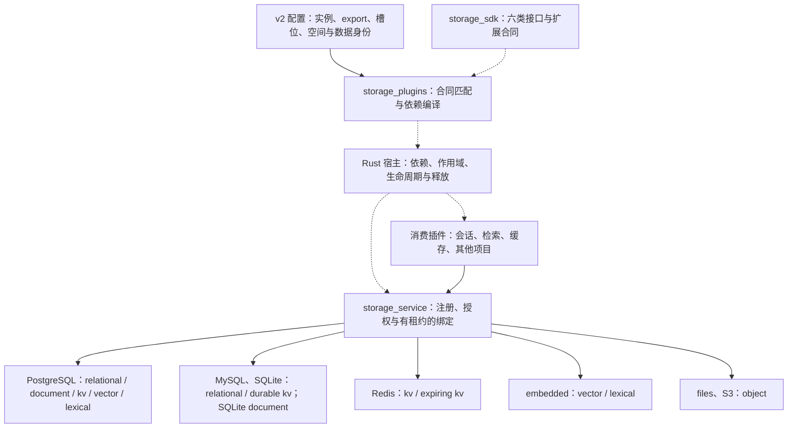

# 公共存储插件架构

公共存储服务以合同连接消费插件和提供商插件。消费插件声明需要的接口，部署配置选择实例和数据空间，提供商实现接口。Rust 宿主统一检查插件依赖并管理生命周期。执行和迁移步骤见 [执行方案](storage-plugins-execution-plan.md)，内置实现见 [插件目录](plugin-catalog.md)。

这与公共模型服务采用同一种扩展方式。模型提供商导出 chat、embedding 等能力，存储提供商导出 relational、document 等合同。两个公共服务各自负责领域合同，Rust 核心不认识数据库品牌、模型品牌或知识库表结构。

公共模型服务和公共存储服务都是可选基础插件。第三方可以声明直接依赖自己的提供商或服务，不经过公共服务。Rust 宿主仍检查这些插件的一般依赖、作用域和生命周期。

## 六类合同与提供商

`kb_platform/storage_sdk/` 定义合同、接口、错误、空间身份和类型化槽位。类别从合同 ID 派生，不再维护另一份能力标签。`storage_catalog.default_storage_providers()` 提供首批适配器目录。

| 类别 | 接口职责 | 当前提供商和扩展 |
| --- | --- | --- |
| relational | 参数化 SQL、事务、业务迁移、有界进程查询 | PostgreSQL、MySQL、SQLite；PG 专用消费者声明 `RELATIONAL_POSTGRES_V1` |
| document | 按 ID 读取 JSON 文档、有界批量读取、revision 条件写入与删除 | PostgreSQL、SQLite；不提供任意文档查询语言 |
| kv | 按键读取、写入和删除 bytes | 三种 SQL 后端导出 `KV_DURABLE_V1`；Redis 导出 `KV_EXPIRING_V1` |
| vector | 向量集合写入、校验、封存、读取与近邻查询 | PostgreSQL pgvector、embedded dense |
| lexical | 文本集合写入、校验、封存、读取与排名 | PostgreSQL pg_textsearch、embedded Tantivy，导出 `LEXICAL_BM25_V1` |
| object | 二进制对象写入、读取、引用和完整性校验 | files、S3 兼容服务；当前使用有界完整 bytes |

同一个 PostgreSQL 实例插件可以导出 `relational`、`document`、`kv`、`vector`、`lexical`。每个 export 声明自己实现的合同。消费插件取得 vector 句柄时只能调用 vector 合同的方法，不能借此调用 document 或 SQL 接口。

当前 PostgreSQL 搜索适配实现复用已有搜索 schema，部署需同时安装 pgvector 和 pg_textsearch。即使只绑定一个搜索 export，这个内部实现要求仍然存在。公共 vector 和 lexical 接口彼此独立，后续提供商可以分别实现。

合同按 ID 和主版本精确匹配，SDK 显式声明继承关系。例如 `KV_EXPIRING_V1` 满足基础 `KV_V1`，但不满足 `KV_DURABLE_V1`。Redis 不会因为能够保存 bytes 就被当作持久文档数据库。未实现的 CAS、原子计数、流式对象接口不会出现在导出声明中。

## 装配与调用



实线表示配置输入或服务调用，虚线表示声明和生命周期管理。公共注册表不是所有插件可随意读取的共享数据池。服务目录列出合同，授权绑定决定消费者能取得哪个空间的哪个接口。

消费插件同时用槽位对象声明和获取接口：

```python
from kb_platform.plugin_host import PluginSpec
from kb_platform.storage_plugins import require_storage
from kb_platform.storage_sdk import KV_EXPIRING_V1, StorageSlot

CACHE = StorageSlot("cache", KV_EXPIRING_V1)

def mount(ctx, config):
	cache = require_storage(ctx, CACHE)
	cache.put_expiring("request:123", b"payload", ttl_seconds=60)

PLUGIN = PluginSpec("example.consumer", (), (), mount, storage_slots=(CACHE,))
```

`compile_storage_plugins(profile, catalog, configuration, provider_catalog=...)` 将声明和配置编译为已有宿主的静态依赖。生成的依赖顺序为 `storage.service`、`storage.instance.*`、`storage.bound.*`、消费者。实例依赖公共注册服务并向其注册，注册服务不反向依赖所有提供商。一个实例导出多个接口时，资源只有一个关闭所有者。

`require_storage` 拒绝未声明或未绑定的槽位。编译器拒绝缺失合同和版本不匹配；绑定还检查实际实现的方法、数据身份和提供商注册身份。错误以 `StorageError.code` 返回，例如 `STORAGE_CONTRACT_MISSING`、`STORAGE_IMPLEMENTATION_INVALID`、`STORAGE_DATASET_IDENTITY_MISMATCH`。关闭或替换实例后，旧句柄不自动指向新实例。在途事务持有消费者、绑定和提供商租约，结束后再释放资源。

## 配置与数据身份

[storage.example.json](../config/storage.example.json) 是 v2 初始化模板。顶层字段固定为 `version`、`application_id`、`instances`、`services`、`bindings`。`services` 将业务可读的服务名映射到实例的具名 export，`bindings` 将消费者实例的槽位映射到服务和空间。

根应用读取 `KB_STORAGE_CONFIG`，独立 core 也接受 `create_agent_application(storage_configuration=...)`。其他应用可直接使用编译器和自己的提供商目录。旧 `KB_DATABASES_CONFIG` 会被拒绝；旧配置只能通过离线转换命令生成新文件，不能在启动时回退到旧注册器。

`SpaceKey(application_id, owner_id, space_id)` 标识持久归属。插件实现名、实例名和运行代次不改变空间归属。持久绑定必须携带经显式初始化生成的 `dataset_id`，普通启动使用 `ExistingDataset` 核对身份。空目标、缺少身份或错误身份均拒绝绑定，不会自动创建空数据集替代旧数据。Redis 缓存使用 `EphemeralCacheSpace(cache_id)`，承认 TTL 和丢失语义，不伪装为持久数据集。

不同项目默认使用不同 `application_id`。同一物理空间只有一个 owner；同一实例的多个 export 可以显式绑定同一归属和数据身份。不同实例不能在同一应用身份下声称拥有同一空间。共享业务数据需要显式绑定和领域授权，不能靠同类合同自动取得。

## schema 与权限所有权

| 模块 | 所有权 |
| --- | --- |
| `storage_sdk/` | 公共合同、接口、错误和数据类型，不依赖宿主或知识库业务 |
| `storage_plugins.py`、`storage_service.py` | 合同编译、注册、授权和绑定，生命周期委托 Rust 宿主 |
| `storage_catalog.py`、`storage_adapters/` | 提供商装配、合同实现和适配器内部表或索引 |
| `database_providers/`、`database_migrations.py` | SQL 引擎、账号、事务、迁移锁、版本和内容哈希 |
| `session_storage/`、`session_store.py` | 会话业务表、迁移与并发规则 |
| `knowledge_storage.py`、`knowledge_queries.py`、`knowledge_sql.py`、`knowledge_schema.py` | 知识库语义操作、可信事务身份、私有方言与领域迁移 |
| `persistence_schema.py`、`provider_receipt_database.py` | 缓存索引、预算、请求回执的表结构 |

业务插件拥有领域 schema、逻辑集合、字段和迁移。提供商管理连接、隔离和引擎差异；document、kv、vector 等适配器只管理实现其合同需要的内部结构。提供商不替业务插件定义文档表，也不自动把 PostgreSQL SQL 翻译成 MySQL SQL。

关系消费者提交自己的 `SchemaPackage`。owner 必须匹配空间 owner，同版本不同内容哈希或 dirty 迁移拒绝继续。`prepare()` 在 `seal()` 或首次普通事务后关闭。SQLite 用写事务，PostgreSQL 用事务级 advisory lock，MySQL 用命名锁协调迁移；MySQL DDL 的隐式提交由迁移进度记录处理。受限运行账号与 SQLite authorizer 限制直接 DDL 和基础元数据修改。

一个插件空间可以包含多个企业租户。空间归属与企业 ACL 是不同的约束。知识库继续在每次事务设置局部 tenant、kb 和 search_path，并在证据读取和最终交付时复查权限。可信 Python 插件和数据库账号边界不构成恶意代码沙箱。

## 当前业务适配边界

| 消费者 | 可以选择的实现 | 保留的限制 |
| --- | --- | --- |
| 会话 `harness.store.database` | PostgreSQL、MySQL、SQLite | `SessionStore` 唯一拥有 revision、请求指纹、租约和原子完成规则 |
| StageCache 索引、BudgetLedger、数据库回执 | 三种关系后端 | 使用同一缓存、预算及物理请求实现 |
| 通用 JSON 文档 | PostgreSQL、SQLite | 按 ID 与 revision 访问，迁移必须保存删除历史 |
| 完整知识库正文、ACL、构建和任务 | PostgreSQL、SQLite | 同一领域规则；PG 保留 RLS，SQLite 使用封闭作用域操作和写事务；MySQL 领域方言尚未实现 |
| `platform.search.storage` | BM25、dense、source 分别绑定 | 要求 lexical BM25、vector、document 三个合同 |
| 原件 `platform.originals.storage` | files、S3 | 对象复制和数据库引用切换分别执行 |
| `storage.cache.volatile` | 关系索引与 Redis payload | 显式使用可丢失缓存，miss 或断线返回未命中 |

BM25 与 dense 可以使用同一 PostgreSQL、两个 PostgreSQL 数据库、PostgreSQL 与 embedded，或两个 embedded 通道。`SplitSearch` 分别接收词法和向量投影，从独立 source 读取权威文档。封存绑定三个数据身份与内容哈希，只有全部校验和封存成功后才允许发布。检索结果仍由业务层按当前权限过滤和复核。

`KB_SEARCH_CHANNELS_CONFIG` 仍是领域组合的可选入口，见 [search-channels.example.json](../config/search-channels.example.json)。它不替代 v2 公共存储配置，也不是旧数据库配置的自动兼容入口。

`StageCache(payload_cache=...)` 是文件或 object payload 后端的显式替代。关系索引仍保存精确依赖与校验信息，Redis 不形成第二套缓存或费用账本。授权、模式和 `under_test` 检查先于复用；payload 丢失触发必要阶段重建，内容损坏明确报错。这里没有性能提升的测量结论。

## 原件、进程调用与迁移

`BlobRef` 绑定数据空间、租户、SHA-256 和长度。API 经对象接口读取，不使用调用者提供的本地路径。对象与数据库引用没有分布式事务。`storage_object_transfer.transfer_objects` 校验源计划和身份，复制后读回目标并返回引用映射，不删除源或自动切换业务引用。旧原件可使用 `scripts/migrate_original_blobs.py` 显式复制。

`storage_process.py` 为进程插件提供合同允许的方法和有界 JSON 编码，支持 document、bytes 和对象引用。关系调用限于 `query_json` 和 `batch_json`，不暴露原始连接、迁移或跨 IPC 事务令牌。写批次必须有 `operation_id`；提交失联保留 `COMMIT_UNKNOWN`，不自动重发。示例见 [process-database](../examples/process-database/plugin.json) 和 [process-storage](../examples/process-storage/plugin.json)。

切换提供商与搬迁数据是两个操作。文档快照、会话 clone 和对象复制均有显式身份、哈希与目标核验，不在普通读取中尝试旧格式。数据拥有者停写、导出、导入、核验，再切换绑定。具体步骤见 [执行方案](storage-plugins-execution-plan.md)。

## 保留的本地持久化边界

本轮没有把所有审计文件搬入数据库：

- 冻结的 `budget_batches` 前序 SQLite、文件哈希和审核记录保持只读。
- `producer_guard` 专用 SQLite sidecar 继续负责跨进程互斥与封存。
- `model_http` 的实际请求 capture 继续写独立 `audit_root` JSON，远程账本需要另外提供审计目录。
- `LunaClient` 旧格式响应缓存和默认文件回执保留；`RequestReceipts(database=...)` 支持显式注入。
- `ProviderAdmission` 支持数据库与对象注入，`from_directory` 保留不可变历史读取入口。

Embedding 恢复和语义页核验通过账本接口读取物理请求，冻结前序账本保持只读。存储替换不能清零已有实际费用、UNKNOWN 或未决请求。本轮验收使用合成文档、本地模型夹具和固定向量，不新增外部模型、Embedding 或 judge 调用。

## 领域仓储与通用检索边界

`platform.repository.storage` 依赖 relational 合同，知识库自身拥有封闭操作、schema 和方言映射，当前实现 PostgreSQL、SQLite。通用 MySQL SQL/KV 仍可用于会话和其他插件；知识库仓储遇到尚未实现的方言会在挂载时返回 `KNOWLEDGE_SQL_DIALECT_UNAVAILABLE`。能力匹配用于确认接口合同，具体领域实现是否支持目标方言仍必须验证。

PostgreSQL 的通用 vector/lexical 出口使用 `storage_adapters/postgres_search.py` 及独立 schema，记录只包含通用 ID、metadata 和相应通道数据，不要求知识库表或伪造 tenant/kb 字段。vector 只检查 pgvector，lexical 只检查 pg_textsearch。旧 PG 知识库空间的 Migration 1 不能用新搜索 Migration 1 覆盖；应绑定独立搜索空间并显式重建、核验和发布。原有知识库专用 PG 搜索入口继续作为领域实现保留。
